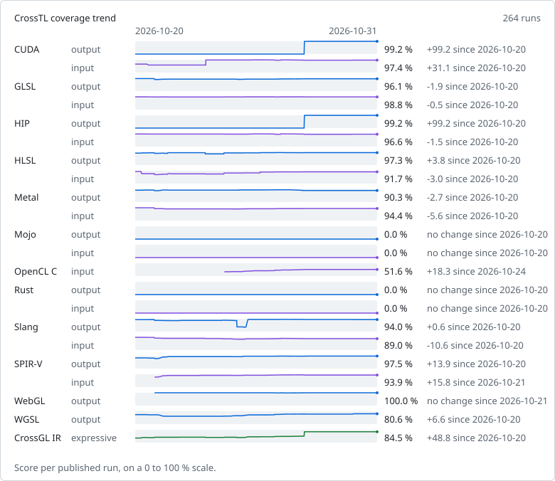

# CrossTL coverage

Measured on commit [`54eed42`](https://github.com/CrossGL/crosstl/commit/54eed423b64f1434473c72a88ebc535aae8093dd) at 2026-11-01T15:27:33Z (CrossTL 3.5.0) by the [Coverage workflow](https://github.com/CrossGL/crosstl/actions/workflows/coverage.yml), which publishes this file on every push to `main` and nightly. Run `python -m tools.coverage run` to measure locally.

Every feature in a pinned upstream feature list gets a generated probe. For output, CrossTL translates a CrossGL probe to the language; for input, it imports a native probe and translates it back. The native SPIR-V probe is the module glslang compiles the GLSL probe to, and its round trip must keep the feature's instruction. The language's reference tool then validates the result:

- **supported**: the reference tool accepts the translation and, where it runs, the translation computes what the native probe computes;
- **refused**: CrossTL rejects the feature with a diagnostic;
- **wrong**: CrossTL produces output the reference tool rejects or that computes other results, or fails without a diagnostic;
- **untested**: no probe can be built for the feature yet, or the reference tool rejects the probe itself.

Score = supported / (supported + refused + wrong). Untested features are shown separately and do not count. The CrossGL IR row covers the union of every language's output features, merged into semantic features through the SPIR-V each native probe lowers to; a semantic feature is expressible when its CrossGL probe translates correctly to at least one language that has it.

Where Core's conformance harness has a runtime for the language, a supported compute probe that reads one input buffer also runs: the native probe and CrossTL's translation get the same inputs, and a translation that binds other resources or writes other results is wrong. HLSL, Slang and WGSL probes run as the SPIR-V their reference compiler writes for them, and so do GLSL probes that llvmpipe's OpenGL rejects. Executed: GLSL output, 326 probes on opengl-llvmpipe, vulkan-lavapipe; GLSL input, 326 probes on opengl-llvmpipe, vulkan-lavapipe; HLSL output, 341 probes on vulkan-lavapipe; HLSL input, 340 probes on vulkan-lavapipe; Metal output, 402 probes on metal-apple; Metal input, 416 probes on metal-apple; Slang output, 414 probes on vulkan-lavapipe; Slang input, 407 probes on vulkan-lavapipe; SPIR-V output, 305 probes on vulkan-lavapipe; SPIR-V input, 335 probes on vulkan-lavapipe; WGSL output, 258 probes on vulkan-lavapipe.

| Language | Direction | Score | Supported | Refused | Wrong | Untested |
|---|---|---:|---:|---:|---:|---:|
| CUDA | output | 99.2 % | 643 | 1 | 4 | 0 |
| CUDA | input | 97.4 % | 631 | 14 | 3 | 0 |
| GLSL | output | 96.1 % | 417 | 2 | 15 | 0 |
| GLSL | input | 98.8 % | 429 | 0 | 5 | 0 |
| HIP | output | 99.2 % | 528 | 1 | 3 | 0 |
| HIP | input | 96.6 % | 514 | 16 | 2 | 0 |
| HLSL | output | 97.3 % | 727 | 14 | 6 | 11 |
| HLSL | input | 91.7 % | 685 | 27 | 35 | 11 |
| Metal | output | 90.3 % | 436 | 14 | 33 | 0 |
| Metal | input | 94.4 % | 456 | 5 | 22 | 0 |
| Mojo | output | 0.0 % | 0 | 1 | 261 | 0 |
| Mojo | input | 0.0 % | 0 | 261 | 1 | 0 |
| OpenCL C | output | not offered | | | | |
| OpenCL C | input | 51.6 % | 344 | 70 | 253 | 0 |
| Rust | output | 0.0 % | 0 | 15 | 541 | 4 |
| Rust | input | 0.0 % | 0 | 39 | 516 | 5 |
| Slang | output | 94.0 % | 566 | 18 | 18 | 19 |
| Slang | input | 89.0 % | 536 | 19 | 47 | 19 |
| SPIR-V | output | 97.5 % | 421 | 8 | 3 | 3 |
| SPIR-V | input | 93.9 % | 401 | 13 | 13 | 8 |
| WebGL | output | 100.0 % | 291 | 0 | 0 | 0 |
| WebGL | input | not offered | | | | |
| WGSL | output | 80.6 % | 303 | 2 | 71 | 1 |
| WGSL | input | not offered | | | | |
| CrossGL IR | expressiveness | 84.5 % | 1437 | 36 | 227 | 32 |

OpenCL C output is not offered: CrossTL has no OpenCL C generator.
WebGL input is not offered: CrossTL has no WebGL source frontend.
WGSL input is not offered: CrossTL has no WGSL source frontend.

## Trend

## By category

Each cell counts the supported features of a category over its supported, refused and wrong ones. Untested features are left out, and a blank cell means none of the category's features could be measured.

| Language | Direction | compute | control-flow | function | graphics | method | operator | resource | stage | type |
|---|---|---:|---:|---:|---:|---:|---:|---:|---:|---:|
| CUDA | output | 10/11 | 59/60 | 469/469 | | | 33/33 | 29/30 | 1/1 | 42/44 |
| CUDA | input | 11/11 | 57/60 | 459/469 | | | 33/33 | 29/30 | 1/1 | 41/44 |
| GLSL | output | 11/11 | 59/59 | 156/170 | 22/23 | | 50/50 | 42/42 | 12/14 | 65/65 |
| GLSL | input | 11/11 | 59/59 | 169/170 | 22/23 | | 50/50 | 39/42 | 14/14 | 65/65 |
| HIP | output | 10/11 | 59/60 | 353/353 | | | 33/33 | 30/30 | 1/1 | 42/44 |
| HIP | input | 11/11 | 57/60 | 342/353 | | | 33/33 | 29/30 | 1/1 | 41/44 |
| HLSL | output | 10/10 | 60/62 | 196/198 | 18/20 | 273/285 | 50/50 | 41/42 | 14/14 | 65/66 |
| HLSL | input | 10/10 | 61/62 | 196/198 | 19/20 | 231/285 | 49/50 | 41/42 | 14/14 | 64/66 |
| Metal | output | 10/11 | 61/62 | 213/224 | 17/23 | | 50/50 | 17/42 | 5/7 | 63/64 |
| Metal | input | 11/11 | 62/62 | 205/224 | 22/23 | | 50/50 | 41/42 | 3/7 | 62/64 |
| Mojo | output | 0/11 | 0/47 | 0/83 | | | 0/41 | 0/29 | 0/1 | 0/50 |
| Mojo | input | 0/11 | 0/47 | 0/83 | | | 0/41 | 0/29 | 0/1 | 0/50 |
| OpenCL C | input | 10/11 | 48/57 | 166/474 | | | 42/43 | 28/30 | 1/1 | 49/51 |
| Rust | output | 0/11 | 0/54 | 0/311 | 0/20 | | 0/45 | 0/39 | 0/14 | 0/62 |
| Rust | input | 0/11 | 0/54 | 0/310 | 0/20 | | 0/45 | 0/39 | 0/14 | 0/62 |
| Slang | output | 11/11 | 61/62 | 315/333 | 18/22 | | 50/50 | 35/42 | 12/14 | 64/68 |
| Slang | input | 11/11 | 55/62 | 302/333 | 19/22 | | 49/50 | 35/42 | 9/14 | 56/68 |
| SPIR-V | output | 11/11 | 61/62 | 156/161 | 22/23 | | 51/51 | 42/42 | 12/14 | 66/68 |
| SPIR-V | input | 11/11 | 59/59 | 152/163 | 21/23 | | 49/50 | 36/42 | 13/14 | 60/65 |
| WebGL | output | | 58/58 | 89/89 | 11/11 | | 50/50 | 26/26 | 2/2 | 55/55 |
| WGSL | output | 10/11 | 51/56 | 92/145 | 12/16 | | 47/48 | 35/42 | 3/3 | 53/55 |
| CrossGL IR | expressiveness | 11/11 | 61/62 | 1073/1323 | 22/23 | 96/106 | 51/51 | 42/42 | 14/14 | 67/68 |

## Feature lists

| Language | Feature list | Pinned at |
|---|---|---|
| CUDA | [LLVM 23.1.3 device-side CUDA Math API wrappers](https://github.com/llvm/llvm-project/blob/0d261d1ca552c95a8f007e061c787ac7132fbcbc/clang/lib/Headers/__clang_cuda_math.h) | `0d261d1ca552` |
| CUDA | [LLVM 23.1.3 CUDA intrinsic and atomic wrappers](https://github.com/llvm/llvm-project/blob/0d261d1ca552c95a8f007e061c787ac7132fbcbc/clang/lib/Headers/__clang_cuda_device_functions.h) | `0d261d1ca552` |
| GLSL | [GLSL 4.60 specification, chapter 8 (built-in functions)](https://github.com/KhronosGroup/GLSL/blob/0099bf83b0288469917fc2e2972cb0a2b74d6711/chapters/builtinfunctions.adoc) | `0099bf83b028` |
| HIP | [LLVM 17.0.6 device-side HIP math functions and intrinsics](https://github.com/llvm/llvm-project/blob/6009708b4367171ccdbf4b5905cb6a803753fe18/clang/lib/Headers/__clang_hip_math.h) | `6009708b4367` |
| HIP | [ROCm 5.7.1 HIP atomic functions](https://github.com/ROCm/clr/blob/1949b1621a802ffb1492616adbae6154bfbe64ef/hipamd/include/hip/amd_detail/amd_hip_atomic.h) | `1949b1621a80` |
| HIP | [ROCm 5.7.1 HIP device functions (integer intrinsics, conversions, barriers)](https://github.com/ROCm/clr/blob/1949b1621a802ffb1492616adbae6154bfbe64ef/hipamd/include/hip/amd_detail/amd_device_functions.h) | `1949b1621a80` |
| HLSL | [DXC v1.9.2602.24 intrinsic table](https://github.com/microsoft/DirectXShaderCompiler/blob/d355aa8364d34df3f0822ba0de8d1dfc75ae6f48/utils/hct/gen_intrin_main.txt) | `d355aa8364d3` |
| Metal | [Metal Shading Language 4.1 standard library, from Apple metal version 32023.918 (metalfe-32023.918.1)](https://github.com/CrossGL/crosstl/blob/54eed423b64f1434473c72a88ebc535aae8093dd/tools/coverage/features/metal.txt) | this repository |
| Mojo | [Mojo 1.2.0 std.bit functions](https://github.com/modular/modular/blob/527d069ee11a41ac5320af1f9402db0a66b2b868/Mojo/stdlib/std/bit/bit.mojo) | `527d069ee11a` |
| Mojo | [Mojo 1.2.0 std.bit public API](https://github.com/modular/modular/blob/527d069ee11a41ac5320af1f9402db0a66b2b868/Mojo/stdlib/std/bit/__init__.mojo) | `527d069ee11a` |
| Mojo | [Mojo 1.2.0 std.math functions](https://github.com/modular/modular/blob/527d069ee11a41ac5320af1f9402db0a66b2b868/Mojo/stdlib/std/math/math.mojo) | `527d069ee11a` |
| Mojo | [Mojo 1.2.0 std.math public API](https://github.com/modular/modular/blob/527d069ee11a41ac5320af1f9402db0a66b2b868/Mojo/stdlib/std/math/__init__.mojo) | `527d069ee11a` |
| Mojo | [Mojo 1.2.0 floating-point predicates std.math re-exports](https://github.com/modular/modular/blob/527d069ee11a41ac5320af1f9402db0a66b2b868/Mojo/stdlib/std/utils/numerics.mojo) | `527d069ee11a` |
| OpenCL C | [LLVM 18.1.3 OpenCL C built-in function declarations](https://github.com/llvm/llvm-project/blob/c13b7485b87909fcf739f62cfa382b55407433c0/clang/lib/Headers/opencl-c.h) | `c13b7485b879` |
| Rust | [rust-gpu 0.11.0 spirv_std::arch](https://github.com/Rust-GPU/rust-gpu/blob/62401280ab4b512c734ad1aceee7553385e17418/crates/spirv-std/src/arch.rs) | `62401280ab4b` |
| Rust | [rust-gpu 0.11.0 spirv_std::arch, module atomics](https://github.com/Rust-GPU/rust-gpu/blob/62401280ab4b512c734ad1aceee7553385e17418/crates/spirv-std/src/arch/atomics.rs) | `62401280ab4b` |
| Rust | [rust-gpu 0.11.0 spirv_std::arch, module barrier](https://github.com/Rust-GPU/rust-gpu/blob/62401280ab4b512c734ad1aceee7553385e17418/crates/spirv-std/src/arch/barrier.rs) | `62401280ab4b` |
| Rust | [rust-gpu 0.11.0 spirv_std::arch, module demote_to_helper_invocation_ext](https://github.com/Rust-GPU/rust-gpu/blob/62401280ab4b512c734ad1aceee7553385e17418/crates/spirv-std/src/arch/demote_to_helper_invocation_ext.rs) | `62401280ab4b` |
| Rust | [rust-gpu 0.11.0 spirv_std::arch, module derivative](https://github.com/Rust-GPU/rust-gpu/blob/62401280ab4b512c734ad1aceee7553385e17418/crates/spirv-std/src/arch/derivative.rs) | `62401280ab4b` |
| Rust | [num-traits 0.2.19 Float trait](https://github.com/rust-num/num-traits/blob/7ec3d41d39b28190ec1d42db38021107b3951f3a/src/float.rs) | `7ec3d41d39b2` |
| Rust | [rust-gpu 0.11.0 spirv_std::arch, module mesh_shading](https://github.com/Rust-GPU/rust-gpu/blob/62401280ab4b512c734ad1aceee7553385e17418/crates/spirv-std/src/arch/mesh_shading.rs) | `62401280ab4b` |
| Rust | [rust-gpu 0.11.0 spirv_std::arch, module primitive](https://github.com/Rust-GPU/rust-gpu/blob/62401280ab4b512c734ad1aceee7553385e17418/crates/spirv-std/src/arch/primitive.rs) | `62401280ab4b` |
| Rust | [rust-gpu 0.11.0 spirv_std::arch, module ray_tracing](https://github.com/Rust-GPU/rust-gpu/blob/62401280ab4b512c734ad1aceee7553385e17418/crates/spirv-std/src/arch/ray_tracing.rs) | `62401280ab4b` |
| Rust | [rust-gpu 0.11.0 spirv_std::arch, module subgroup](https://github.com/Rust-GPU/rust-gpu/blob/62401280ab4b512c734ad1aceee7553385e17418/crates/spirv-std/src/arch/subgroup.rs) | `62401280ab4b` |
| Rust | [glam 0.34.1 Vec3](https://github.com/bitshifter/glam-rs/blob/f5c5a6b635c5be1b7e904808175470ed0f29f4ff/src/f32/vec3.rs) | `f5c5a6b635c5` |
| Slang | [Slang v2026.20 core module: HLSL-compatible built-in functions](https://github.com/shader-slang/slang/blob/d9ede2dd5836afc0e9586da18d9236b171d0faa8/source/slang/hlsl.meta.slang) | `d9ede2dd5836` |
| Slang | [Slang v2026.20 core module: core built-in functions](https://github.com/shader-slang/slang/blob/d9ede2dd5836afc0e9586da18d9236b171d0faa8/source/slang/core.meta.slang) | `d9ede2dd5836` |
| SPIR-V | [SPIR-V GLSL.std.450 extended instruction grammar](https://github.com/KhronosGroup/SPIRV-Headers/blob/496543121ce6419f23d6fa5d7194ba66c36212d2/include/spirv/unified1/extinst.glsl.std.450.grammar.json) | `496543121ce6` |
| SPIR-V | [SPIR-V core grammar (execution models, capabilities, storage classes, instructions)](https://github.com/KhronosGroup/SPIRV-Headers/blob/496543121ce6419f23d6fa5d7194ba66c36212d2/include/spirv/unified1/spirv.core.grammar.json) | `496543121ce6` |
| WebGL | [ANGLE's GLSL ES built-in function table](https://github.com/google/angle/blob/1ff891807e391d842c33d552ea26ab26b5341ef4/src/compiler/translator/builtin_function_declarations.txt) | `1ff891807e39` |
| WGSL | [Tint's WGSL built-in function definitions](https://github.com/google/dawn/blob/ff7c6960f62d4249f967a78448918eec21705a86/src/tint/lang/wgsl/wgsl.def) | `ff7c6960f62d` |

Reference tools: clang Ubuntu clang version 18.1.3 (1ubuntu1), dxc libdxcompiler.so: 1.9(5191-d355aa83)(1.9.0.5191), glslangValidator Glslang Version: 11:16.6.0, hipcc HIP version: 5.7.31921-0, metal Apple metal version 32023.921 (metalfe-32023.921.6), mojo Mojo 1.2.0 (2016d0cd), naga 30.0.1, nvcc nvcc: NVIDIA (R) Cuda compiler driver, rust-gpu rust-gpu 0.11.0 (rustc 1.99.0-nightly (d453bdd8f 2026-08-14)), slangc 2026.20, spirv-as SPIRV-Tools v2026.4 ef96ed763b43b59b33b31b362f09a02b729fa1c9, spirv-dis SPIRV-Tools v2026.4 ef96ed763b43b59b33b31b362f09a02b729fa1c9, spirv-val SPIRV-Tools v2026.4 ef96ed763b43b59b33b31b362f09a02b729fa1c9.

## Gaps

Each row's wrong and refused features are grouped by diagnostic. A diagnostic drops its line numbers and writes the probe's own variables as `<probe>`, and one that several features share writes each feature's name as `<feature>`. Untested features are grouped by the reason no probe could measure them.

### CUDA output

5 gaps: 1 refused, 4 wrong

Wrong, by cause ([open bug issues](https://github.com/CrossGL/crosstl/issues?q=is:issue%20is:open%20label:coverage%20label:bug%20label:backend:cuda%20label:direction:output)):

- `identifier "<probe>" is undefined`: `shared-memory-in-helper`
- `identifier "V" is undefined in device code`: `constant-expression`
- `identifier "blend" is undefined`: `default-argument`
- `no operator "*" matches these operands`: `uniform-vector`

Refused, by diagnostic:

- `project.translate.aggregate-equality-unsupported: AggregateEqualityUnsupportedError: '==' compares a 'Mode' with an operand whose type is not known (target cuda) [project.translate.aggregate-equality-unsupported]`: `enum-constant`

### CUDA input

17 gaps: 14 refused, 3 wrong

Wrong, by cause ([open bug issues](https://github.com/CrossGL/crosstl/issues?q=is:issue%20is:open%20label:coverage%20label:bug%20label:backend:cuda%20label:direction:input)):

- `class "Span" has no member "width"`: `struct-method`
- `identifier "blend" is undefined`: `default-argument`
- `identifier "twice" is undefined`: `forward-declaration`

Refused, by diagnostic:

- `project.translate.cuda-lowering-unsupported: CudaLoweringRefused: CUDA cannot lower N construct: <feature>: the output part is not a single assignable value (target cuda) [project.translate.cuda-lowering-unsupported]` (10): `frexp`, `frexpf`, `modf`, `modff`, `remquo`, `remquof`, `sincos`, `sincosf`, `sincospi`, `sincospif`
- `project.translate.aggregate-equality-unsupported: AggregateEqualityUnsupportedError: '==' compares a 'Mode' with an operand whose type is not known (target cuda) [project.translate.aggregate-equality-unsupported]`: `enum-constant`
- `project.translate.reference-parameter-unsupported: ReferenceParameterError: argument N of 'grow' binds a reference parameter to storage that other threads or other arguments can reach; CrossGL passes it in and out by copy (target cgl) [project.translate.reference-parameter-unsupported]`: `buffer-element-argument`
- `project.translate.undeclared-type: UndeclaredTypeError: type 'N' is not declared: it is neither a CrossGL built-in type nor a structure, enumeration, type alias or generic parameter of the program (target cuda) [project.translate.undeclared-type]`: `constant-array-size`
- `project.translate.undeclared-type: UndeclaredTypeError: type 'T' is not declared: it is neither a CrossGL built-in type nor a structure, enumeration, type alias or generic parameter of the program (target cuda) [project.translate.undeclared-type]`: `generic-function`

### GLSL output

17 gaps: 2 refused, 15 wrong

Wrong, by cause ([open bug issues](https://github.com/CrossGL/crosstl/issues?q=is:issue%20is:open%20label:coverage%20label:bug%20label:backend:glsl%20label:direction:output)):

- `'<feature>' : no matching overloaded function found` (9): `atomicCounterAdd`, `atomicCounterAnd`, `atomicCounterCompSwap`, `atomicCounterExchange`, `atomicCounterMax`, `atomicCounterMin`, `atomicCounterOr`, `atomicCounterSubtract`, `atomicCounterXor`
- `on opengl-llvmpipe, the translation is rejected by the runtime` (3): `allInvocations`, `allInvocationsEqual`, `anyInvocation`
- `'crossgl_gl_FragDepth' : undeclared identifier`: `conservative-depth`
- `'textureSamples' : no matching overloaded function found`: `imageSamples`
- `'location' : SPIR-V requires location for user input/output`: `subpassLoad`

Refused, by diagnostic:

- `project.translate.opengl-tessellation-patch-unsupported: TessellationPatchUnsupportedError: domain entry point '<probe>' needs [domain("tri"|"quad"|"isoline")]; opengl tessellation shaders exchange control points through per-vertex arrays, patch variables and gl_TessLevelOuter/gl_TessLevelInner (target opengl) [project.translate.opengl-tessellation-patch-unsupported]`: `tessellation-evaluation`
- `project.translate.opengl-tessellation-patch-unsupported: TessellationPatchUnsupportedError: patch-constant function 'IdentifierNode(name=constants)' is not one function of the program; opengl tessellation shaders exchange control points through per-vertex arrays, patch variables and gl_TessLevelOuter/gl_TessLevelInner (target opengl) [project.translate.opengl-tessellation-patch-unsupported`: `tessellation-control`

### GLSL input

5 gaps: 0 refused, 5 wrong

Wrong, by cause ([open bug issues](https://github.com/CrossGL/crosstl/issues?q=is:issue%20is:open%20label:coverage%20label:bug%20label:backend:glsl%20label:direction:input)):

- `on opengl-llvmpipe, the translation computes different results from the native probe` (3): `buffer-row-major-array`, `buffer-row-major-matrix`, `buffer-row-major-non-square`
- `'crossgl_gl_FragDepth' : undeclared identifier`: `conservative-depth`
- `'textureSamples' : no matching overloaded function found`: `imageSamples`

### HIP output

4 gaps: 1 refused, 3 wrong

Wrong, by cause ([open bug issues](https://github.com/CrossGL/crosstl/issues?q=is:issue%20is:open%20label:coverage%20label:bug%20label:backend:hip%20label:direction:output)):

- `reference to __host__ variable 'V' in __global__ function`: `constant-expression`
- `use of undeclared identifier '<probe>'; did you mean 'time'?`: `shared-memory-in-helper`
- `use of undeclared identifier 'blend'`: `default-argument`

Refused, by diagnostic:

- `project.translate.aggregate-equality-unsupported: AggregateEqualityUnsupportedError: '==' compares a 'Mode' with an operand whose type is not known (target hip) [project.translate.aggregate-equality-unsupported]`: `enum-constant`

### HIP input

18 gaps: 16 refused, 2 wrong

Wrong, by cause ([open bug issues](https://github.com/CrossGL/crosstl/issues?q=is:issue%20is:open%20label:coverage%20label:bug%20label:backend:hip%20label:direction:input)):

- `redefinition of 'twice'`: `forward-declaration`
- `use of undeclared identifier 'blend'`: `default-argument`

Refused, by diagnostic:

- `project.translate.hip-lowering-unsupported: HipLoweringRefused: HIP cannot lower N construct: <feature>: the output part is not a single assignable value (target hip) [project.translate.hip-lowering-unsupported]` (11): `__sincosf`, `frexp`, `frexpf`, `modf`, `modff`, `remquo`, `remquof`, `sincos`, `sincosf`, `sincospi`, `sincospif`
- `project.translate.aggregate-equality-unsupported: AggregateEqualityUnsupportedError: '==' compares a 'Mode' with an operand whose type is not known (target hip) [project.translate.aggregate-equality-unsupported]`: `enum-constant`
- `project.translate.hip-record-semantics-unsupported: HipRecordSemanticError: HIP record method call 'width' is unsupported for record 'Span' in call expression`: `struct-method`
- `project.translate.reference-parameter-unsupported: ReferenceParameterError: argument N of 'grow' binds a reference parameter to storage that other threads or other arguments can reach; CrossGL passes it in and out by copy (target cgl) [project.translate.reference-parameter-unsupported]`: `buffer-element-argument`
- `project.translate.undeclared-type: UndeclaredTypeError: type 'N' is not declared: it is neither a CrossGL built-in type nor a structure, enumeration, type alias or generic parameter of the program (target hip) [project.translate.undeclared-type]`: `constant-array-size`
- `project.translate.undeclared-type: UndeclaredTypeError: type 'T' is not declared: it is neither a CrossGL built-in type nor a structure, enumeration, type alias or generic parameter of the program (target hip) [project.translate.undeclared-type]`: `generic-function`

### HLSL output

20 gaps: 14 refused, 6 wrong

Wrong, by cause ([open bug issues](https://github.com/CrossGL/crosstl/issues?q=is:issue%20is:open%20label:coverage%20label:bug%20label:backend:hlsl%20label:direction:output)):

- `on vulkan-lavapipe as SPIR-V from dxc, the translation computes different results from the native probe` (2): `buffer-row-major-non-square`, `intrinsic-name`
- `type 'Payload' used as payload requires that it is annotated with the [raypayload] attribute` (2): `DxHitObject.Invoke`, `DxHitObject.TraceRay`
- `Semantic depth_greater is invalid for shader model: ps`: `conservative-depth`
- `no matching function for call to 'blend'`: `default-argument`

Refused, by diagnostic:

- `CrossGL has no work-graph node stage` (11): `EmptyNodeInput.Count`, `EmptyNodeOutput.GroupIncrementOutputCount`, `EmptyNodeOutput.IsValid`, `EmptyNodeOutput.ThreadIncrementOutputCount`, `GetRemainingRecursionLevels`, `GroupNodeInputRecords.Count`, `GroupOrThreadNodeOutputRecords.OutputComplete`, `NodeOutput.GetGroupNodeOutputRecords`, `NodeOutput.GetThreadNodeOutputRecords`, `NodeOutput.IsValid`, `RWDispatchNodeInputRecord.FinishedCrossGroupSharing`
- `project.translate.aggregate-equality-unsupported: AggregateEqualityUnsupportedError: '==' compares a 'Mode' with an operand whose type is not known (target directx) [project.translate.aggregate-equality-unsupported]`: `enum-constant`
- `project.translate.directx-contextual-conversion-unrepresentable: DirectXContextualConversionError: DirectX canonical select requires a resolved boolean scalar or vector condition`: `select`
- `project.translate.directx-lowering-unsupported: DirectXLoweringRefused: DirectX cannot lower N construct: HLSL has no system value for the built-in @gl_HelperInvocation; it would become a user semantic no stage writes (target directx) [project.translate.directx-lowering-unsupported]`: `helper-invocation`

11 untested: function 5, method 6

- `needs shader model 6.10` (10): `ClusterID`, `DxHitObject.ClusterID`, `DxHitObject.TriangleObjectPosition`, `GetGroupWaveCount`, `GetGroupWaveIndex`, `RayQuery.CandidateClusterID`, `RayQuery.CandidateTriangleObjectPosition`, `RayQuery.CommittedClusterID`, `RayQuery.CommittedTriangleObjectPosition`, `TriangleObjectPosition`
- `DXC compiles printf only to SPIR-V; DXIL has no print operation`: `printf`

### HLSL input

62 gaps: 27 refused, 35 wrong

Wrong, by cause ([open bug issues](https://github.com/CrossGL/crosstl/issues?q=is:issue%20is:open%20label:coverage%20label:bug%20label:backend:hlsl%20label:direction:input)):

- `ValueError: DirectX compute function '<probe>' cannot use return semantic 'NodeLaunch' with void return type` (7): `GetRemainingRecursionLevels`, `GroupNodeInputRecords.Count`, `GroupOrThreadNodeOutputRecords.OutputComplete`, `NodeOutput.GetGroupNodeOutputRecords`, `NodeOutput.GetThreadNodeOutputRecords`, `NodeOutput.IsValid`, `RWDispatchNodeInputRecord.FinishedCrossGroupSharing`
- `use of undeclared identifier '<feature>'` (5): `RWByteAddressBuffer.InterlockedAnd`, `RWByteAddressBuffer.InterlockedMax`, `RWByteAddressBuffer.InterlockedMin`, `RWByteAddressBuffer.InterlockedOr`, `RWByteAddressBuffer.InterlockedXor`
- `ValueError: DirectX texture operation 'textureCompareLod' requires a declared texture or image resource argument: obj` (4): `Texture1D.SampleCmpLevel`, `Texture1D.SampleCmpLevelZero`, `Texture1DArray.SampleCmpLevel`, `Texture1DArray.SampleCmpLevelZero`
- `ValueError: DirectX texture operation 'textureCompare' requires a declared texture or image resource argument: obj` (2): `Texture1D.SampleCmp`, `Texture1DArray.SampleCmp`
- `ValueError: DirectX texture operation 'textureCompareGrad' requires a declared texture or image resource argument: obj` (2): `Texture1D.SampleCmpGrad`, `Texture1DArray.SampleCmpGrad`
- `ValueError: DirectX texture query operation 'textureQueryLod' requires a 2D floating coordinate for Texture1DArray: a1 has type float` (2): `Texture1DArray.CalculateLevelOfDetail`, `Texture1DArray.CalculateLevelOfDetailUnclamped`
- `ValueError: DirectX texture query operation 'textureQueryLod' requires a 3D floating coordinate for Texture2DArray: a1 has type float2` (2): `Texture2DArray.CalculateLevelOfDetail`, `Texture2DArray.CalculateLevelOfDetailUnclamped`
- `ValueError: DirectX texture query operation 'textureQueryLod' requires a 4D floating coordinate for TextureCubeArray: a1 has type float3` (2): `TextureCUBEArray.CalculateLevelOfDetail`, `TextureCUBEArray.CalculateLevelOfDetailUnclamped`
- `cannot <feature> from resource containing uint4` (2): `Texture2D.GatherRaw`, `Texture2DArray.GatherRaw`
- `brackets are not allowed here; to declare an array, place the brackets after the name`: `array-return`
- `cannot convert from 'matrix<float, 2, 2>' to 'float2'`: `buffer-row-major-array`
- `no matching function for call to 'InterlockedAdd'`: `RWByteAddressBuffer.InterlockedAdd`
- `use of undeclared identifier 'atomicCompareExchange'`: `RWByteAddressBuffer.InterlockedCompareExchange`
- `use of undeclared identifier 'atomicExchange'`: `RWByteAddressBuffer.InterlockedExchange`
- `the translation loses ExecutionMode.DepthGreater`: `conservative-depth`
- `on vulkan-lavapipe as SPIR-V from dxc, the translation computes different results from the native probe`: `nested-unary`

Refused, by diagnostic:

- `project.translate.directx-import-unsupported: DirectXImportRefused: CrossGL cannot represent N HLSL construct: DirectX texture overload extras for <feature>: CrossGL has no operand for LOD bias (target cgl) [project.translate.directx-import-unsupported]` (6): `Texture1D.SampleCmpBias`, `Texture1DArray.SampleCmpBias`, `Texture2D.SampleCmpBias`, `Texture2DArray.SampleCmpBias`, `TextureCUBE.SampleCmpBias`, `TextureCUBEArray.SampleCmpBias`
- `project.translate.directx-import-unsupported: DirectXImportRefused: CrossGL cannot represent N HLSL construct: DirectX texture gather-compare component for Texture2D: <feature> requires a compare-gather component selector; CrossGL only represents the default/red compare gather (target cgl) [project.translate.directx-import-unsupported]` (3): `Texture2D.GatherCmpAlpha`, `Texture2D.GatherCmpBlue`, `Texture2D.GatherCmpGreen`
- `project.translate.directx-import-unsupported: DirectXImportRefused: CrossGL cannot represent N HLSL construct: DirectX texture gather-compare component for Texture2DArray: <feature> requires a compare-gather component selector; CrossGL only represents the default/red compare gather (target cgl) [project.translate.directx-import-unsupported]` (3): `Texture2DArray.GatherCmpAlpha`, `Texture2DArray.GatherCmpBlue`, `Texture2DArray.GatherCmpGreen`
- `project.translate.directx-import-unsupported: DirectXImportRefused: CrossGL cannot represent N HLSL construct: DirectX texture gather-compare component for TextureCube: <feature> requires a compare-gather component selector; CrossGL only represents the default/red compare gather (target cgl) [project.translate.directx-import-unsupported]` (3): `TextureCUBE.GatherCmpAlpha`, `TextureCUBE.GatherCmpBlue`, `TextureCUBE.GatherCmpGreen`
- `project.translate.directx-import-unsupported: DirectXImportRefused: CrossGL cannot represent N HLSL construct: DirectX texture gather-compare component for TextureCubeArray: <feature> requires a compare-gather component selector; CrossGL only represents the default/red compare gather (target cgl) [project.translate.directx-import-unsupported]` (3): `TextureCUBEArray.GatherCmpAlpha`, `TextureCUBEArray.GatherCmpBlue`, `TextureCUBEArray.GatherCmpGreen`
- `project.translate.undeclared-type: UndeclaredTypeError: type 'EmptyNodeOutput' is not declared: it is neither a CrossGL built-in type nor a structure, enumeration, type alias or generic parameter of the program (target directx) [project.translate.undeclared-type]` (3): `EmptyNodeOutput.GroupIncrementOutputCount`, `EmptyNodeOutput.IsValid`, `EmptyNodeOutput.ThreadIncrementOutputCount`
- `project.translate.aggregate-equality-unsupported: AggregateEqualityUnsupportedError: '==' compares a 'Mode' with an operand whose type is not known (target directx) [project.translate.aggregate-equality-unsupported]`: `enum-constant`
- `project.translate.directx-import-unsupported: DirectXImportRefused: CrossGL cannot represent N HLSL construct: DirectX texture sample-position query for RWTexture2DMS: GetSamplePosition is only available on sampled multisample textures (target cgl) [project.translate.directx-import-unsupported]`: `RWTexture2DMS.GetSamplePosition`
- `project.translate.directx-import-unsupported: DirectXImportRefused: CrossGL cannot represent N HLSL construct: DirectX texture sample-position query for RWTexture2DMSArray: GetSamplePosition is only available on sampled multisample textures (target cgl) [project.translate.directx-import-unsupported]`: `RWTexture2DMSArray.GetSamplePosition`
- `project.translate.directx-import-unsupported: DirectXImportRefused: CrossGL cannot represent N HLSL construct: DirectX tiled-resource status check CheckAccessFullyMapped: CrossGL has no residency status, so the mapped result is unknown (target cgl) [project.translate.directx-import-unsupported]`: `CheckAccessFullyMapped`
- `project.translate.undeclared-type: UndeclaredTypeError: type 'EmptyNodeInput' is not declared: it is neither a CrossGL built-in type nor a structure, enumeration, type alias or generic parameter of the program (target directx) [project.translate.undeclared-type]`: `EmptyNodeInput.Count`
- `project.translate.undeclared-type: UndeclaredTypeError: type 'T' is not declared: it is neither a CrossGL built-in type nor a structure, enumeration, type alias or generic parameter of the program (target directx) [project.translate.undeclared-type]`: `generic-function`

11 untested: function 5, method 6

- `needs shader model 6.10` (10): `ClusterID`, `DxHitObject.ClusterID`, `DxHitObject.TriangleObjectPosition`, `GetGroupWaveCount`, `GetGroupWaveIndex`, `RayQuery.CandidateClusterID`, `RayQuery.CandidateTriangleObjectPosition`, `RayQuery.CommittedClusterID`, `RayQuery.CommittedTriangleObjectPosition`, `TriangleObjectPosition`
- `DXC compiles printf only to SPIR-V; DXIL has no print operation`: `printf`

### Metal output

47 gaps: 14 refused, 33 wrong

Wrong, by cause ([open bug issues](https://github.com/CrossGL/crosstl/issues?q=is:issue%20is:open%20label:coverage%20label:bug%20label:backend:metal%20label:direction:output)):

- `on metal-apple, the translation binds other resources than the native probe` (25): `uniform-array`, `uniform-bool`, `uniform-bool-vector`, `uniform-buffer`, `uniform-cbuffer-vector`, `uniform-in-helper`, `uniform-integer`, `uniform-integer-vector`, `uniform-matrix`, `uniform-matrix2`, `uniform-matrix3`, `uniform-members`, `uniform-non-square-matrix`, `uniform-row-major-array`, `uniform-row-major-matrix`, `uniform-row-major-non-square`, `uniform-std140-array`, `uniform-std140-vector`, `uniform-struct`, `uniform-struct-array`, `uniform-struct-copy`, `uniform-unsigned`, `uniform-vector`, `uniform-vector-array`, `uniform-vector-packing`
- `ValueError: Metal struct 'FragmentInput' semantic 'gl_Layer' maps to 'render_target_array_index' and requires member 'layer' to have type uint, got int`: `layer`
- `ValueError: Metal struct 'FragmentInput' semantic 'gl_PrimitiveID' maps to 'primitive_id' and requires member 'pid' to have type uint, got int`: `primitive-id`
- `ValueError: Metal struct 'FragmentInput' semantic 'gl_SampleID' maps to 'sample_id' and requires member 'sid' to have type uint, got int`: `sample-index`
- `ValueError: Metal struct 'FragmentInput' semantic 'gl_ViewportIndex' maps to 'viewport_array_index' and requires member 'viewport' to have type uint, got int`: `viewport-index`
- `invalid return type 'FragmentOutput' for fragment function`: `conservative-depth`
- `no matching function for call to 'atomic_fetch_sub'`: `atomic_fetch_sub`
- `no matching function for call to 'blend'`: `default-argument`
- `use of undeclared identifier '<probe>'`: `shared-memory-in-helper`

Refused, by diagnostic:

- `project.translate.metal-lowering-unsupported: MetalLoweringRefused: Metal cannot lower N construct: buffer atomic: <feature> requires a supported scalar device/threadgroup target, got uint64_t (target metal) [project.translate.metal-lowering-unsupported]` (4): `atomic_max`, `atomic_max_explicit`, `atomic_min`, `atomic_min_explicit`
- `CrossGL has no spelling for this operation: CrossGL has no operation that takes a memory order or memory flags` (3): `atomic_fetch_sub_explicit`, `atomic_thread_fence`, `simdgroup_barrier`
- `CrossGL has no type for Metal's quad_vote mask` (2): `quad_active_threads_mask`, `quad_ballot`
- `CrossGL has no type for Metal's simd_vote mask`: `simd_active_threads_mask`
- `project.translate.aggregate-equality-unsupported: AggregateEqualityUnsupportedError: '==' compares a 'Mode' with an operand whose type is not known (target metal) [project.translate.aggregate-equality-unsupported]`: `enum-constant`
- `project.translate.metal-lowering-unsupported: MetalLoweringRefused: Metal cannot lower N construct: bounding_box intersection stage: a void entry that reports hits with ReportHit has no lowering to a Metal intersection function result yet (target metal) [project.translate.metal-lowering-unsupported]`: `intersection`
- `project.translate.metal-stage-unsupported: MetalStageUnsupportedError: Metal evaluates tessellated patches in a [[patch]] post-tessellation vertex function that reads its control points and per-patch data through [[stage_in]] (Metal Shading Language Specification N.N.N); lowering a tessellation evaluation (domain) stage to that function is not implemented (stage tessel`: `tessellation-evaluation`
- `project.translate.metal-stage-varying-link-unsupported: MetalVaryingLinkError: stage varying 'helper': system-value semantic 'gl_HelperInvocation' has no Metal vertex-output or fragment-input attribute (target metal) [project.translate.metal-stage-varying-link-unsupported]`: `helper-invocation`

### Metal input

27 gaps: 5 refused, 22 wrong

Wrong, by cause ([open bug issues](https://github.com/CrossGL/crosstl/issues?q=is:issue%20is:open%20label:coverage%20label:bug%20label:backend:metal%20label:direction:input)):

- `no matching function for call to '<feature>'` (15): `atomic_compare_exchange_weak`, `atomic_exchange`, `atomic_fetch_add`, `atomic_fetch_and`, `atomic_fetch_max`, `atomic_fetch_min`, `atomic_fetch_or`, `atomic_fetch_sub`, `atomic_fetch_xor`, `atomic_load`, `atomic_max`, `atomic_max_explicit`, `atomic_min`, `atomic_min_explicit`, `atomic_store`
- `use of undeclared identifier 'vote_t'; did you mean 'metal::quad_vote::vote_t'?` (2): `quad_active_threads_mask`, `quad_ballot`
- `use of undeclared identifier 'vote_t'; did you mean 'metal::simd_vote::vote_t'?` (2): `simd_active_threads_mask`, `simd_ballot`
- `SyntaxError: Expected binding name, got LBRACE`: `reserved-type-name`
- `no matching function for call to 'grow'`: `buffer-element-argument`
- `the translation loses ExecutionMode.DepthGreater`: `conservative-depth`

Refused, by diagnostic:

- `project.translate.aggregate-equality-unsupported: AggregateEqualityUnsupportedError: '==' compares a 'Mode' with an operand whose type is not known (target metal) [project.translate.aggregate-equality-unsupported]`: `enum-constant`
- `project.translate.metal-import-unsupported: MetalImportRefused: CrossGL cannot represent N Metal construct: Metal intersection function '<probe>' has no CrossGL import; its ray-tracing parameters and results are not yet mapped to a CrossGL ray stage (target cgl) [project.translate.metal-import-unsupported]`: `intersection`
- `project.translate.metal-indexed-component-type-unresolved: MetalIndexedComponentTypeResolutionError: Cannot resolve Metal indexed component type for 'patch_control_point<ControlPoint>' (aggregate-subscript) at index 'N': the user-defined aggregate subscript result type cannot be inferred`: `tessellation-evaluation`
- `project.translate.metal-parse-failed: MetalParserError: Expected type, got MESH in function probe at line N, column N`: `mesh`
- `project.translate.workgroup-size-host-defined: HostDefinedWorkgroupSizeError: Entry '<probe>' declares the groupshared variable payload, so its result depends on the threadgroup size, which the host chooses at dispatch time in the source language. The target fixes the size in the shader: give it with source_options={'threadgroup_size': (x, y, z)} or a project workgroup-size rul`: `task`

### Mojo output

262 gaps: 1 refused, 261 wrong

Wrong, by cause ([open bug issues](https://github.com/CrossGL/crosstl/issues?q=is:issue%20is:open%20label:coverage%20label:bug%20label:backend:mojo%20label:direction:output)):

- `global variables are not supported; move this into a function body or use 'comptime' to declare a constant` (258): `abs`, `acos`, `acosh`, `aggregate-equality`, `aggregate-inout-parameter`, `align_down`, `align_up`, `array`, `array-copy`, `array-initializer`, `array-of-arrays`, `array-of-structs`, `array-parameter`, `array-return`, `asin`, `asinh`, `atan`, `atan2`, `atanh`, `barrier-in-loop`, `bit_not`, `bit_reverse`, `bit_width`, `bitwise-logic`, `block-scope`, `bool-array`, `bool-bitwise`, `bool-conversion`, `bool-vector-conversion`, `bool-vector-logic`, `boolean-logic`, `break`, `buffer-element-argument`, `buffer-in-helper`, `byte_swap`, `call-result-access`, `cbrt`, `ceil`, `ceildiv`, `chained-assignment`, `chained-conditional`, `clamp`, `comb`, `compound-assignment`, `compute`, `conditional-expression`, `conditional-side-effect`, `const-local`, `const-parameter`, `constant-array`, `constant-array-size`, `constant-expression`, `constant-struct`, `constant-vector-array`, `continue`, `control-attribute`, `copysign`, `cos`, `cosh`, `count_leading_zeros`, `count_trailing_zeros`, `default-argument`, `deferred-initialization`, `double`, `early-return`, `empty-statement`, `erf`, `erfc`, `exp`, `exp2`, `expm1`, `expression-swizzle`, `factorial`, `float-arithmetic`, `float-comparison`, `float-loop-counter`, `float-remainder`, `float-to-integer`, `floor`, `fma`, `for-loop`, `for-loop-variants`, `forward-declaration`, `frexp`, `function-call`, `function-overloading`, `gamma`, `gcd`, `generic-function`, `global-constant`, `global-shadowing`, `half`, `hypot`, `if-else`, `implicit-conversion`, `indexed-compound-assignment`, `inf`, `infinite-loop`, `inout-argument-lvalues`, `inout-parameter`, `int16`, `int64`, `int8`, `integer-arithmetic`, `integer-buffer`, `integer-condition`, `integer-division`, `integer-literal-limits`, `integer-to-float`, `integer-vector-arithmetic`, `integer-vector-comparison`, `intrinsic-name`, `invocation-id-in-helper`, `iota`, `isclose`, `isfinite`, `isinf`, `isnan`, `j0`, `j1`, `lcm`, `ldexp`, `lgamma`, `local-invocation-id`, `local-invocation-index`, `log`, `log10`, `log1p`, `log2`, `log2_ceil`, `log2_floor`, `logb`, `loop-condition-call`, `loop-counter-write`, `loop-return`, `max`, `min`, `modf`, `mulhi`, `multi-variable-loop`, `multiple-declarators`, `mulwide`, `nan`, `negation`, `nested-call`, `nested-loop`, `nested-member-assignment`, `nested-struct`, `nested-struct-buffer`, `nested-unary`, `next_power_of_two`, `nextafter`, `num-workgroups`, `numeric-literals`, `octal-literal`, `operator-precedence`, `out-parameter-forwarding`, `perm`, `pop_count`, `pow`, `prev_power_of_two`, `read-only-buffer`, `recip`, `remainder`, `reserved-global-name`, `reserved-identifier`, `reserved-member-name`, `reserved-type-name`, `rotate_bits_left`, `rotate_bits_right`, `round`, `rsqrt`, `scalb`, `shared-2d-array`, `shared-memory`, `shared-memory-in-helper`, `shared-struct-array`, `shared-vector-array`, `short-circuit-logic`, `sibling-redeclaration`, `signed-comparison`, `signed-division`, `signed-shift`, `signed-to-unsigned`, `sin`, `sinh`, `sqrt`, `struct`, `struct-array-buffer`, `struct-array-copy`, `struct-array-member`, `struct-array-parameter`, `struct-buffer`, `struct-buffer-copy`, `struct-buffer-packing`, `struct-conditional`, `struct-constructor`, `struct-copy`, `struct-method`, `struct-parameter`, `struct-return`, `struct-vector-member`, `swizzle`, `tan`, `tanh`, `trunc`, `type-alias`, `uint16`, `uint64`, `uint8`, `ulp`, `uniform-array`, `uniform-bool`, `uniform-bool-vector`, `uniform-buffer`, `uniform-cbuffer-vector`, `uniform-in-helper`, `uniform-integer`, `uniform-integer-vector`, `uniform-members`, `uniform-std140-array`, `uniform-std140-vector`, `uniform-struct`, `uniform-struct-array`, `uniform-struct-copy`, `uniform-unsigned`, `uniform-vector`, `uniform-vector-array`, `uniform-vector-packing`, `unreachable-statement`, `unsigned-buffer`, `unsigned-comparison`, `unsigned-division`, `unsigned-float-conversion`, `unsigned-negation`, `unsigned-shift`, `unsigned-vector-arithmetic`, `unsigned-wraparound`, `value-parameter-mutation`, `vector-array`, `vector-bitwise`, `vector-buffer`, `vector-comparison`, `vector-compound-assignment`, `vector-conditional`, `vector-constructor`, `vector-conversion`, `vector-dynamic-index`, `vector-scalar-arithmetic`, `vector-scalar-product`, `vector-shift`, `vector-unary-operators`, `void-return`, `while-loop`, `workgroup-id`, `y0`, `y1`, `zero-initializer`
- `ValueError: Unsupported increment/decrement expression for Mojo codegen; statement prelude context is required` (3): `condition-assignment`, `lvalue-increment`, `unsigned-countdown`

Refused, by diagnostic:

- `CrossGL has no spelling for this operation: no CrossGL function returns a quotient and a remainder together`: `divmod`

### Mojo input

262 gaps: 261 refused, 1 wrong

Wrong, by cause ([open bug issues](https://github.com/CrossGL/crosstl/issues?q=is:issue%20is:open%20label:coverage%20label:bug%20label:backend:mojo%20label:direction:input)):

- `SyntaxError: Expected SEMICOLON, got RPAREN ')'`: `reserved-type-name`

Refused, by diagnostic:

- `project.translate.undeclared-type: UndeclaredTypeError: type 'MutAnyOrigin' is not declared: it is neither a CrossGL built-in type nor a structure, enumeration, type alias or generic parameter of the program (target mojo) [project.translate.undeclared-type]` (257): `abs`, `acos`, `acosh`, `aggregate-equality`, `aggregate-inout-parameter`, `align_down`, `align_up`, `array`, `array-copy`, `array-initializer`, `array-of-arrays`, `array-of-structs`, `array-parameter`, `array-return`, `asin`, `asinh`, `atan`, `atan2`, `atanh`, `barrier-in-loop`, `bit_not`, `bit_reverse`, `bit_width`, `bitwise-logic`, `block-scope`, `bool-array`, `bool-bitwise`, `bool-conversion`, `bool-vector-conversion`, `bool-vector-logic`, `boolean-logic`, `break`, `buffer-in-helper`, `byte_swap`, `call-result-access`, `cbrt`, `ceil`, `ceildiv`, `chained-assignment`, `chained-conditional`, `clamp`, `comb`, `compound-assignment`, `compute`, `condition-assignment`, `conditional-expression`, `conditional-side-effect`, `const-local`, `const-parameter`, `constant-array`, `constant-array-size`, `constant-expression`, `constant-struct`, `constant-vector-array`, `continue`, `control-attribute`, `copysign`, `cos`, `cosh`, `count_leading_zeros`, `count_trailing_zeros`, `default-argument`, `deferred-initialization`, `divmod`, `double`, `early-return`, `empty-statement`, `erf`, `erfc`, `exp`, `exp2`, `expm1`, `expression-swizzle`, `factorial`, `float-arithmetic`, `float-comparison`, `float-loop-counter`, `float-remainder`, `float-to-integer`, `floor`, `fma`, `for-loop`, `for-loop-variants`, `forward-declaration`, `frexp`, `function-call`, `function-overloading`, `gamma`, `gcd`, `generic-function`, `global-constant`, `global-shadowing`, `half`, `hypot`, `if-else`, `implicit-conversion`, `indexed-compound-assignment`, `inf`, `infinite-loop`, `inout-argument-lvalues`, `inout-parameter`, `int16`, `int64`, `int8`, `integer-arithmetic`, `integer-buffer`, `integer-condition`, `integer-division`, `integer-literal-limits`, `integer-to-float`, `integer-vector-arithmetic`, `integer-vector-comparison`, `intrinsic-name`, `invocation-id-in-helper`, `iota`, `isclose`, `isfinite`, `isinf`, `isnan`, `j0`, `j1`, `lcm`, `ldexp`, `lgamma`, `local-invocation-id`, `local-invocation-index`, `log`, `log10`, `log1p`, `log2`, `log2_ceil`, `log2_floor`, `logb`, `loop-condition-call`, `loop-counter-write`, `loop-return`, `lvalue-increment`, `max`, `min`, `modf`, `mulhi`, `multi-variable-loop`, `multiple-declarators`, `mulwide`, `nan`, `negation`, `nested-call`, `nested-loop`, `nested-member-assignment`, `nested-struct`, `nested-struct-buffer`, `nested-unary`, `next_power_of_two`, `nextafter`, `num-workgroups`, `numeric-literals`, `octal-literal`, `operator-precedence`, `out-parameter-forwarding`, `perm`, `pop_count`, `pow`, `prev_power_of_two`, `read-only-buffer`, `recip`, `remainder`, `reserved-global-name`, `reserved-identifier`, `reserved-member-name`, `rotate_bits_left`, `rotate_bits_right`, `round`, `rsqrt`, `scalb`, `shared-memory`, `shared-struct-array`, `shared-vector-array`, `short-circuit-logic`, `sibling-redeclaration`, `signed-comparison`, `signed-division`, `signed-shift`, `signed-to-unsigned`, `sin`, `sinh`, `sqrt`, `struct`, `struct-array-buffer`, `struct-array-copy`, `struct-array-member`, `struct-array-parameter`, `struct-buffer`, `struct-buffer-copy`, `struct-buffer-packing`, `struct-conditional`, `struct-constructor`, `struct-copy`, `struct-method`, `struct-parameter`, `struct-return`, `struct-vector-member`, `swizzle`, `tan`, `tanh`, `trunc`, `uint16`, `uint64`, `uint8`, `ulp`, `uniform-array`, `uniform-bool`, `uniform-bool-vector`, `uniform-buffer`, `uniform-cbuffer-vector`, `uniform-in-helper`, `uniform-integer`, `uniform-integer-vector`, `uniform-members`, `uniform-std140-array`, `uniform-std140-vector`, `uniform-struct`, `uniform-struct-array`, `uniform-struct-copy`, `uniform-unsigned`, `uniform-vector`, `uniform-vector-array`, `uniform-vector-packing`, `unreachable-statement`, `unsigned-buffer`, `unsigned-comparison`, `unsigned-countdown`, `unsigned-division`, `unsigned-float-conversion`, `unsigned-negation`, `unsigned-shift`, `unsigned-vector-arithmetic`, `unsigned-wraparound`, `value-parameter-mutation`, `vector-array`, `vector-bitwise`, `vector-buffer`, `vector-comparison`, `vector-compound-assignment`, `vector-conditional`, `vector-constructor`, `vector-conversion`, `vector-dynamic-index`, `vector-scalar-arithmetic`, `vector-scalar-product`, `vector-shift`, `vector-unary-operators`, `void-return`, `while-loop`, `workgroup-id`, `y0`, `y1`, `zero-initializer`
- `project.translate.crossgl-function-body-parse-failed: CrossGLFunctionBodyParseError: CrossGL could not parse the body of function '<probe>' at COMMA ',': Expected RBRACKET, got COMMA ','`: `shared-2d-array`
- `project.translate.crossgl-function-body-parse-failed: CrossGLFunctionBodyParseError: CrossGL could not parse the body of function 'grow' at RPAREN ')': Expected RBRACKET, got RPAREN ')'`: `buffer-element-argument`
- `project.translate.undeclared-type: UndeclaredTypeError: type 'MutUntrackedOrigin' is not declared: it is neither a CrossGL built-in type nor a structure, enumeration, type alias or generic parameter of the program (target mojo) [project.translate.undeclared-type]`: `shared-memory-in-helper`
- `project.translate.undeclared-type: UndeclaredTypeError: type 'Real' is not declared: it is neither a CrossGL built-in type nor a structure, enumeration, type alias or generic parameter of the program (target mojo) [project.translate.undeclared-type]`: `type-alias`

### OpenCL C input

323 gaps: 70 refused, 253 wrong

Wrong, by cause ([open bug issues](https://github.com/CrossGL/crosstl/issues?q=is:issue%20is:open%20label:coverage%20label:bug%20label:backend:opencl%20label:direction:input)):

- `use of undeclared identifier '<feature>'` (204): `abs_diff`, `add_sat`, `bit_reverse`, `bitfield_extract_signed`, `bitfield_extract_unsigned`, `bitfield_insert`, `bitselect`, `cbrt`, `clz`, `ctz`, `dot_4x8packed_ss_int`, `dot_4x8packed_su_int`, `dot_4x8packed_us_int`, `dot_4x8packed_uu_uint`, `dot_acc_sat`, `dot_acc_sat_4x8packed_ss_int`, `dot_acc_sat_4x8packed_su_int`, `dot_acc_sat_4x8packed_us_int`, `dot_acc_sat_4x8packed_uu_uint`, `erf`, `erfc`, `expm1`, `fast_distance`, `fast_length`, `fast_normalize`, `fdim`, `get_enqueued_local_size`, `get_enqueued_num_sub_groups`, `get_fence`, `get_global_id`, `get_global_linear_id`, `get_global_offset`, `get_global_size`, `get_group_id`, `get_image_array_size`, `get_image_channel_data_type`, `get_image_channel_order`, `get_image_depth`, `get_image_dim`, `get_image_height`, `get_image_num_mip_levels`, `get_image_width`, `get_local_id`, `get_local_size`, `get_max_sub_group_size`, `get_num_groups`, `get_num_sub_groups`, `get_sub_group_eq_mask`, `get_sub_group_ge_mask`, `get_sub_group_gt_mask`, `get_sub_group_id`, `get_sub_group_le_mask`, `get_sub_group_local_id`, `get_sub_group_lt_mask`, `get_sub_group_size`, `get_work_dim`, `hadd`, `half_cos`, `half_divide`, `half_exp`, `half_exp10`, `half_exp2`, `half_log`, `half_log10`, `half_log2`, `half_powr`, `half_recip`, `half_rsqrt`, `half_sin`, `half_sqrt`, `half_tan`, `hypot`, `ilogb`, `isequal`, `isgreater`, `isgreaterequal`, `isless`, `islessequal`, `islessgreater`, `isnotequal`, `isordered`, `isunordered`, `lgamma`, `log1p`, `logb`, `mad24`, `mad_hi`, `mad_sat`, `maxmag`, `minmag`, `mul24`, `mul_hi`, `nan`, `native_cos`, `native_divide`, `native_exp`, `native_exp10`, `native_exp2`, `native_log`, `native_log10`, `native_log2`, `native_powr`, `native_recip`, `native_rsqrt`, `native_sin`, `native_sqrt`, `native_tan`, `nextafter`, `popcount`, `pown`, `remainder`, `rhadd`, `rootn`, `rotate`, `shuffle`, `shuffle2`, `sub_group_all`, `sub_group_any`, `sub_group_ballot`, `sub_group_ballot_bit_count`, `sub_group_ballot_bit_extract`, `sub_group_ballot_exclusive_scan`, `sub_group_ballot_find_lsb`, `sub_group_ballot_find_msb`, `sub_group_ballot_inclusive_scan`, `sub_group_broadcast`, `sub_group_broadcast_first`, `sub_group_clustered_reduce_add`, `sub_group_clustered_reduce_and`, `sub_group_clustered_reduce_logical_and`, `sub_group_clustered_reduce_logical_or`, `sub_group_clustered_reduce_logical_xor`, `sub_group_clustered_reduce_max`, `sub_group_clustered_reduce_min`, `sub_group_clustered_reduce_mul`, `sub_group_clustered_reduce_or`, `sub_group_clustered_reduce_xor`, `sub_group_clustered_rotate`, `sub_group_elect`, `sub_group_inverse_ballot`, `sub_group_non_uniform_all`, `sub_group_non_uniform_all_equal`, `sub_group_non_uniform_any`, `sub_group_non_uniform_broadcast`, `sub_group_non_uniform_reduce_add`, `sub_group_non_uniform_reduce_and`, `sub_group_non_uniform_reduce_logical_and`, `sub_group_non_uniform_reduce_logical_or`, `sub_group_non_uniform_reduce_logical_xor`, `sub_group_non_uniform_reduce_max`, `sub_group_non_uniform_reduce_min`, `sub_group_non_uniform_reduce_mul`, `sub_group_non_uniform_reduce_or`, `sub_group_non_uniform_reduce_xor`, `sub_group_non_uniform_scan_exclusive_add`, `sub_group_non_uniform_scan_exclusive_and`, `sub_group_non_uniform_scan_exclusive_logical_and`, `sub_group_non_uniform_scan_exclusive_logical_or`, `sub_group_non_uniform_scan_exclusive_logical_xor`, `sub_group_non_uniform_scan_exclusive_max`, `sub_group_non_uniform_scan_exclusive_min`, `sub_group_non_uniform_scan_exclusive_mul`, `sub_group_non_uniform_scan_exclusive_or`, `sub_group_non_uniform_scan_exclusive_xor`, `sub_group_non_uniform_scan_inclusive_add`, `sub_group_non_uniform_scan_inclusive_and`, `sub_group_non_uniform_scan_inclusive_logical_and`, `sub_group_non_uniform_scan_inclusive_logical_or`, `sub_group_non_uniform_scan_inclusive_logical_xor`, `sub_group_non_uniform_scan_inclusive_max`, `sub_group_non_uniform_scan_inclusive_min`, `sub_group_non_uniform_scan_inclusive_mul`, `sub_group_non_uniform_scan_inclusive_or`, `sub_group_non_uniform_scan_inclusive_xor`, `sub_group_reduce_add`, `sub_group_reduce_max`, `sub_group_reduce_min`, `sub_group_rotate`, `sub_group_scan_exclusive_add`, `sub_group_scan_exclusive_max`, `sub_group_scan_exclusive_min`, `sub_group_scan_inclusive_add`, `sub_group_scan_inclusive_max`, `sub_group_scan_inclusive_min`, `sub_group_shuffle`, `sub_group_shuffle_down`, `sub_group_shuffle_up`, `sub_group_shuffle_xor`, `sub_sat`, `tgamma`, `upsample`, `work_group_all`, `work_group_any`, `work_group_broadcast`, `work_group_reduce_add`, `work_group_reduce_max`, `work_group_reduce_min`, `work_group_scan_exclusive_add`, `work_group_scan_exclusive_max`, `work_group_scan_exclusive_min`, `work_group_scan_inclusive_add`, `work_group_scan_inclusive_max`, `work_group_scan_inclusive_min`, `write_imageh`
- `operator is not supported` (46): `atom_add`, `atom_and`, `atom_cmpxchg`, `atom_dec`, `atom_inc`, `atom_max`, `atom_min`, `atom_or`, `atom_sub`, `atom_xchg`, `atom_xor`, `atomic_compare_exchange_strong`, `atomic_compare_exchange_strong_explicit`, `atomic_compare_exchange_weak`, `atomic_compare_exchange_weak_explicit`, `atomic_init`, `atomic_load`, `atomic_load_explicit`, `atomic_store`, `atomic_store_explicit`, `fract`, `frexp`, `lgamma_r`, `modf`, `remquo`, `sincos`, `vload_half`, `vload_halfn`, `vloada_halfn`, `vloadn`, `vstore_half`, `vstore_half_rte`, `vstore_half_rtn`, `vstore_half_rtp`, `vstore_half_rtz`, `vstore_halfn`, `vstore_halfn_rte`, `vstore_halfn_rtn`, `vstore_halfn_rtp`, `vstore_halfn_rtz`, `vstorea_halfn`, `vstorea_halfn_rte`, `vstorea_halfn_rtn`, `vstorea_halfn_rtp`, `vstorea_halfn_rtz`, `vstoren`
- `cannot initialize a variable of type 'vector<float, 4>' with an rvalue of type 'vector<float, 3>'`: `cross`
- `use of undeclared identifier 'Low'`: `enum-constant`
- `use of undeclared identifier 'ptr'`: `async_work_group_strided_copy`

Refused, by diagnostic:

- `project.translate.opencl-conversion-unsupported: OpenCLConversionUnsupportedError: <feature> saturates or rounds to a N-bit integer, which the convert_sat rule family does not cover [project.translate.opencl-conversion-unsupported]` (16): `convert_long_rte`, `convert_long_rtn`, `convert_long_rtp`, `convert_long_sat`, `convert_long_sat_rte`, `convert_long_sat_rtn`, `convert_long_sat_rtp`, `convert_long_sat_rtz`, `convert_ulong_rte`, `convert_ulong_rtn`, `convert_ulong_rtp`, `convert_ulong_sat`, `convert_ulong_sat_rte`, `convert_ulong_sat_rtn`, `convert_ulong_sat_rtp`, `convert_ulong_sat_rtz`
- `project.translate.directx-metal-math-function-unsupported: MetalMathFunctionUnsupportedError: <feature> is exact at integers and half-integers, which directx has no function for, and CrossTL does not lower it with an exact range reduction yet (target directx) [project.translate.directx-metal-math-function-unsupported]` (7): `acospi`, `asinpi`, `atan2pi`, `atanpi`, `cospi`, `sinpi`, `tanpi`
- `opencl.target.unsupported: OpenCLTargetUnsupportedError: opencl.target.unsupported: cannot lower OpenCL source to directx because target lowering would produce invalid artifacts: OpenCL device-side enqueue event builtins have no target equivalent: create_user_event, <feature>` (4): `is_valid_event`, `release_event`, `retain_event`, `set_user_event_status`
- `project.translate.directx-unnormalized-sampler-coordinates-unsupported: FixedSamplerCoordinatesUnsupportedError: fixed sampler 'u1' uses pixel coordinates (coord::pixel), which directx cannot bind: Direct3D samplers have no unnormalized coordinates, and Vulkan allows them only for single-level images sampled without LOD, offsets or comparison (target directx) [project.translate.directx-unnormaliz…` (4): `read_imagef`, `read_imageh`, `read_imagei`, `read_imageui`
- `project.translate.undeclared-type: UndeclaredTypeError: type 'atomic_flag' is not declared: it is neither a CrossGL built-in type nor a structure, enumeration, type alias or generic parameter of the program (target directx) [project.translate.undeclared-type]` (4): `atomic_flag_clear`, `atomic_flag_clear_explicit`, `atomic_flag_test_and_set`, `atomic_flag_test_and_set_explicit`
- `project.translate.opencl-conversion-unsupported: OpenCLConversionUnsupportedError: <feature> rounds to a floating-point type in mode _rtn; CrossGL conversions to floating-point types round to nearest even [project.translate.opencl-conversion-unsupported]` (3): `convert_double_rtn`, `convert_float_rtn`, `convert_half_rtn`
- `project.translate.opencl-conversion-unsupported: OpenCLConversionUnsupportedError: <feature> rounds to a floating-point type in mode _rtp; CrossGL conversions to floating-point types round to nearest even [project.translate.opencl-conversion-unsupported]` (3): `convert_double_rtp`, `convert_float_rtp`, `convert_half_rtp`
- `project.translate.opencl-conversion-unsupported: OpenCLConversionUnsupportedError: <feature> rounds to a floating-point type in mode _rtz; CrossGL conversions to floating-point types round to nearest even [project.translate.opencl-conversion-unsupported]` (3): `convert_double_rtz`, `convert_float_rtz`, `convert_half_rtz`
- `project.translate.undeclared-type: UndeclaredTypeError: type 'ndrange_t' is not declared: it is neither a CrossGL built-in type nor a structure, enumeration, type alias or generic parameter of the program (target directx) [project.translate.undeclared-type]` (3): `ndrange_1D`, `ndrange_2D`, `ndrange_3D`
- `opencl.target.unsupported: OpenCLTargetUnsupportedError: opencl.target.unsupported: cannot lower OpenCL source to directx because target lowering would produce invalid artifacts: OpenCL device-side enqueue event builtins have no target equivalent: create_user_event`: `create_user_event`
- `opencl.target.unsupported: OpenCLTargetUnsupportedError: opencl.target.unsupported: cannot lower OpenCL source to directx because target lowering would produce invalid artifacts: OpenCL device-side enqueue event builtins have no target equivalent: capture_event_profiling_info, create_user_event`: `capture_event_profiling_info`
- `opencl.target.unsupported: OpenCLTargetUnsupportedError: opencl.target.unsupported: cannot lower OpenCL source to directx because target lowering would produce invalid artifacts: OpenCL device-side enqueue event builtins have no target equivalent: create_user_event`: `enqueue_marker`
- `opencl.target.unsupported: OpenCLTargetUnsupportedError: opencl.target.unsupported: cannot lower OpenCL source to directx because target lowering would produce invalid artifacts: OpenCL event/local-memory builtins require semantics not preserved by target lowering: async_work_group_copy`: `async_work_group_copy`
- `opencl.target.unsupported: OpenCLTargetUnsupportedError: opencl.target.unsupported: cannot lower OpenCL source to directx because target lowering would produce invalid artifacts: OpenCL pointer helper parameters are not representable in target codegen: absorb(q: ptr<Pair>)`: `aggregate-inout-parameter`
- `opencl.target.unsupported: OpenCLTargetUnsupportedError: opencl.target.unsupported: cannot lower OpenCL source to directx because target lowering would produce invalid artifacts: OpenCL pointer helper parameters are not representable in target codegen: advance(k: ptr<i32>)`: `loop-condition-call`
- `opencl.target.unsupported: OpenCLTargetUnsupportedError: opencl.target.unsupported: cannot lower OpenCL source to directx because target lowering would produce invalid artifacts: OpenCL pointer helper parameters are not representable in target codegen: bump(a: ptr<f32>)`: `inout-parameter`
- `opencl.target.unsupported: OpenCLTargetUnsupportedError: opencl.target.unsupported: cannot lower OpenCL source to directx because target lowering would produce invalid artifacts: OpenCL pointer helper parameters are not representable in target codegen: bump(k: ptr<i32>), leap(k: ptr<i32>)`: `conditional-side-effect`
- `opencl.target.unsupported: OpenCLTargetUnsupportedError: opencl.target.unsupported: cannot lower OpenCL source to directx because target lowering would produce invalid artifacts: OpenCL pointer helper parameters are not representable in target codegen: copy2(a: ptr<f32>), copy2(b: ptr<f32>), grow(a: ptr<f32>)`: `inout-argument-lvalues`
- `opencl.target.unsupported: OpenCLTargetUnsupportedError: opencl.target.unsupported: cannot lower OpenCL source to directx because target lowering would produce invalid artifacts: OpenCL pointer helper parameters are not representable in target codegen: deposit(iin: ptr<i32>), deposit(outp: ptr<f32>), fetch(iin: ptr<i32>), put(outp: ptr<f32>)`: `buffer-in-helper`
- `opencl.target.unsupported: OpenCLTargetUnsupportedError: opencl.target.unsupported: cannot lower OpenCL source to directx because target lowering would produce invalid artifacts: OpenCL pointer helper parameters are not representable in target codegen: exchange(tile: ptr<f32>), stash(tile: ptr<f32>)`: `shared-memory-in-helper`
- `opencl.target.unsupported: OpenCLTargetUnsupportedError: opencl.target.unsupported: cannot lower OpenCL source to directx because target lowering would produce invalid artifacts: OpenCL pointer helper parameters are not representable in target codegen: grow(x: ptr<f32>)`: `buffer-element-argument`
- `opencl.target.unsupported: OpenCLTargetUnsupportedError: opencl.target.unsupported: cannot lower OpenCL source to directx because target lowering would produce invalid artifacts: OpenCL pointer helper parameters are not representable in target codegen: inner(r: ptr<f32>), inner(s: ptr<f32>), outer(r: ptr<f32>), outer(s: ptr<f32>)`: `out-parameter-forwarding`
- `opencl.target.unsupported: OpenCLTargetUnsupportedError: opencl.target.unsupported: cannot lower OpenCL source to directx because target lowering would produce invalid artifacts: OpenCL pointer helper parameters are not representable in target codegen: limit(x: ptr<f32>)`: `void-return`
- `opencl.target.unsupported: OpenCLTargetUnsupportedError: opencl.target.unsupported: cannot lower OpenCL source to directx because target lowering would produce invalid artifacts: OpenCL pointer helper parameters are not representable in target codegen: slot(k: ptr<i32>)`: `indexed-compound-assignment`
- `opencl.target.unsupported: OpenCLTargetUnsupportedError: opencl.target.unsupported: cannot lower OpenCL source to directx because target lowering would produce invalid artifacts: OpenCL pointer helper parameters are not representable in target codegen: split(a: ptr<f32>), split(b: ptr<f32>)`: `out-parameter`
- `opencl.target.unsupported: OpenCLTargetUnsupportedError: opencl.target.unsupported: cannot lower OpenCL source to directx because target lowering would produce invalid artifacts: unresolved non-void helper declarations without bodies: twice`: `forward-declaration`
- `project.translate.directx-contextual-conversion-unrepresentable: DirectXContextualConversionError: DirectX canonical select requires a resolved boolean scalar or vector condition`: `select`
- `project.translate.directx-software-subgroup-invalid: DirectXSoftwareSubgroupError: DirectX subgroup execution barriers require checked software subgroup lowering with uniform workgroup participation`: `sub_group_barrier`
- `project.translate.undeclared-type: UndeclaredTypeError: type 'hip_array_extent_4_mul_2' is not declared: it is neither a CrossGL built-in type nor a structure, enumeration, type alias or generic parameter of the program (target directx) [project.translate.undeclared-type]`: `constant-array-size`
- `project.translate.undeclared-type: UndeclaredTypeError: type 'image2d_msaa_t' is not declared: it is neither a CrossGL built-in type nor a structure, enumeration, type alias or generic parameter of the program (target directx) [project.translate.undeclared-type]`: `get_image_num_samples`
- `project.translate.undeclared-type: UndeclaredTypeError: type 'queue_t' is not declared: it is neither a CrossGL built-in type nor a structure, enumeration, type alias or generic parameter of the program (target directx) [project.translate.undeclared-type]`: `get_default_queue`
- `project.translate.undeclared-type: UndeclaredTypeError: type 'reserve_id_t' is not declared: it is neither a CrossGL built-in type nor a structure, enumeration, type alias or generic parameter of the program (target directx) [project.translate.undeclared-type]`: `is_valid_reserve_id`

### Rust output

556 gaps: 15 refused, 541 wrong

Wrong, by cause ([open bug issues](https://github.com/CrossGL/crosstl/issues?q=is:issue%20is:open%20label:coverage%20label:bug%20label:backend:rust%20label:direction:output)):

- `error[E0463]: can't find crate for 'std'` (531): `Derivative::dfdx`, `Derivative::dfdx_coarse`, `Derivative::dfdx_fine`, `Derivative::dfdy`, `Derivative::dfdy_coarse`, `Derivative::dfdy_fine`, `Derivative::fwidth`, `Derivative::fwidth_coarse`, `Derivative::fwidth_fine`, `Float::abs`, `Float::acos`, `Float::acosh`, `Float::asin`, `Float::asinh`, `Float::atan`, `Float::atan2`, `Float::atanh`, `Float::cbrt`, `Float::ceil`, `Float::clamp`, `Float::copysign`, `Float::cos`, `Float::cosh`, `Float::epsilon`, `Float::exp`, `Float::exp2`, `Float::exp_m1`, `Float::floor`, `Float::infinity`, `Float::is_finite`, `Float::is_infinite`, `Float::is_nan`, `Float::is_normal`, `Float::is_sign_negative`, `Float::is_sign_positive`, `Float::is_subnormal`, `Float::ln`, `Float::ln_1p`, `Float::log10`, `Float::log2`, `Float::max`, `Float::max_value`, `Float::min`, `Float::min_positive_value`, `Float::min_value`, `Float::mul_add`, `Float::nan`, `Float::neg_infinity`, `Float::neg_zero`, `Float::powf`, `Float::powi`, `Float::recip`, `Float::round`, `Float::signum`, `Float::sin`, `Float::sin_cos`, `Float::sinh`, `Float::sqrt`, `Float::tan`, `Float::tanh`, `Float::to_degrees`, `Float::to_radians`, `Float::trunc`, `Vec3::abs`, `Vec3::abs_diff_eq`, `Vec3::angle_between`, `Vec3::angle_to`, `Vec3::any_orthogonal_vector`, `Vec3::any_orthonormal_vector`, `Vec3::as_dvec3`, `Vec3::as_ivec3`, `Vec3::as_uvec3`, `Vec3::ceil`, `Vec3::clamp`, `Vec3::clamp_length`, `Vec3::clamp_length_max`, `Vec3::clamp_length_min`, `Vec3::cmpeq`, `Vec3::cmpge`, `Vec3::cmpgt`, `Vec3::cmple`, `Vec3::cmplt`, `Vec3::cmpne`, `Vec3::copysign`, `Vec3::cos`, `Vec3::cross`, `Vec3::distance`, `Vec3::distance_squared`, `Vec3::div_euclid`, `Vec3::dot`, `Vec3::dot_into_vec`, `Vec3::element_product`, `Vec3::element_sum`, `Vec3::exp`, `Vec3::exp2`, `Vec3::extend`, `Vec3::floor`, `Vec3::fract_gl`, `Vec3::from_array`, `Vec3::from_homogeneous`, `Vec3::from_slice`, `Vec3::is_finite`, `Vec3::is_finite_mask`, `Vec3::is_nan`, `Vec3::is_nan_mask`, `Vec3::is_negative_bitmask`, `Vec3::is_negative_mask`, `Vec3::is_normalized`, `Vec3::length`, `Vec3::length_recip`, `Vec3::length_squared`, `Vec3::lerp`, `Vec3::lerp_monotonic`, `Vec3::ln`, `Vec3::log2`, `Vec3::max`, `Vec3::max_element`, `Vec3::midpoint`, `Vec3::min`, `Vec3::min_element`, `Vec3::move_towards`, `Vec3::mul_add`, `Vec3::new`, `Vec3::normalize`, `Vec3::normalize_or`, `Vec3::normalize_or_zero`, `Vec3::powf`, `Vec3::project_onto`, `Vec3::project_onto_normalized`, `Vec3::recip`, `Vec3::reflect`, `Vec3::refract`, `Vec3::reject_from`, `Vec3::reject_from_normalized`, `Vec3::rem_euclid`, `Vec3::rotate_axis`, `Vec3::rotate_towards`, `Vec3::rotate_x`, `Vec3::rotate_y`, `Vec3::rotate_z`, `Vec3::round`, `Vec3::saturate`, `Vec3::select`, `Vec3::signum`, `Vec3::sin`, `Vec3::sin_cos`, `Vec3::slerp`, `Vec3::smoothstep`, `Vec3::splat`, `Vec3::sqrt`, `Vec3::step`, `Vec3::to_homogeneous`, `Vec3::to_vec3a`, `Vec3::trunc`, `Vec3::truncate`, `Vec3::with_x`, `Vec3::with_y`, `Vec3::with_z`, `aggregate-equality`, `aggregate-inout-parameter`, `all`, `all_memory_barrier`, `all_memory_barrier_with_group_sync`, `any`, `any-hit`, `array`, `array-copy`, `array-initializer`, `array-of-arrays`, `array-of-structs`, `array-parameter`, `array-return`, `atomic_and`, `atomic_compare_exchange`, `atomic_exchange`, `atomic_f_add`, `atomic_f_max`, `atomic_f_min`, `atomic_i_add`, `atomic_i_decrement`, `atomic_i_increment`, `atomic_i_sub`, `atomic_load`, `atomic_or`, `atomic_s_max`, `atomic_s_min`, `atomic_store`, `atomic_u_max`, `atomic_u_min`, `atomic_xor`, `barrier-in-loop`, `bitwise-logic`, `block-scope`, `bool-array`, `bool-bitwise`, `bool-conversion`, `bool-vector-conversion`, `bool-vector-logic`, `boolean-logic`, `break`, `buffer-in-helper`, `buffer-row-major-array`, `buffer-row-major-matrix`, `call-result-access`, `callable`, `chained-assignment`, `chained-conditional`, `clip-distance`, `closest-hit`, `compound-assignment`, `compute`, `condition-assignment`, `conditional-expression`, `conditional-side-effect`, `conservative-depth`, `const-local`, `const-parameter`, `constant-array`, `constant-array-size`, `constant-expression`, `constant-matrix`, `constant-struct`, `constant-vector-array`, `continue`, `control_barrier`, `default-only-switch`, `deferred-initialization`, `demote_to_helper_invocation`, `device_memory_barrier`, `device_memory_barrier_with_group_sync`, `diagonal-matrix`, `discard`, `double`, `early-fragment-tests`, `early-return`, `emit_mesh_tasks_ext`, `emit_mesh_tasks_ext_payload`, `empty-statement`, `execute_callable`, `expression-swizzle`, `flat-interpolation`, `float-arithmetic`, `float-comparison`, `float-loop-counter`, `float-remainder`, `float-to-integer`, `for-loop`, `for-loop-variants`, `forward-declaration`, `fragment`, `fragment-coordinate`, `fragment-depth`, `front-facing`, `function-call`, `generic-function`, `global-constant`, `half`, `helper-invocation`, `if-else`, `ignore_intersection`, `implicit-conversion`, `indexed-compound-assignment`, `inout-argument-lvalues`, `inout-parameter`, `instance-index`, `int16`, `int64`, `int8`, `integer-arithmetic`, `integer-buffer`, `integer-division`, `integer-literal-limits`, `integer-to-float`, `integer-vector-comparison`, `intersection`, `intrinsic-name`, `invariant-position`, `invocation-id-in-helper`, `is_helper_invocation`, `kill`, `layer`, `literal-suffixes`, `local-invocation-id`, `local-invocation-index`, `local-struct`, `loop-condition-call`, `loop-counter-write`, `loop-in-switch`, `loop-return`, `lvalue-increment`, `matrix-arithmetic`, `matrix-array`, `matrix-buffer`, `matrix-column-assignment`, `matrix-compound-assignment`, `matrix-from-vectors`, `matrix-indexing`, `matrix-negation`, `matrix-parameter`, `matrix-product`, `matrix-resize`, `matrix-vector-product`, `memory_barrier`, `mesh`, `miss`, `multiple-declarators`, `multiple-render-targets`, `negation`, `nested-call`, `nested-loop`, `nested-member-assignment`, `nested-struct`, `nested-struct-buffer`, `nested-switch`, `num-workgroups`, `numeric-literals`, `octal-literal`, `operator-precedence`, `out-parameter`, `out-parameter-forwarding`, `point-coordinate`, `point-size`, `primitive-id`, `ray-generation`, `read-only-buffer`, `read_clock_khr`, `read_clock_uvec2_khr`, `report_intersection`, `reserved-global-name`, `reserved-identifier`, `reserved-member-name`, `runtime-array-length`, `sample-index`, `sample-mask`, `sample-mask-input`, `sampled-texture`, `set_mesh_outputs_ext`, `shared-2d-array`, `shared-memory`, `shared-memory-in-helper`, `shared-struct-array`, `shared-vector-array`, `short-circuit-logic`, `sibling-redeclaration`, `signed-comparison`, `signed-division`, `signed-shift`, `signed-to-unsigned`, `signed_max`, `signed_min`, `storage-image`, `struct`, `struct-array-buffer`, `struct-array-copy`, `struct-array-member`, `struct-array-parameter`, `struct-buffer`, `struct-buffer-copy`, `struct-buffer-packing`, `struct-conditional`, `struct-constructor`, `struct-copy`, `struct-matrix-member`, `struct-method`, `struct-parameter`, `struct-return`, `struct-vector-member`, `subgroup_all`, `subgroup_all_equal`, `subgroup_and`, `subgroup_any`, `subgroup_ballot`, `subgroup_ballot_bit_count`, `subgroup_ballot_bit_extract`, `subgroup_ballot_exclusive_bit_count`, `subgroup_ballot_find_lsb`, `subgroup_ballot_find_msb`, `subgroup_ballot_inclusive_bit_count`, `subgroup_barrier`, `subgroup_broadcast`, `subgroup_broadcast_const`, `subgroup_broadcast_first`, `subgroup_clustered_and`, `subgroup_clustered_f_add`, `subgroup_clustered_f_max`, `subgroup_clustered_f_min`, `subgroup_clustered_f_mul`, `subgroup_clustered_i_add`, `subgroup_clustered_i_mul`, `subgroup_clustered_logical_and`, `subgroup_clustered_logical_or`, `subgroup_clustered_logical_xor`, `subgroup_clustered_or`, `subgroup_clustered_s_max`, `subgroup_clustered_s_min`, `subgroup_clustered_u_max`, `subgroup_clustered_u_min`, `subgroup_clustered_xor`, `subgroup_elect`, `subgroup_exclusive_and`, `subgroup_exclusive_f_add`, `subgroup_exclusive_f_max`, `subgroup_exclusive_f_min`, `subgroup_exclusive_f_mul`, `subgroup_exclusive_i_add`, `subgroup_exclusive_i_mul`, `subgroup_exclusive_logical_and`, `subgroup_exclusive_logical_or`, `subgroup_exclusive_logical_xor`, `subgroup_exclusive_or`, `subgroup_exclusive_s_max`, `subgroup_exclusive_s_min`, `subgroup_exclusive_u_max`, `subgroup_exclusive_u_min`, `subgroup_exclusive_xor`, `subgroup_f_add`, `subgroup_f_max`, `subgroup_f_min`, `subgroup_f_mul`, `subgroup_i_add`, `subgroup_i_mul`, `subgroup_inclusive_and`, `subgroup_inclusive_f_add`, `subgroup_inclusive_f_max`, `subgroup_inclusive_f_min`, `subgroup_inclusive_f_mul`, `subgroup_inclusive_i_add`, `subgroup_inclusive_i_mul`, `subgroup_inclusive_logical_and`, `subgroup_inclusive_logical_or`, `subgroup_inclusive_logical_xor`, `subgroup_inclusive_or`, `subgroup_inclusive_s_max`, `subgroup_inclusive_s_min`, `subgroup_inclusive_u_max`, `subgroup_inclusive_u_min`, `subgroup_inclusive_xor`, `subgroup_inverse_ballot`, `subgroup_logical_and`, `subgroup_logical_or`, `subgroup_logical_xor`, `subgroup_memory_barrier`, `subgroup_memory_barrier_buffer`, `subgroup_memory_barrier_image`, `subgroup_memory_barrier_shared`, `subgroup_or`, `subgroup_quad_broadcast`, `subgroup_quad_swap`, `subgroup_s_max`, `subgroup_s_min`, `subgroup_shuffle`, `subgroup_shuffle_down`, `subgroup_shuffle_up`, `subgroup_shuffle_xor`, `subgroup_u_max`, `subgroup_u_min`, `subgroup_xor`, `switch`, `switch-case-scope`, `switch-default-position`, `switch-in-loop`, `switch-return`, `swizzle`, `task`, `terminate_ray`, `tessellation-control`, `type-alias`, `uint16`, `uint64`, `uint8`, `uniform-array`, `uniform-bool`, `uniform-bool-vector`, `uniform-buffer`, `uniform-cbuffer-vector`, `uniform-in-helper`, `uniform-integer`, `uniform-integer-vector`, `uniform-matrix`, `uniform-matrix2`, `uniform-matrix3`, `uniform-members`, `uniform-row-major-array`, `uniform-row-major-matrix`, `uniform-std140-array`, `uniform-std140-vector`, `uniform-struct`, `uniform-struct-array`, `uniform-struct-copy`, `uniform-unsigned`, `uniform-vector`, `uniform-vector-array`, `uniform-vector-packing`, `unreachable-statement`, `unsigned-buffer`, `unsigned-comparison`, `unsigned-countdown`, `unsigned-division`, `unsigned-float-conversion`, `unsigned-negation`, `unsigned-shift`, `unsigned-switch`, `unsigned-vector-arithmetic`, `unsigned-wraparound`, `unsigned_max`, `unsigned_min`, `value-parameter-mutation`, `vector-array`, `vector-bitwise`, `vector-buffer`, `vector-comparison`, `vector-compound-assignment`, `vector-conditional`, `vector-constructor`, `vector-conversion`, `vector-scalar-arithmetic`, `vector-scalar-product`, `vector-shift`, `vector-truncation`, `vector-unary-operators`, `vector_extract_dynamic`, `vector_insert_dynamic`, `vertex`, `vertex-index`, `viewport-index`, `void-return`, `while-loop`, `workgroup-id`, `workgroup_memory_barrier`, `workgroup_memory_barrier_with_group_sync`, `zero-initializer`
- `ValueError: Rust geometry stage requires maxvertexcount attribute` (5): `emit_stream_vertex`, `emit_vertex`, `end_primitive`, `end_stream_primitive`, `geometry`
- `ValueError: Unsupported SV_Position struct return semantic 'DomainOutput.position' for Rust tessellation_evaluation stage; valid stage is vertex`: `tessellation-evaluation`
- `expected ':', found '='`: `multi-variable-loop`
- `expected '{', found keyword 'while'`: `infinite-loop`
- `expected expression, found '+'`: `nested-unary`
- `expected identifier, found keyword 'type'`: `reserved-type-name`

Refused, by diagnostic:

- `CrossGL has no spelling for this operation: Rust's fract is x - trunc(x); CrossGL's is x - floor(x)` (2): `Float::fract`, `Vec3::fract`
- `CrossGL has no spelling for this operation: Float::log takes a base; CrossGL's log is the natural logarithm`: `Float::log`
- `CrossGL has no spelling for this operation: CrossGL has no closures or function values`: `Vec3::map`
- `CrossGL has no spelling for this operation: no CrossGL function converts a vector to an array`: `Vec3::to_array`
- `CrossGL has no spelling for this operation: no CrossGL function returns a float's category`: `Float::classify`
- `CrossGL has no spelling for this operation: no CrossGL function returns a float's mantissa, exponent and sign as integers`: `Float::integer_decode`
- `CrossGL has no spelling for this operation: no CrossGL function returns a vector's direction and length together`: `Vec3::normalize_and_length`
- `CrossGL has no spelling for this operation: no CrossGL function returns an optional value`: `Vec3::try_normalize`
- `CrossGL has no spelling for this operation: no CrossGL function returns the index of a vector's largest element`: `Vec3::max_position`
- `CrossGL has no spelling for this operation: no CrossGL function returns the index of a vector's smallest element`: `Vec3::min_position`
- `CrossGL has no spelling for this operation: no CrossGL function returns two vectors orthonormal to a vector`: `Vec3::any_orthonormal_pair`
- `CrossGL has no spelling for this operation: no CrossGL function writes a vector's elements to an array`: `Vec3::write_to_slice`
- `project.translate.aggregate-equality-unsupported: AggregateEqualityUnsupportedError: '==' compares a 'Mode' with an operand whose type is not known (target rust) [project.translate.aggregate-equality-unsupported]`: `enum-constant`
- `project.translate.rust-lowering-unsupported: RustLoweringRefused: Rust cannot lower N construct: argument N of grow is passed to an out/inout parameter but is not a local variable, member or element that Rust can borrow mutably (target rust) [project.translate.rust-lowering-unsupported]`: `buffer-element-argument`

4 untested: function 2, operator 1, type 1

- `the probe itself is rejected: error: Fdim not supported yet`: `Float::abs_sub`
- `the probe itself is rejected: error: Hypot not supported yet`: `Float::hypot`
- `the probe itself is rejected: error: Using pointers with OpPhi requires capability VariablePointers or VariablePointersStorageBuffer`: `vector-dynamic-index`
- `the probe itself is rejected: error[E0282]: type annotations needed`: `integer-vector-arithmetic`

### Rust input

555 gaps: 39 refused, 516 wrong

Wrong, by cause ([open bug issues](https://github.com/CrossGL/crosstl/issues?q=is:issue%20is:open%20label:coverage%20label:bug%20label:backend:rust%20label:direction:input)):

- `error[E0463]: can't find crate for 'std'` (505): `Derivative::dfdx`, `Derivative::dfdx_coarse`, `Derivative::dfdx_fine`, `Derivative::dfdy`, `Derivative::dfdy_coarse`, `Derivative::dfdy_fine`, `Derivative::fwidth`, `Derivative::fwidth_coarse`, `Derivative::fwidth_fine`, `Float::abs`, `Float::acos`, `Float::acosh`, `Float::asin`, `Float::asinh`, `Float::atan`, `Float::atan2`, `Float::atanh`, `Float::cbrt`, `Float::ceil`, `Float::clamp`, `Float::classify`, `Float::copysign`, `Float::cos`, `Float::cosh`, `Float::epsilon`, `Float::exp`, `Float::exp2`, `Float::exp_m1`, `Float::floor`, `Float::fract`, `Float::infinity`, `Float::is_finite`, `Float::is_infinite`, `Float::is_nan`, `Float::is_normal`, `Float::is_sign_negative`, `Float::is_sign_positive`, `Float::is_subnormal`, `Float::ln`, `Float::ln_1p`, `Float::log`, `Float::log10`, `Float::log2`, `Float::max`, `Float::max_value`, `Float::min`, `Float::min_positive_value`, `Float::min_value`, `Float::mul_add`, `Float::nan`, `Float::neg_infinity`, `Float::neg_zero`, `Float::powf`, `Float::powi`, `Float::recip`, `Float::round`, `Float::signum`, `Float::sin`, `Float::sinh`, `Float::sqrt`, `Float::tan`, `Float::tanh`, `Float::to_degrees`, `Float::to_radians`, `Float::trunc`, `Vec3::abs`, `Vec3::abs_diff_eq`, `Vec3::angle_between`, `Vec3::angle_to`, `Vec3::any_orthogonal_vector`, `Vec3::any_orthonormal_vector`, `Vec3::as_ivec3`, `Vec3::as_uvec3`, `Vec3::ceil`, `Vec3::clamp`, `Vec3::clamp_length`, `Vec3::clamp_length_max`, `Vec3::clamp_length_min`, `Vec3::cmpeq`, `Vec3::cmpge`, `Vec3::cmpgt`, `Vec3::cmple`, `Vec3::cmplt`, `Vec3::cmpne`, `Vec3::copysign`, `Vec3::cos`, `Vec3::cross`, `Vec3::distance`, `Vec3::distance_squared`, `Vec3::div_euclid`, `Vec3::dot`, `Vec3::dot_into_vec`, `Vec3::element_product`, `Vec3::element_sum`, `Vec3::exp`, `Vec3::exp2`, `Vec3::extend`, `Vec3::floor`, `Vec3::fract`, `Vec3::fract_gl`, `Vec3::from_array`, `Vec3::from_homogeneous`, `Vec3::from_slice`, `Vec3::is_finite`, `Vec3::is_finite_mask`, `Vec3::is_nan`, `Vec3::is_nan_mask`, `Vec3::is_negative_bitmask`, `Vec3::is_negative_mask`, `Vec3::is_normalized`, `Vec3::length`, `Vec3::length_recip`, `Vec3::length_squared`, `Vec3::lerp`, `Vec3::lerp_monotonic`, `Vec3::ln`, `Vec3::log2`, `Vec3::map`, `Vec3::max`, `Vec3::max_element`, `Vec3::max_position`, `Vec3::midpoint`, `Vec3::min`, `Vec3::min_element`, `Vec3::min_position`, `Vec3::move_towards`, `Vec3::mul_add`, `Vec3::new`, `Vec3::normalize`, `Vec3::normalize_or`, `Vec3::normalize_or_zero`, `Vec3::powf`, `Vec3::project_onto`, `Vec3::project_onto_normalized`, `Vec3::recip`, `Vec3::reflect`, `Vec3::refract`, `Vec3::reject_from`, `Vec3::reject_from_normalized`, `Vec3::rem_euclid`, `Vec3::rotate_axis`, `Vec3::rotate_towards`, `Vec3::rotate_x`, `Vec3::rotate_y`, `Vec3::rotate_z`, `Vec3::round`, `Vec3::saturate`, `Vec3::select`, `Vec3::signum`, `Vec3::sin`, `Vec3::slerp`, `Vec3::smoothstep`, `Vec3::splat`, `Vec3::sqrt`, `Vec3::step`, `Vec3::to_array`, `Vec3::to_homogeneous`, `Vec3::to_vec3a`, `Vec3::trunc`, `Vec3::truncate`, `Vec3::try_normalize`, `Vec3::with_x`, `Vec3::with_y`, `Vec3::with_z`, `aggregate-equality`, `aggregate-inout-parameter`, `all`, `all_memory_barrier`, `all_memory_barrier_with_group_sync`, `any`, `any-hit`, `array`, `array-copy`, `array-initializer`, `array-of-arrays`, `array-of-structs`, `array-parameter`, `array-return`, `barrier-in-loop`, `bitwise-logic`, `block-scope`, `bool-array`, `bool-bitwise`, `bool-conversion`, `bool-vector-conversion`, `bool-vector-logic`, `boolean-logic`, `break`, `buffer-element-argument`, `buffer-row-major-array`, `buffer-row-major-matrix`, `call-result-access`, `callable`, `chained-assignment`, `chained-conditional`, `closest-hit`, `compound-assignment`, `compute`, `condition-assignment`, `conditional-expression`, `conditional-side-effect`, `const-local`, `const-parameter`, `constant-array`, `constant-array-size`, `constant-expression`, `constant-matrix`, `constant-struct`, `constant-vector-array`, `continue`, `default-only-switch`, `deferred-initialization`, `demote_to_helper_invocation`, `device_memory_barrier`, `device_memory_barrier_with_group_sync`, `diagonal-matrix`, `discard`, `double`, `early-fragment-tests`, `early-return`, `emit_mesh_tasks_ext`, `emit_mesh_tasks_ext_payload`, `empty-statement`, `enum-constant`, `execute_callable`, `expression-swizzle`, `flat-interpolation`, `float-arithmetic`, `float-comparison`, `float-loop-counter`, `float-remainder`, `float-to-integer`, `for-loop`, `for-loop-variants`, `forward-declaration`, `fragment`, `fragment-coordinate`, `front-facing`, `function-call`, `global-constant`, `half`, `helper-invocation`, `if-else`, `ignore_intersection`, `implicit-conversion`, `indexed-compound-assignment`, `infinite-loop`, `inout-argument-lvalues`, `inout-parameter`, `int16`, `int64`, `int8`, `integer-arithmetic`, `integer-buffer`, `integer-division`, `integer-literal-limits`, `integer-to-float`, `integer-vector-comparison`, `intersection`, `intrinsic-name`, `invocation-id-in-helper`, `is_helper_invocation`, `kill`, `layer`, `literal-suffixes`, `local-invocation-id`, `local-invocation-index`, `loop-condition-call`, `loop-counter-write`, `loop-in-switch`, `loop-return`, `lvalue-increment`, `matrix-arithmetic`, `matrix-array`, `matrix-buffer`, `matrix-column-assignment`, `matrix-compound-assignment`, `matrix-from-vectors`, `matrix-indexing`, `matrix-negation`, `matrix-parameter`, `matrix-product`, `matrix-resize`, `matrix-vector-product`, `miss`, `multi-variable-loop`, `multiple-declarators`, `multiple-render-targets`, `negation`, `nested-call`, `nested-loop`, `nested-member-assignment`, `nested-struct`, `nested-struct-buffer`, `nested-switch`, `nested-unary`, `num-workgroups`, `numeric-literals`, `octal-literal`, `operator-precedence`, `out-parameter`, `out-parameter-forwarding`, `point-coordinate`, `primitive-id`, `ray-generation`, `read-only-buffer`, `report_intersection`, `reserved-global-name`, `reserved-identifier`, `reserved-member-name`, `runtime-array-length`, `sample-index`, `sample-mask`, `sample-mask-input`, `sampled-texture`, `shared-2d-array`, `shared-memory`, `shared-memory-in-helper`, `shared-struct-array`, `shared-vector-array`, `short-circuit-logic`, `sibling-redeclaration`, `signed-comparison`, `signed-division`, `signed-shift`, `signed-to-unsigned`, `signed_max`, `signed_min`, `storage-image`, `struct`, `struct-array-buffer`, `struct-array-copy`, `struct-array-member`, `struct-array-parameter`, `struct-buffer`, `struct-buffer-copy`, `struct-buffer-packing`, `struct-conditional`, `struct-constructor`, `struct-copy`, `struct-matrix-member`, `struct-method`, `struct-parameter`, `struct-return`, `struct-vector-member`, `subgroup_all`, `subgroup_all_equal`, `subgroup_and`, `subgroup_any`, `subgroup_ballot`, `subgroup_ballot_bit_count`, `subgroup_ballot_bit_extract`, `subgroup_ballot_exclusive_bit_count`, `subgroup_ballot_find_lsb`, `subgroup_ballot_find_msb`, `subgroup_ballot_inclusive_bit_count`, `subgroup_barrier`, `subgroup_broadcast`, `subgroup_broadcast_const`, `subgroup_broadcast_first`, `subgroup_clustered_and`, `subgroup_clustered_f_add`, `subgroup_clustered_f_max`, `subgroup_clustered_f_min`, `subgroup_clustered_f_mul`, `subgroup_clustered_i_add`, `subgroup_clustered_i_mul`, `subgroup_clustered_logical_and`, `subgroup_clustered_logical_or`, `subgroup_clustered_logical_xor`, `subgroup_clustered_or`, `subgroup_clustered_s_max`, `subgroup_clustered_s_min`, `subgroup_clustered_u_max`, `subgroup_clustered_u_min`, `subgroup_clustered_xor`, `subgroup_elect`, `subgroup_exclusive_and`, `subgroup_exclusive_f_add`, `subgroup_exclusive_f_max`, `subgroup_exclusive_f_min`, `subgroup_exclusive_f_mul`, `subgroup_exclusive_i_add`, `subgroup_exclusive_i_mul`, `subgroup_exclusive_logical_and`, `subgroup_exclusive_logical_or`, `subgroup_exclusive_logical_xor`, `subgroup_exclusive_or`, `subgroup_exclusive_s_max`, `subgroup_exclusive_s_min`, `subgroup_exclusive_u_max`, `subgroup_exclusive_u_min`, `subgroup_exclusive_xor`, `subgroup_f_add`, `subgroup_f_max`, `subgroup_f_min`, `subgroup_f_mul`, `subgroup_i_add`, `subgroup_i_mul`, `subgroup_inclusive_and`, `subgroup_inclusive_f_add`, `subgroup_inclusive_f_max`, `subgroup_inclusive_f_min`, `subgroup_inclusive_f_mul`, `subgroup_inclusive_i_add`, `subgroup_inclusive_i_mul`, `subgroup_inclusive_logical_and`, `subgroup_inclusive_logical_or`, `subgroup_inclusive_logical_xor`, `subgroup_inclusive_or`, `subgroup_inclusive_s_max`, `subgroup_inclusive_s_min`, `subgroup_inclusive_u_max`, `subgroup_inclusive_u_min`, `subgroup_inclusive_xor`, `subgroup_inverse_ballot`, `subgroup_logical_and`, `subgroup_logical_or`, `subgroup_logical_xor`, `subgroup_memory_barrier`, `subgroup_memory_barrier_buffer`, `subgroup_memory_barrier_image`, `subgroup_memory_barrier_shared`, `subgroup_or`, `subgroup_quad_broadcast`, `subgroup_quad_swap`, `subgroup_s_max`, `subgroup_s_min`, `subgroup_shuffle`, `subgroup_shuffle_down`, `subgroup_shuffle_up`, `subgroup_shuffle_xor`, `subgroup_u_max`, `subgroup_u_min`, `subgroup_xor`, `switch`, `switch-case-scope`, `switch-default-position`, `switch-in-loop`, `switch-return`, `swizzle`, `task`, `terminate_ray`, `uint16`, `uint64`, `uint8`, `uniform-array`, `uniform-bool`, `uniform-bool-vector`, `uniform-buffer`, `uniform-cbuffer-vector`, `uniform-in-helper`, `uniform-integer`, `uniform-integer-vector`, `uniform-matrix`, `uniform-matrix2`, `uniform-matrix3`, `uniform-members`, `uniform-row-major-array`, `uniform-row-major-matrix`, `uniform-std140-array`, `uniform-std140-vector`, `uniform-struct`, `uniform-struct-array`, `uniform-struct-copy`, `uniform-unsigned`, `uniform-vector`, `uniform-vector-array`, `uniform-vector-packing`, `unreachable-statement`, `unsigned-buffer`, `unsigned-comparison`, `unsigned-countdown`, `unsigned-division`, `unsigned-float-conversion`, `unsigned-negation`, `unsigned-shift`, `unsigned-switch`, `unsigned-vector-arithmetic`, `unsigned-wraparound`, `unsigned_max`, `unsigned_min`, `value-parameter-mutation`, `vector-array`, `vector-bitwise`, `vector-buffer`, `vector-comparison`, `vector-compound-assignment`, `vector-conditional`, `vector-constructor`, `vector-conversion`, `vector-scalar-arithmetic`, `vector-scalar-product`, `vector-shift`, `vector-truncation`, `vector-unary-operators`, `vector_extract_dynamic`, `vector_insert_dynamic`, `viewport-index`, `void-return`, `while-loop`, `workgroup-id`, `workgroup_memory_barrier`, `workgroup_memory_barrier_with_group_sync`, `zero-initializer`
- `ValueError: Rust geometry stage requires maxvertexcount attribute` (5): `emit_stream_vertex`, `emit_vertex`, `end_primitive`, `end_stream_primitive`, `geometry`
- `ValueError: Unsupported gl_Position stage parameter semantic for Rust vertex stage; valid stage is fragment` (4): `instance-index`, `invariant-position`, `vertex`, `vertex-index`
- `SyntaxError: Expected COLON, got RPAREN ')'`: `reserved-type-name`
- `ValueError: Rust tessellation_evaluation stage requires domain attribute`: `tessellation-evaluation`

Refused, by diagnostic:

- `project.translate.crossgl-function-body-parse-failed: CrossGLFunctionBodyParseError: CrossGL could not parse the body of function '<probe>' at COMMA ',': Expected SEMICOLON, got COMMA ','` (18): `atomic_and`, `atomic_compare_exchange`, `atomic_exchange`, `atomic_f_add`, `atomic_f_max`, `atomic_f_min`, `atomic_i_add`, `atomic_i_decrement`, `atomic_i_increment`, `atomic_i_sub`, `atomic_load`, `atomic_or`, `atomic_s_max`, `atomic_s_min`, `atomic_store`, `atomic_u_max`, `atomic_u_min`, `atomic_xor`
- `project.translate.crossgl-function-body-parse-failed: CrossGLFunctionBodyParseError: CrossGL could not parse the body of function '<probe>' at FLOAT_NUMBER '.N': Expected SEMICOLON, got FLOAT_NUMBER '.N'` (5): `Float::integer_decode`, `Float::sin_cos`, `Vec3::any_orthonormal_pair`, `Vec3::normalize_and_length`, `Vec3::sin_cos`
- `project.translate.crossgl-function-body-parse-failed: CrossGLFunctionBodyParseError: CrossGL could not parse the body of function '<probe>' at AS 'as': Expected RBRACE, got AS 'as'` (4): `control_barrier`, `memory_barrier`, `read_clock_khr`, `read_clock_uvec2_khr`
- `project.translate.builtin-value-unsupported: BuiltinValueUnsupportedError: @gl_FragDepth on parameter 'depth' of '<probe>' is not a fragment input in GLSL; GLSL declares gl_FragDepth as an output of fragment (GLSL N.N section N.N) (target rust) [project.translate.builtin-value-unsupported]` (2): `conservative-depth`, `fragment-depth`
- `project.translate.builtin-value-unsupported: BuiltinValueUnsupportedError: @gl_ClipDistance on parameter 'clip' of '<probe>' is not a vertex input in GLSL; GLSL declares gl_ClipDistance as an input of fragment, geometry, tessellation_control, tessellation_evaluation and an output of geometry, mesh, tessellation_control, tessellation_evaluation, vertex (GLSL N.N section N.N)`: `clip-distance`
- `project.translate.builtin-value-unsupported: BuiltinValueUnsupportedError: @gl_PointSize on parameter 'size' of '<probe>' is not a vertex input in GLSL; GLSL declares gl_PointSize as an input of fragment, geometry, tessellation_control, tessellation_evaluation and an output of geometry, mesh, tessellation_control, tessellation_evaluation, vertex (GLSL N.N section N.N) (targe`: `point-size`
- `project.translate.builtin-value-unsupported: BuiltinValueUnsupportedError: @gl_Position on parameter 'positions' of '<probe>' is not a mesh input in GLSL; GLSL declares gl_Position as an input of fragment, geometry, tessellation_control, tessellation_evaluation, vertex and an output of geometry, mesh, tessellation_control, tessellation_evaluation, vertex (GLSL N.N section N.`: `mesh`
- `project.translate.builtin-value-unsupported: BuiltinValueUnsupportedError: @gl_Position on parameter 'positions' of '<probe>' is not a mesh input in GLSL; GLSL declares gl_Position as an input of fragment, geometry, tessellation_control, tessellation_evaluation, vertex and an output of geometry, mesh, tessellation_control, tessellation_evaluation, vertex (GLSL N.N section N`: `set_mesh_outputs_ext`
- `project.translate.builtin-value-unsupported: BuiltinValueUnsupportedError: @gl_TessLevelOuter on parameter 'outer' of '<probe>' is not a tessellation_control input in GLSL; GLSL declares gl_TessLevelOuter as an input of tessellation_evaluation and an output of tessellation_control (GLSL N.N section N.N) (target rust) [project.translate.builtin-value-unsupported]`: `tessellation-control`
- `project.translate.rust-unsized-array-unsupported: UnsizedArrayUnsupportedError: unsized array '<probe>' is a parameter: only a storage buffer's last member or an array of resources may omit its element count (HLSL allows unsized arrays only for resources, MSL array bounds are constant expressions, and GLSL and WGSL allow runtime-sized arrays only as the last member of a storage blo`: `buffer-in-helper`
- `project.translate.undeclared-type: UndeclaredTypeError: type 'DVec3' is not declared: it is neither a CrossGL built-in type nor a structure, enumeration, type alias or generic parameter of the program (target rust) [project.translate.undeclared-type]`: `Vec3::as_dvec3`
- `project.translate.undeclared-type: UndeclaredTypeError: type 'Real' is not declared: it is neither a CrossGL built-in type nor a structure, enumeration, type alias or generic parameter of the program (target rust) [project.translate.undeclared-type]`: `type-alias`
- `project.translate.undeclared-type: UndeclaredTypeError: type 'Span' is not declared: it is neither a CrossGL built-in type nor a structure, enumeration, type alias or generic parameter of the program (target rust) [project.translate.undeclared-type]`: `local-struct`
- `project.translate.undeclared-type: UndeclaredTypeError: type 'T' is not declared: it is neither a CrossGL built-in type nor a structure, enumeration, type alias or generic parameter of the program (target rust) [project.translate.undeclared-type]`: `generic-function`

5 untested: function 3, operator 1, type 1

- `the probe itself is rejected: error: Fdim not supported yet`: `Float::abs_sub`
- `the probe itself is rejected: error: Hypot not supported yet`: `Float::hypot`
- `the probe itself is rejected: error: Using pointers with OpPhi requires capability VariablePointers or VariablePointersStorageBuffer`: `vector-dynamic-index`
- `the probe itself is rejected: error: cannot cast between pointer types`: `Vec3::write_to_slice`
- `the probe itself is rejected: error[E0282]: type annotations needed`: `integer-vector-arithmetic`

### Slang output

36 gaps: 18 refused, 18 wrong

Wrong, by cause ([open bug issues](https://github.com/CrossGL/crosstl/issues?q=is:issue%20is:open%20label:coverage%20label:bug%20label:backend:slang%20label:direction:output)):

- `on vulkan-lavapipe as SPIR-V from slangc, the translation computes different results from the native probe` (7): `buffer-row-major-array`, `buffer-row-major-matrix`, `buffer-row-major-non-square`, `uniform-cbuffer-vector`, `uniform-row-major-array`, `uniform-row-major-matrix`, `uniform-row-major-non-square`
- `ValueError: Slang DispatchMesh payload argument requires a mesh stage @mesh_payload parameter` (2): `DispatchMesh`, `task`
- `ValueError: Slang ray_intersection ReportHit hit attribute argument must use a user-defined struct type, got int`: `ReportHit`
- `error[E30011]: left of '=' is not an l-value`: `conservative-depth`
- `error[E30015]: undefined identifier 'gl_Position'`: `geometry`
- `error[E30019]: type mismatch in expression: expected an expression of type 'float', got 'matrix<float,2,2>'`: `matrix-resize`
- `error[E30019]: type mismatch in expression: expected an expression of type 'float', got 'vector<float,4>'`: `vector-truncation`
- `error[E30027]: member not found: 'length' is not a member of 'RWStructuredBuffer<float, DefaultDataLayout>'`: `runtime-array-length`
- `error[E39999]: not enough arguments to call (got N, expected N)`: `default-argument`
- `the translation loses BuiltIn.PointSize`: `point-size`
- `the translation loses ExecutionMode.EarlyFragmentTests`: `early-fragment-tests`

Refused, by diagnostic:

- `project.translate.slang-lowering-unsupported: SlangLoweringRefused: Slang cannot lower N construct: Slang wave intrinsic: <feature> is not recognized by the Slang backend (target slang) [project.translate.slang-lowering-unsupported]` (13): `QuadAll`, `QuadAny`, `WaveActiveAllEqual`, `WaveActiveCountBits`, `WaveClusteredBitAnd`, `WaveClusteredBitOr`, `WaveClusteredBitXor`, `WaveClusteredMax`, `WaveClusteredMin`, `WaveClusteredProduct`, `WaveClusteredSum`, `WaveMultiPrefixCountBits`, `WavePrefixCountBits`
- `project.translate.slang-metal-math-function-unsupported: MetalMathFunctionUnsupportedError: <feature> is exact at integers and half-integers, which slang has no function for, and CrossTL does not lower it with an exact range reduction yet (target slang) [project.translate.slang-metal-math-function-unsupported]` (3): `cospi`, `sinpi`, `tanpi`
- `project.translate.aggregate-equality-unsupported: AggregateEqualityUnsupportedError: '==' compares a 'Mode' with an operand whose type is not known (target slang) [project.translate.aggregate-equality-unsupported]`: `enum-constant`
- `project.translate.slang-lowering-unsupported: SlangLoweringRefused: Slang cannot lower N construct: Slang has no system value for the built-in @gl_HelperInvocation; it would become a user varying, not the built-in (target slang) [project.translate.slang-lowering-unsupported]`: `helper-invocation`

19 untested: function 19

- `needs a target other than SPIR-V and HLSL` (11): `GetInstanceTraversable`, `GetTransformListHandle`, `GetTransformListSize`, `GetTraversableChild`, `GetTraversableInstanceId`, `GetTraversableObjectToWorld`, `GetTraversableTransformType`, `GetTraversableWorldToObject`, `cudaBlockDim`, `cudaBlockIdx`, `cudaThreadIdx`
- `no probe for parameters of type IOpaqueDescriptor` (4): `defaultGetDescriptorFromHandle`, `getDescriptorFromDescriptorHeapEXT`, `getDescriptorFromDynamicResourceHeap`, `getDescriptorFromExplicitHeapIndex`
- `no probe for parameters of type DescriptorHandle<T>`: `nonuniform`
- `no probe type for the generic parameter T : IOpaqueDescriptor`: `usesNativeSpirvDescriptorHandle`
- `the probe itself is rejected: error: slangc emits /* debugBreak() not currently supported for HLSL */`: `debugBreak`
- `the probe itself is rejected: error: slangc exited with status -11 and no message`: `createDynamicObject`

### Slang input

66 gaps: 19 refused, 47 wrong

Wrong, by cause ([open bug issues](https://github.com/CrossGL/crosstl/issues?q=is:issue%20is:open%20label:coverage%20label:bug%20label:backend:slang%20label:direction:input)):

- `ValueError: Slang tessellation_control stage requires outputcontrolpoints` (11): `Process2DQuadTessFactorsAvg`, `Process2DQuadTessFactorsMax`, `Process2DQuadTessFactorsMin`, `ProcessIsolineTessFactors`, `ProcessQuadTessFactorsAvg`, `ProcessQuadTessFactorsMax`, `ProcessQuadTessFactorsMin`, `ProcessTriTessFactorsAvg`, `ProcessTriTessFactorsMax`, `ProcessTriTessFactorsMin`, `tessellation-control`
- `on vulkan-lavapipe as SPIR-V from slangc, the translation binds other resources than the native probe` (8): `constant-array`, `constant-expression`, `constant-matrix`, `constant-struct`, `constant-vector-array`, `global-constant`, `global-shadowing`, `reserved-global-name`
- `on vulkan-lavapipe as SPIR-V from slangc, the translation computes different results from the native probe` (8): `buffer-row-major-array`, `buffer-row-major-matrix`, `buffer-row-major-non-square`, `nested-unary`, `uniform-cbuffer-vector`, `uniform-row-major-array`, `uniform-row-major-matrix`, `uniform-row-major-non-square`
- `ValueError: Slang DispatchMesh payload argument requires a mesh stage @mesh_payload parameter` (2): `DispatchMesh`, `task`
- `error[E30200]: conflicting declaration: declaration of 't' conflicts with existing declaration` (2): `sibling-redeclaration`, `switch-case-scope`
- `error[E38047]: mesh shader missing [outputtopology] attribute: mesh shader entry point '<probe>' must have an '[outputtopology("point"|"line"|"triangle")]' attribute` (2): `SetMeshOutputCounts`, `mesh`
- `invalid semantic 'OUT_COLOR' for ps N.N` (2): `GetRenderTargetSampleCount`, `GetRenderTargetSamplePosition`
- `SyntaxError: Expected RPAREN, got IDENTIFIER 't'`: `reserved-type-name`
- `SyntaxError: Expected SEMICOLON, got LBRACKET`: `array-return`
- `ValueError: Slang geometry stage parameters must include an input primitive parameter qualified as point, line, triangle, lineadj, or triangleadj`: `geometry`
- `ValueError: Slang ray_intersection ReportHit hit attribute argument must use a user-defined struct type, got int`: `ReportHit`
- `ValueError: Slang tessellation_evaluation stage requires a domain attribute`: `tessellation-evaluation`
- `error[E30027]: member not found: 'width' is not a member of 'Span'`: `struct-method`
- `error[E30200]: conflicting declaration: declaration of 'x' conflicts with existing declaration`: `block-scope`
- `error[E30201]: function 'twice' already has a body: redeclared here`: `forward-declaration`
- `error[E39999]: expression does not evaluate to a compile-time constant`: `constant-array-size`
- `the translation loses BuiltIn.FragDepth`: `fragment-depth`
- `the translation loses BuiltIn.FragDepth, ExecutionMode.DepthGreater`: `conservative-depth`
- `the translation loses ExecutionMode.EarlyFragmentTests`: `early-fragment-tests`

Refused, by diagnostic:

- `project.translate.slang-lowering-unsupported: SlangLoweringRefused: Slang cannot lower N construct: Slang wave intrinsic: <feature> is not recognized by the Slang backend (target slang) [project.translate.slang-lowering-unsupported]` (13): `QuadAll`, `QuadAny`, `WaveActiveAllEqual`, `WaveActiveCountBits`, `WaveClusteredBitAnd`, `WaveClusteredBitOr`, `WaveClusteredBitXor`, `WaveClusteredMax`, `WaveClusteredMin`, `WaveClusteredProduct`, `WaveClusteredSum`, `WaveMultiPrefixCountBits`, `WavePrefixCountBits`
- `project.translate.slang-metal-math-function-unsupported: MetalMathFunctionUnsupportedError: <feature> is exact at integers and half-integers, which slang has no function for, and CrossTL does not lower it with an exact range reduction yet (target slang) [project.translate.slang-metal-math-function-unsupported]` (3): `cospi`, `sinpi`, `tanpi`
- `project.translate.aggregate-equality-unsupported: AggregateEqualityUnsupportedError: '==' compares a 'Mode' with an operand whose type is not known (target slang) [project.translate.aggregate-equality-unsupported]`: `enum-constant`
- `project.translate.crossgl-function-body-parse-failed: CrossGLFunctionBodyParseError: CrossGL could not parse the body of function '<probe>' at IDENTIFIER 'b': Expected SEMICOLON, got IDENTIFIER 'b'`: `multi-variable-loop`
- `project.translate.undeclared-type: UndeclaredTypeError: type 'T' is not declared: it is neither a CrossGL built-in type nor a structure, enumeration, type alias or generic parameter of the program (target slang) [project.translate.undeclared-type]`: `generic-function`

19 untested: function 19

- `needs a target other than SPIR-V and HLSL` (11): `GetInstanceTraversable`, `GetTransformListHandle`, `GetTransformListSize`, `GetTraversableChild`, `GetTraversableInstanceId`, `GetTraversableObjectToWorld`, `GetTraversableTransformType`, `GetTraversableWorldToObject`, `cudaBlockDim`, `cudaBlockIdx`, `cudaThreadIdx`
- `no probe for parameters of type IOpaqueDescriptor` (4): `defaultGetDescriptorFromHandle`, `getDescriptorFromDescriptorHeapEXT`, `getDescriptorFromDynamicResourceHeap`, `getDescriptorFromExplicitHeapIndex`
- `no probe for parameters of type DescriptorHandle<T>`: `nonuniform`
- `no probe type for the generic parameter T : IOpaqueDescriptor`: `usesNativeSpirvDescriptorHandle`
- `the probe itself is rejected: error: slangc emits /* debugBreak() not currently supported for HLSL */`: `debugBreak`
- `the probe itself is rejected: error: slangc exited with status -11 and no message`: `createDynamicObject`

### SPIR-V output

11 gaps: 8 refused, 3 wrong

Wrong, by cause ([open bug issues](https://github.com/CrossGL/crosstl/issues?q=is:issue%20is:open%20label:coverage%20label:bug%20label:backend:spirv%20label:direction:output)):

- `line N: OpFunctionCall Function <id>'s parameter count does not match the argument count.`: `default-argument`
- `on vulkan-lavapipe, the translation computes different results from the native probe`: `int8`
- `the translation loses BuiltIn.FragDepth, ExecutionMode.DepthGreater`: `conservative-depth`

Refused, by diagnostic:

- `project.translate.vulkan-builtin-unsupported: SPIRVBuiltinLoweringError: Cannot lower call to '<feature>' to SPIR-V: it is neither a declared function nor a built-in with a SPIR-V lowering` (5): `InterpolateAtCentroid`, `InterpolateAtOffset`, `InterpolateAtSample`, `OpEmitStreamVertex`, `OpEndStreamPrimitive`
- `project.translate.aggregate-equality-unsupported: AggregateEqualityUnsupportedError: '==' compares a 'Mode' with an operand whose type is not known (target vulkan) [project.translate.aggregate-equality-unsupported]`: `enum-constant`
- `project.translate.vulkan-tessellation-patch-unsupported: TessellationPatchUnsupportedError: domain entry point '<probe>' needs [domain("tri"|"quad"|"isoline")]; vulkan tessellation shaders exchange control points through per-vertex arrays, patch variables and gl_TessLevelOuter/gl_TessLevelInner (target vulkan) [project.translate.vulkan-tessellation-patch-unsupported]`: `tessellation-evaluation`
- `project.translate.vulkan-tessellation-patch-unsupported: TessellationPatchUnsupportedError: patch-constant function 'IdentifierNode(name=constants)' is not one function of the program; vulkan tessellation shaders exchange control points through per-vertex arrays, patch variables and gl_TessLevelOuter/gl_TessLevelInner (target vulkan) [project.translate.vulkan-tessellation-patch-unsupported`: `tessellation-control`

3 untested: function 3

- `alternative encoding of Frexp, chosen by the compiler`: `FrexpStruct`
- `alternative encoding of Modf, chosen by the compiler`: `ModfStruct`
- `reserved by the GLSL.std.450 specification, not a valid instruction`: `IMix`

### SPIR-V input

26 gaps: 13 refused, 13 wrong

Wrong, by cause ([open bug issues](https://github.com/CrossGL/crosstl/issues?q=is:issue%20is:open%20label:coverage%20label:bug%20label:backend:spirv%20label:direction:input)):

- `on vulkan-lavapipe, the translation computes different results from the native probe` (8): `buffer-row-major-array`, `buffer-row-major-matrix`, `buffer-row-major-non-square`, `int8`, `nested-unary`, `uniform-row-major-array`, `uniform-row-major-matrix`, `uniform-row-major-non-square`
- `the round trip no longer calls <feature>` (3): `NClamp`, `NMax`, `NMin`
- `ValueError: Unsupported gl_SampleMask interface declaration for SPIR-V codegen; expected int-compatible sample-mask type`: `sample-mask`
- `the translation loses ExecutionMode.DepthGreater`: `conservative-depth`

Refused, by diagnostic:

- `project.translate.vulkan-builtin-unsupported: SPIRVBuiltinLoweringError: Cannot lower call to '<feature>' to SPIR-V: it is neither a declared function nor a built-in with a SPIR-V lowering` (3): `InterpolateAtCentroid`, `InterpolateAtOffset`, `InterpolateAtSample`
- `project.translate.vulkan-lowering-unsupported: SpirvLoweringRefused: SPIR-V cannot lower N construct: Unknown variable value_35 (target vulkan) [project.translate.vulkan-lowering-unsupported]` (3): `OpGroupNonUniformAll`, `OpGroupNonUniformAllEqual`, `OpGroupNonUniformAny`
- `project.translate.spirv-instruction-unsupported: SpirvInstructionUnsupportedError: SPIR-V instruction <feature> has no CrossGL translation (target cgl) [project.translate.spirv-instruction-unsupported]` (2): `OpEmitStreamVertex`, `OpEndStreamPrimitive`
- `project.translate.vulkan-builtin-unsupported: SPIRVBuiltinLoweringError: Cannot lower call to 'spirvArrayLength' to SPIR-V: it is neither a declared function nor a built-in with a SPIR-V lowering`: `runtime-array-length`
- `project.translate.vulkan-builtin-unsupported: SPIRVBuiltinLoweringError: Cannot lower call to 'spirvBitcast_u16' to SPIR-V: it is neither a declared function nor a built-in with a SPIR-V lowering`: `uint16`
- `project.translate.vulkan-builtin-unsupported: SPIRVBuiltinLoweringError: Cannot lower call to 'spirvBitcast_u64' to SPIR-V: it is neither a declared function nor a built-in with a SPIR-V lowering`: `uint64`
- `project.translate.vulkan-builtin-unsupported: SPIRVBuiltinLoweringError: Cannot lower call to 'spirvBitcast_u8' to SPIR-V: it is neither a declared function nor a built-in with a SPIR-V lowering`: `uint8`
- `project.translate.vulkan-lowering-unsupported: SpirvLoweringRefused: SPIR-V cannot lower N construct: Cannot assign to member value of payload: it does not name storage (target vulkan) [project.translate.vulkan-lowering-unsupported]`: `task`

8 untested: control-flow 3, function 1, operator 1, type 3

- `glsl has no spelling for bool-bitwise`: `bool-bitwise`
- `glsl has no spelling for default-argument`: `default-argument`
- `glsl has no spelling for enum-constant`: `enum-constant`
- `glsl has no spelling for generic-function`: `generic-function`
- `glsl has no spelling for integer-condition`: `integer-condition`
- `glsl has no spelling for struct-method`: `struct-method`
- `glsl has no spelling for type-alias`: `type-alias`
- `reserved by the GLSL.std.450 specification, not a valid instruction`: `IMix`

### WGSL output

73 gaps: 2 refused, 71 wrong

Wrong, by cause ([open bug issues](https://github.com/CrossGL/crosstl/issues?q=is:issue%20is:open%20label:coverage%20label:bug%20label:backend:wgsl%20label:direction:output)):

- `ValueError: WGSL target does not support expression WaveOpNode` (20): `subgroupAdd`, `subgroupAll`, `subgroupAnd`, `subgroupAny`, `subgroupBallot`, `subgroupBroadcast`, `subgroupBroadcastFirst`, `subgroupExclusiveAdd`, `subgroupExclusiveMul`, `subgroupInclusiveAdd`, `subgroupInclusiveMul`, `subgroupMax`, `subgroupMin`, `subgroupMul`, `subgroupOr`, `subgroupShuffle`, `subgroupShuffleDown`, `subgroupShuffleUp`, `subgroupShuffleXor`, `subgroupXor`
- `no definition in scope for identifier: '<feature>'` (18): `atomicCompareExchangeWeak`, `countOneBits`, `extractBits`, `faceForward`, `firstLeadingBit`, `firstTrailingBit`, `insertBits`, `pack2x16float`, `pack2x16snorm`, `pack2x16unorm`, `pack4x8snorm`, `pack4x8unorm`, `reverseBits`, `unpack2x16float`, `unpack2x16snorm`, `unpack2x16unorm`, `unpack4x8snorm`, `unpack4x8unorm`
- `[ERROR naga::front::wgsl::lower] Type Scalar(Scalar { kind: Sint, width: N }) passed to atomic op` (10): `atomicAdd`, `atomicAnd`, `atomicExchange`, `atomicLoad`, `atomicMax`, `atomicMin`, `atomicOr`, `atomicStore`, `atomicSub`, `atomicXor`
- `on vulkan-lavapipe as SPIR-V from naga, the translation computes different results from the native probe` (6): `conditional-side-effect`, `uniform-cbuffer-vector`, `uniform-matrix2`, `uniform-row-major-array`, `uniform-row-major-matrix`, `uniform-row-major-non-square`
- `ValueError: WGSL target does not support CrossGL texture function <feature> yet` (3): `textureGather`, `textureGatherCompare`, `textureNumLevels`
- `ValueError: WGSL target does not support do-while statements` (2): `do-while-continue`, `do-while-loop`
- `Entry point vertex_main at Vertex is invalid` (2): `instance-index`, `vertex-index`
- `ValueError: WGSL target cannot lower a for-loop update that uses an increment, decrement or assignment as a value; WGSL has no such expressions and the update runs after every continue`: `multi-variable-loop`
- `ValueError: WGSL target cannot pass a part of '<probe>' to inout parameter x of grow: the argument is not a whole local variable, and a ptr<function, T> argument must be a whole function-scope variable (WGSL N.N.N); copy it into a local variable around the call`: `buffer-element-argument`
- `ValueError: WGSL target cannot pass a part of 'values' to inout parameter a of grow: the argument is not a whole local variable, and a ptr<function, T> argument must be a whole function-scope variable (WGSL N.N.N); copy it into a local variable around the call`: `inout-argument-lvalues`
- `ValueError: WGSL target does not support CrossGL resource type sampler2DMS yet; split texture/sampler/storage bindings are required`: `textureNumSamples`
- `ValueError: WGSL target does not support barrier() inside helper function exchange yet; keep barriers directly in compute entry points`: `shared-memory-in-helper`
- `Entry point compute_main at Compute is invalid`: `implicit-conversion`
- `Entry point fragment_main at Fragment is invalid`: `sample-index`
- `Global variable [N] '_Params' is invalid`: `uniform-bool-vector`
- `cannot cast a mat3x3<f32> to a mat2x2<f32>`: `matrix-resize`
- `invalid left-hand side of assignment`: `color-swizzle`

Refused, by diagnostic:

- `CrossGL has no spelling for this operation: no CrossGL sample clamps its coordinates half a texel inside the edge`: `textureSampleBaseClampToEdge`
- `project.translate.wgsl-stage-io-unsupported: WGSLStageIOUnsupportedError: WGSL target has no built-in value for system semantic gl_ClipDistance on stage interface member VertexOutput.clip (target wgsl) [project.translate.wgsl-stage-io-unsupported]`: `clip-distance`

1 untested: function 1

- `the probe itself is rejected: error: no definition in scope for identifier: 'subgroupElect'`: `subgroupElect`

### CrossGL IR expressiveness

263 gaps: 36 refused, 227 wrong

Wrong, by cause:

- `rust: error[E0463]: can't find crate for 'std'` (161): `GLSL.std.450:Exp+OpFSub`, `GLSL.std.450:FAbs+OpFOrdLessThan`, `GLSL.std.450:Log+OpFAdd`, `GLSL.std.450:Log+OpFMul`, `OpAll+OpFOrdGreaterThan`, `OpAny+OpFOrdGreaterThan`, `OpAtomicFMaxEXT`, `OpAtomicFMinEXT`, `OpAtomicIDecrement`, `OpAtomicIIncrement`, `OpAtomicISub`, `OpAtomicLoad`, `OpAtomicStore`, `OpBitwiseAnd+OpBitwiseOr`, `OpBitwiseAnd+OpBitwiseOr+OpFUnordNotEqual`, `OpBitwiseAnd+OpIEqual+OpSwitch`, `OpBitwiseAnd+OpINotEqual`, `OpBitwiseAnd+OpINotEqual+OpLogicalNot`, `OpControlBarrier(3,3,0)`, `OpControlBarrier(3,3,2376)`, `OpDemoteToHelperInvocation`, `OpEmitMeshTasksEXT`, `OpFOrdEqual+OpLogicalOr`, `OpFOrdGreaterThan+OpFOrdLessThan+OpFOrdLessThanEqual`, `OpFOrdGreaterThan+OpGroupNonUniformAll`, `OpFOrdGreaterThan+OpGroupNonUniformAny`, `OpFOrdGreaterThan+OpGroupNonUniformBallot`, `OpFOrdGreaterThan+OpGroupNonUniformLogicalAnd.ClusteredReduce`, `OpFOrdGreaterThan+OpGroupNonUniformLogicalAnd.ExclusiveScan`, `OpFOrdGreaterThan+OpGroupNonUniformLogicalAnd.InclusiveScan`, `OpFOrdGreaterThan+OpGroupNonUniformLogicalAnd.Reduce`, `OpFOrdGreaterThan+OpGroupNonUniformLogicalOr.ClusteredReduce`, `OpFOrdGreaterThan+OpGroupNonUniformLogicalOr.ExclusiveScan`, `OpFOrdGreaterThan+OpGroupNonUniformLogicalOr.InclusiveScan`, `OpFOrdGreaterThan+OpGroupNonUniformLogicalOr.Reduce`, `OpFOrdGreaterThan+OpGroupNonUniformLogicalXor.ClusteredReduce`, `OpFOrdGreaterThan+OpGroupNonUniformLogicalXor.ExclusiveScan`, `OpFOrdGreaterThan+OpGroupNonUniformLogicalXor.InclusiveScan`, `OpFOrdGreaterThan+OpGroupNonUniformLogicalXor.Reduce`, `OpFOrdGreaterThanEqual+OpFUnordNotEqual`, `OpFOrdLessThanEqual+OpFUnordNotEqual`, `OpGroupNonUniformAllEqual+OpLogicalAnd`, `OpGroupNonUniformBallotBitCount.ExclusiveScan`, `OpGroupNonUniformBallotBitCount.InclusiveScan`, `OpGroupNonUniformBallotBitCount.Reduce`, `OpGroupNonUniformBallotBitExtract`, `OpGroupNonUniformBallotFindLSB`, `OpGroupNonUniformBallotFindMSB`, `OpGroupNonUniformBitwiseAnd.ClusteredReduce`, `OpGroupNonUniformBitwiseAnd.InclusiveScan`, `OpGroupNonUniformBitwiseOr.ClusteredReduce`, `OpGroupNonUniformBitwiseOr.InclusiveScan`, `OpGroupNonUniformBitwiseXor.ClusteredReduce`, `OpGroupNonUniformBitwiseXor.InclusiveScan`, `OpGroupNonUniformFAdd.ClusteredReduce`, `OpGroupNonUniformFAdd.InclusiveScan`, `OpGroupNonUniformFMax.ClusteredReduce`, `OpGroupNonUniformFMax.InclusiveScan`, `OpGroupNonUniformFMin.ClusteredReduce`, `OpGroupNonUniformFMin.InclusiveScan`, `OpGroupNonUniformFMul.ClusteredReduce`, `OpGroupNonUniformFMul.InclusiveScan`, `OpGroupNonUniformIAdd.ClusteredReduce`, `OpGroupNonUniformIAdd.ExclusiveScan`, `OpGroupNonUniformIAdd.InclusiveScan`, `OpGroupNonUniformIAdd.Reduce`, `OpGroupNonUniformIMul.ClusteredReduce`, `OpGroupNonUniformIMul.ExclusiveScan`, `OpGroupNonUniformIMul.InclusiveScan`, `OpGroupNonUniformIMul.Reduce`, `OpGroupNonUniformInverseBallot`, `OpGroupNonUniformSMax.ClusteredReduce`, `OpGroupNonUniformSMax.ExclusiveScan`, `OpGroupNonUniformSMax.InclusiveScan`, `OpGroupNonUniformSMax.Reduce`, `OpGroupNonUniformSMin.ClusteredReduce`, `OpGroupNonUniformSMin.ExclusiveScan`, `OpGroupNonUniformSMin.InclusiveScan`, `OpGroupNonUniformSMin.Reduce`, `OpGroupNonUniformShuffleDown`, `OpGroupNonUniformShuffleUp`, `OpGroupNonUniformShuffleXor`, `OpGroupNonUniformUMax.ClusteredReduce`, `OpGroupNonUniformUMax.ExclusiveScan`, `OpGroupNonUniformUMax.InclusiveScan`, `OpGroupNonUniformUMax.Reduce`, `OpGroupNonUniformUMin.ClusteredReduce`, `OpGroupNonUniformUMin.ExclusiveScan`, `OpGroupNonUniformUMin.InclusiveScan`, `OpGroupNonUniformUMin.Reduce`, `OpKill`, `OpMemoryBarrier(3,2056)`, `OpMemoryBarrier(3,2376)`, `OpMemoryBarrier(3,264)`, `OpMemoryBarrier(3,72)`, `OpVectorExtractDynamic`, `OpVectorInsertDynamic`, `rust/abs_diff_eq`, `rust/angle_between`, `rust/angle_to`, `rust/any_orthogonal_vector`, `rust/any_orthonormal_vector`, `rust/as_dvec3`, `rust/as_ivec3`, `rust/as_uvec3`, `rust/clamp_length`, `rust/clamp_length_max`, `rust/clamp_length_min`, `rust/copysign`, `rust/distance_squared`, `rust/div_euclid`, `rust/dot_into_vec`, `rust/element_product`, `rust/element_sum`, `rust/epsilon`, `rust/extend`, `rust/from_homogeneous`, `rust/infinity`, `rust/is_finite`, `rust/is_finite_mask`, `rust/is_nan`, `rust/is_negative_bitmask`, `rust/is_negative_mask`, `rust/is_normalized`, `rust/length_recip`, `rust/length_squared`, `rust/lerp_monotonic`, `rust/max_element`, `rust/max_value`, `rust/midpoint`, `rust/min_element`, `rust/min_positive_value`, `rust/min_value`, `rust/move_towards`, `rust/nan`, `rust/neg_infinity`, `rust/neg_zero`, `rust/normalize_or`, `rust/normalize_or_zero`, `rust/project_onto`, `rust/project_onto_normalized`, `rust/recip`, `rust/reject_from`, `rust/reject_from_normalized`, `rust/rem_euclid`, `rust/rotate_axis`, `rust/rotate_towards`, `rust/rotate_x`, `rust/rotate_y`, `rust/rotate_z`, `rust/saturate`, `rust/select`, `rust/signum`, `rust/sincos`, `rust/slerp`, `rust/to_homogeneous`, `rust/truncate`, `rust/vec3`, `rust/with_x`, `rust/with_y`, `rust/with_z`
- `mojo: global variables are not supported; move this into a function body or use 'comptime' to declare a constant` (46): `mojo/align_down`, `mojo/align_up`, `mojo/bit_not`, `mojo/bit_width`, `mojo/byte_swap`, `mojo/cbrt`, `mojo/ceildiv`, `mojo/comb`, `mojo/copysign`, `mojo/count_leading_zeros`, `mojo/count_trailing_zeros`, `mojo/erf`, `mojo/erfc`, `mojo/expm1`, `mojo/factorial`, `mojo/gamma`, `mojo/gcd`, `mojo/hypot`, `mojo/inf`, `mojo/iota`, `mojo/isclose`, `mojo/isfinite`, `mojo/j0`, `mojo/j1`, `mojo/lcm`, `mojo/lgamma`, `mojo/log10`, `mojo/log1p`, `mojo/log2_ceil`, `mojo/log2_floor`, `mojo/logb`, `mojo/mulhi`, `mojo/mulwide`, `mojo/nan`, `mojo/next_power_of_two`, `mojo/nextafter`, `mojo/perm`, `mojo/prev_power_of_two`, `mojo/recip`, `mojo/remainder`, `mojo/rotate_bits_left`, `mojo/rotate_bits_right`, `mojo/scalb`, `mojo/ulp`, `mojo/y0`, `mojo/y1`
- `glsl: '<feature>' : no matching overloaded function found` (9): `glsl/atomicCounterAdd`, `glsl/atomicCounterAnd`, `glsl/atomicCounterCompSwap`, `glsl/atomicCounterExchange`, `glsl/atomicCounterMax`, `glsl/atomicCounterMin`, `glsl/atomicCounterOr`, `glsl/atomicCounterSubtract`, `glsl/atomicCounterXor`
- `hlsl: type 'Payload' used as payload requires that it is annotated with the [raypayload] attribute` (2): `hlsl/Invoke`, `hlsl/TraceRay`
- `wgsl: no definition in scope for identifier: '<feature>'` (2): `GLSL.std.450:UMin+OpBitFieldInsert+OpISub`, `GLSL.std.450:UMin+OpBitFieldSExtract+OpISub`
- `cuda: identifier "blend" is undefined`: `construct:control-flow/default-argument`
- `glsl: 'crossgl_gl_FragDepth' : undeclared identifier`: `construct:graphics/conservative-depth`
- `glsl: 'textureSamples' : no matching overloaded function found`: `OpImageQuerySamples`
- `glsl: 'location' : SPIR-V requires location for user input/output`: `glsl/subpassLoad`
- `metal: no matching function for call to 'atomic_fetch_sub'`: `metal/atomic_fetch_sub`
- `wgsl: ValueError: WGSL target does not support CrossGL texture function textureQueryLevels yet`: `OpImageQueryLevels`
- `wgsl: [ERROR naga::front::wgsl::lower] Type Scalar(Scalar { kind: Sint, width: N }) passed to atomic op`: `wgsl/atomicLoad`

Refused, by diagnostic:

- `hlsl: CrossGL has no work-graph node stage` (9): `hlsl/Count`, `hlsl/FinishedCrossGroupSharing`, `hlsl/GetGroupNodeOutputRecords`, `hlsl/GetRemainingRecursionLevels`, `hlsl/GetThreadNodeOutputRecords`, `hlsl/GroupIncrementOutputCount`, `hlsl/IsValid`, `hlsl/OutputComplete`, `hlsl/ThreadIncrementOutputCount`
- `metal: CrossGL has no spelling for this operation: CrossGL has no operation that takes a memory order or memory flags` (3): `metal/atomic_fetch_sub_explicit`, `metal/atomic_thread_fence`, `metal/simdgroup_barrier`
- `slang: project.translate.slang-lowering-unsupported: SlangLoweringRefused: Slang cannot lower N construct: Slang wave intrinsic: <feature> is not recognized by the Slang backend (target slang) [project.translate.slang-lowering-unsupported]` (3): `OpGroupNonUniformQuadAllKHR`, `OpGroupNonUniformQuadAnyKHR`, `slang/WaveMultiPrefixCountBits`
- `slang: project.translate.slang-metal-math-function-unsupported: MetalMathFunctionUnsupportedError: <feature> is exact at integers and half-integers, which slang has no function for, and CrossTL does not lower it with an exact range reduction yet (target slang) [project.translate.slang-metal-math-function-unsupported]` (3): `GLSL.std.450:Cos+OpVectorTimesScalar`, `GLSL.std.450:Sin+OpVectorTimesScalar`, `GLSL.std.450:Tan+OpVectorTimesScalar`
- `metal: CrossGL has no type for Metal's quad_vote mask` (2): `metal/quad_active_threads_mask`, `metal/quad_ballot`
- `rust: CrossGL has no spelling for this operation: Rust's fract is x - trunc(x); CrossGL's is x - floor(x)` (2): `GLSL.std.450:Trunc+OpFSub`, `rust/Vec3::fract`
- `cuda: project.translate.aggregate-equality-unsupported: AggregateEqualityUnsupportedError: '==' compares a 'Mode' with an operand whose type is not known (target cuda) [project.translate.aggregate-equality-unsupported]`: `construct:type/enum-constant`
- `metal: CrossGL has no type for Metal's simd_vote mask`: `metal/simd_active_threads_mask`
- `mojo: CrossGL has no spelling for this operation: no CrossGL function returns a quotient and a remainder together`: `mojo/divmod`
- `rust: CrossGL has no spelling for this operation: Float::log takes a base; CrossGL's log is the natural logarithm`: `GLSL.std.450:Log+OpFDiv`
- `rust: CrossGL has no spelling for this operation: CrossGL has no closures or function values`: `rust/Vec3::map`
- `rust: CrossGL has no spelling for this operation: no CrossGL function converts a vector to an array`: `rust/Vec3::to_array`
- `rust: CrossGL has no spelling for this operation: no CrossGL function returns a float's mantissa, exponent and sign as integers`: `OpBitwiseAnd+OpBitwiseOr+OpIEqual+OpISub+OpShiftLeftLogical+OpShiftRightLogical`
- `rust: CrossGL has no spelling for this operation: no CrossGL function returns a vector's direction and length together`: `rust/Vec3::normalize_and_length`
- `rust: CrossGL has no spelling for this operation: no CrossGL function returns an optional value`: `rust/Vec3::try_normalize`
- `rust: CrossGL has no spelling for this operation: no CrossGL function returns the index of a vector's largest element`: `rust/Vec3::max_position`
- `rust: CrossGL has no spelling for this operation: no CrossGL function returns the index of a vector's smallest element`: `rust/Vec3::min_position`
- `rust: CrossGL has no spelling for this operation: no CrossGL function returns two vectors orthonormal to a vector`: `rust/Vec3::any_orthonormal_pair`
- `rust: CrossGL has no spelling for this operation: no CrossGL function writes a vector's elements to an array`: `rust/Vec3::write_to_slice`
- `wgsl: CrossGL has no spelling for this operation: no CrossGL sample clamps its coordinates half a texel inside the edge`: `GLSL.std.450:NClamp+OpFDiv+OpFSub+OpImageQuerySizeLod+OpImageSampleExplicitLod+OpSampledImage`

32 untested: function 28, method 4

- `slang: needs a target other than SPIR-V and HLSL` (11): `slang/GetInstanceTraversable`, `slang/GetTransformListHandle`, `slang/GetTransformListSize`, `slang/GetTraversableChild`, `slang/GetTraversableInstanceId`, `slang/GetTraversableObjectToWorld`, `slang/GetTraversableTransformType`, `slang/GetTraversableWorldToObject`, `slang/cudaBlockDim`, `slang/cudaBlockIdx`, `slang/cudaThreadIdx`
- `hlsl: needs shader model 6.10` (8): `hlsl/CandidateClusterID`, `hlsl/CandidateTriangleObjectPosition`, `hlsl/ClusterID`, `hlsl/CommittedClusterID`, `hlsl/CommittedTriangleObjectPosition`, `hlsl/GetGroupWaveCount`, `hlsl/GetGroupWaveIndex`, `hlsl/TriangleObjectPosition`
- `slang: no probe for parameters of type IOpaqueDescriptor` (4): `slang/defaultGetDescriptorFromHandle`, `slang/getDescriptorFromDescriptorHeapEXT`, `slang/getDescriptorFromDynamicResourceHeap`, `slang/getDescriptorFromExplicitHeapIndex`
- `hlsl: DXC compiles printf only to SPIR-V; DXIL has no print operation`: `hlsl/printf`
- `rust: the probe itself is rejected: error: Fdim not supported yet`: `rust/abs_sub`
- `rust: the probe itself is rejected: error: Hypot not supported yet`: `rust/hypot`
- `slang: no probe for parameters of type DescriptorHandle<T>`: `slang/nonuniform`
- `slang: no probe type for the generic parameter T : IOpaqueDescriptor`: `slang/usesNativeSpirvDescriptorHandle`
- `slang: the probe itself is rejected: error: slangc emits /* debugBreak() not currently supported for HLSL */`: `slang/debugBreak`
- `slang: the probe itself is rejected: error: slangc exited with status -11 and no message`: `slang/createDynamicObject`
- `spirv: reserved by the GLSL.std.450 specification, not a valid instruction`: `GLSL.std.450:IMix`
- `wgsl: the probe itself is rejected: error: no definition in scope for identifier: 'subgroupElect'`: `wgsl/subgroupElect`

