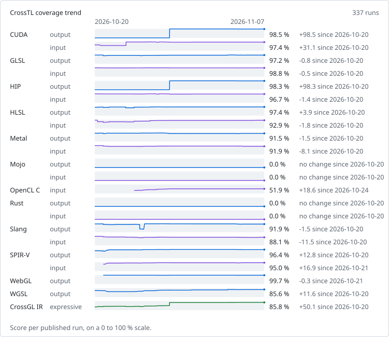

# CrossTL coverage

Measured on commit [`4c130ec`](https://github.com/CrossGL/crosstl/commit/4c130ec2da502bed118cf3f5377afb32d5e22029) at 2026-11-14T20:24:14Z (CrossTL 3.7.0) by the [Coverage workflow](https://github.com/CrossGL/crosstl/actions/workflows/coverage.yml), which publishes this file on every push to `main` and nightly. Run `python -m tools.coverage run` to measure locally.

Every feature in a pinned upstream feature list gets a generated probe. For output, CrossTL translates a CrossGL probe to the language; for input, it imports a native probe and translates it back. The native SPIR-V probe is the module glslang compiles the GLSL probe to, and its round trip must keep the feature's instruction. The language's reference tool then validates the result:

- **supported**: the reference tool accepts the translation, which keeps the built-ins and decorations the feature needs once compiled and, where it runs, computes what the native probe computes;
- **refused**: CrossTL rejects the feature with a diagnostic;
- **wrong**: CrossTL produces output the reference tool rejects, that loses a built-in or decoration the feature needs or that computes other results, writes a placeholder comment in place of the feature, or fails without a diagnostic;
- **untested**: no probe can be built for the feature yet, or the reference tool rejects the probe itself.

Score = supported / (supported + refused + wrong). Untested features are shown separately and do not count. The CrossGL IR row covers the union of every language's output features, merged into semantic features through the SPIR-V each native probe lowers to; a semantic feature is expressible when its CrossGL probe translates correctly to at least one language that has it, or to valid SPIR-V that lowers to the same semantic feature.

The Executed column counts the compute probes that also ran on a runtime of Core's conformance harness, on the GPU or on Mesa's software drivers. A supported compute probe whose translation reads the native probe's input buffers runs next to the native probe on the same inputs, and a translation that binds other resources or writes other results is wrong. HLSL, Slang, WGSL and Rust probes run as the SPIR-V their reference compiler writes for them, and so do GLSL probes that llvmpipe's OpenGL rejects. The harness has no runtime for the language of a compile-only row, so the reference tool alone decides its score; 0 means that no supported probe of the row could run.

| Language | Direction | Score | Supported | Refused | Wrong | Untested | Executed |
|---|---|---:|---:|---:|---:|---:|---|
| CUDA | output | 98.4 % | 697 | 1 | 10 | 8 | compile-only |
| CUDA | input | 84.7 % | 600 | 105 | 3 | 8 | compile-only |
| GLSL | output | 97.1 % | 560 | 8 | 9 | 0 | 394 on opengl-llvmpipe, vulkan-lavapipe |
| GLSL | input | 99.3 % | 573 | 1 | 3 | 0 | 394 on opengl-llvmpipe, vulkan-lavapipe |
| HIP | output | 98.8 % | 558 | 3 | 4 | 0 | compile-only |
| HIP | input | 88.7 % | 501 | 62 | 2 | 0 | compile-only |
| HLSL | output | 97.6 % | 798 | 13 | 7 | 11 | 351 on vulkan-lavapipe |
| HLSL | input | 94.1 % | 770 | 42 | 6 | 11 | 351 on vulkan-lavapipe |
| Metal | output | 92.1 % | 500 | 12 | 31 | 0 | 409 on metal-apple |
| Metal | input | 91.3 % | 496 | 31 | 16 | 0 | 423 on metal-apple |
| Mojo | output | 0.0 % | 0 | 51 | 254 | 16 | compile-only |
| Mojo | input | 0.0 % | 0 | 305 | 0 | 16 | compile-only |
| OpenCL C | output | not offered | | | | | |
| OpenCL C | input | 49.7 % | 365 | 357 | 13 | 0 | compile-only |
| Rust | output | 0.0 % | 0 | 195 | 697 | 6 | 0 |
| Rust | input | 0.0 % | 0 | 252 | 625 | 21 | 0 |
| Slang | output | 78.6 % | 545 | 123 | 25 | 13 | 373 on vulkan-lavapipe |
| Slang | input | 70.7 % | 490 | 188 | 15 | 13 | 351 on vulkan-lavapipe |
| SPIR-V | output | 96.4 % | 537 | 15 | 5 | 7 | 395 on vulkan-lavapipe |
| SPIR-V | input | 92.7 % | 518 | 27 | 14 | 5 | 375 on vulkan-lavapipe |
| WebGL | output | 99.7 % | 297 | 1 | 0 | 0 | compile-only |
| WebGL | input | not offered | | | | | |
| WGSL | output | 85.1 % | 343 | 32 | 28 | 1 | 281 on vulkan-lavapipe |
| WGSL | input | not offered | | | | | |
| CrossGL IR | expressiveness | 84.4 % | 1387 | 137 | 119 | 52 |  |

OpenCL C output is not offered: CrossTL has no OpenCL C generator.
WebGL input is not offered: CrossTL has no WebGL source frontend.
WGSL input is not offered: CrossTL has no WGSL source frontend.

## Trend

## By category

Each cell counts the supported features of a category over its supported, refused and wrong ones. Untested features are left out, and a blank cell means none of the category's features could be measured.

| Language | Direction | compute | control-flow | function | graphics | method | operator | resource | stage | type |
|---|---|---:|---:|---:|---:|---:|---:|---:|---:|---:|
| CUDA | output | 17/18 | 59/60 | 499/504 | | | 33/33 | 43/45 | 1/1 | 45/47 |
| CUDA | input | 18/18 | 57/60 | 404/504 | | | 33/33 | 43/45 | 1/1 | 44/47 |
| GLSL | output | 28/28 | 59/59 | 221/225 | 60/69 | | 50/50 | 65/67 | 12/14 | 65/65 |
| GLSL | input | 28/28 | 59/59 | 225/225 | 67/69 | | 50/50 | 65/67 | 14/14 | 65/65 |
| HIP | output | 17/18 | 59/60 | 359/361 | | | 33/33 | 44/45 | 1/1 | 45/47 |
| HIP | input | 18/18 | 57/60 | 305/361 | | | 33/33 | 43/45 | 1/1 | 44/47 |
| HLSL | output | 13/13 | 60/62 | 196/198 | 60/63 | 273/285 | 50/50 | 66/67 | 14/14 | 66/66 |
| HLSL | input | 13/13 | 62/62 | 194/198 | 61/63 | 245/285 | 49/50 | 67/67 | 14/14 | 65/66 |
| Metal | output | 25/25 | 61/62 | 216/224 | 39/45 | | 50/50 | 38/64 | 5/7 | 66/66 |
| Metal | input | 19/25 | 62/62 | 205/224 | 28/45 | | 50/50 | 64/64 | 3/7 | 65/66 |
| Mojo | output | 0/16 | 0/47 | 0/119 | | | 0/41 | 0/29 | 0/1 | 0/52 |
| Mojo | input | 0/16 | 0/47 | 0/119 | | | 0/41 | 0/29 | 0/1 | 0/52 |
| OpenCL C | input | 13/18 | 48/57 | 168/515 | | | 42/43 | 42/45 | 1/1 | 51/56 |
| Rust | output | 0/17 | 0/54 | 0/572 | 0/64 | | 0/46 | 0/62 | 0/14 | 0/63 |
| Rust | input | 0/17 | 0/54 | 0/557 | 0/64 | | 0/46 | 0/62 | 0/14 | 0/63 |
| Slang | output | 20/24 | 61/62 | 218/339 | 53/67 | | 50/50 | 64/67 | 14/14 | 65/70 |
| Slang | input | 19/24 | 55/62 | 183/339 | 45/67 | | 49/50 | 64/67 | 11/14 | 64/70 |
| SPIR-V | output | 28/28 | 61/62 | 189/192 | 61/73 | | 51/51 | 67/67 | 12/14 | 68/70 |
| SPIR-V | input | 28/28 | 62/62 | 172/194 | 67/73 | | 50/51 | 61/67 | 14/14 | 64/70 |
| WebGL | output | | 58/58 | 89/89 | 11/12 | | 50/50 | 32/32 | 2/2 | 55/55 |
| WGSL | output | 17/22 | 56/56 | 104/145 | 12/16 | | 47/48 | 51/57 | 3/3 | 53/56 |
| CrossGL IR | expressiveness | 28/28 | 61/62 | 926/1169 | 72/73 | 98/108 | 51/51 | 67/67 | 14/14 | 70/71 |

## Feature lists

| Language | Feature list | Pinned at |
|---|---|---|
| CUDA | [LLVM 23.1.3 device-side CUDA Math API wrappers](https://github.com/llvm/llvm-project/blob/0d261d1ca552c95a8f007e061c787ac7132fbcbc/clang/lib/Headers/__clang_cuda_math.h) | `0d261d1ca552` |
| CUDA | [LLVM 23.1.3 CUDA intrinsic and atomic wrappers](https://github.com/llvm/llvm-project/blob/0d261d1ca552c95a8f007e061c787ac7132fbcbc/clang/lib/Headers/__clang_cuda_device_functions.h) | `0d261d1ca552` |
| CUDA | [LLVM 23.1.3 CUDA warp, cache-hinted load and store, and funnel shift intrinsics](https://github.com/llvm/llvm-project/blob/0d261d1ca552c95a8f007e061c787ac7132fbcbc/clang/lib/Headers/__clang_cuda_intrinsics.h) | `0d261d1ca552` |
| GLSL | [GLSL 4.60 specification, chapter 8 (built-in functions)](https://github.com/KhronosGroup/GLSL/blob/0099bf83b0288469917fc2e2972cb0a2b74d6711/chapters/builtinfunctions.adoc) | `0099bf83b028` |
| GLSL | [GL_KHR_shader_subgroup (section 8.18, shader invocation group functions)](https://github.com/KhronosGroup/GLSL/blob/0099bf83b0288469917fc2e2972cb0a2b74d6711/extensions/khr/GL_KHR_shader_subgroup.txt) | `0099bf83b028` |
| HIP | [LLVM 17.0.6 device-side HIP math functions and intrinsics](https://github.com/llvm/llvm-project/blob/6009708b4367171ccdbf4b5905cb6a803753fe18/clang/lib/Headers/__clang_hip_math.h) | `6009708b4367` |
| HIP | [ROCm 5.7.1 HIP atomic functions](https://github.com/ROCm/clr/blob/1949b1621a802ffb1492616adbae6154bfbe64ef/hipamd/include/hip/amd_detail/amd_hip_atomic.h) | `1949b1621a80` |
| HIP | [ROCm 5.7.1 HIP device functions (integer intrinsics, conversions, barriers)](https://github.com/ROCm/clr/blob/1949b1621a802ffb1492616adbae6154bfbe64ef/hipamd/include/hip/amd_detail/amd_device_functions.h) | `1949b1621a80` |
| HIP | [ROCm 5.7.1 HIP warp shuffles and lane permutes](https://github.com/ROCm/clr/blob/1949b1621a802ffb1492616adbae6154bfbe64ef/hipamd/include/hip/amd_detail/amd_warp_functions.h) | `1949b1621a80` |
| HLSL | [DXC v1.9.2602.24 intrinsic table](https://github.com/microsoft/DirectXShaderCompiler/blob/d355aa8364d34df3f0822ba0de8d1dfc75ae6f48/utils/hct/gen_intrin_main.txt) | `d355aa8364d3` |
| Metal | [Metal Shading Language 4.1 standard library, from Apple metal version 32023.918 (metalfe-32023.918.1)](https://github.com/CrossGL/crosstl/blob/4c130ec2da502bed118cf3f5377afb32d5e22029/tools/coverage/features/metal.txt) | this repository |
| Mojo | [Mojo 1.2.0 std.atomic functions and Atomic methods](https://github.com/modular/modular/blob/527d069ee11a41ac5320af1f9402db0a66b2b868/Mojo/stdlib/std/atomic/atomic.mojo) | `527d069ee11a` |
| Mojo | [Mojo 1.2.0 std.atomic public API](https://github.com/modular/modular/blob/527d069ee11a41ac5320af1f9402db0a66b2b868/Mojo/stdlib/std/atomic/__init__.mojo) | `527d069ee11a` |
| Mojo | [Mojo 1.2.0 std.bit functions](https://github.com/modular/modular/blob/527d069ee11a41ac5320af1f9402db0a66b2b868/Mojo/stdlib/std/bit/bit.mojo) | `527d069ee11a` |
| Mojo | [Mojo 1.2.0 std.bit public API](https://github.com/modular/modular/blob/527d069ee11a41ac5320af1f9402db0a66b2b868/Mojo/stdlib/std/bit/__init__.mojo) | `527d069ee11a` |
| Mojo | [MAX 26.7.0 max.gpu.primitives.block functions](https://github.com/modular/modular/blob/527d069ee11a41ac5320af1f9402db0a66b2b868/max/mojo/max/gpu/primitives/block.mojo) | `527d069ee11a` |
| Mojo | [MAX 26.7.0 max.gpu.primitives.id functions](https://github.com/modular/modular/blob/527d069ee11a41ac5320af1f9402db0a66b2b868/max/mojo/max/gpu/primitives/id.mojo) | `527d069ee11a` |
| Mojo | [Mojo 1.2.0 GPU index functions max.gpu re-exports](https://github.com/modular/modular/blob/527d069ee11a41ac5320af1f9402db0a66b2b868/Mojo/stdlib/std/_gpu/primitives/id.mojo) | `527d069ee11a` |
| Mojo | [MAX 26.7.0 max.gpu synchronization functions](https://github.com/modular/modular/blob/527d069ee11a41ac5320af1f9402db0a66b2b868/max/mojo/max/gpu/sync/sync.mojo) | `527d069ee11a` |
| Mojo | [MAX 26.7.0 max.gpu.sync public API](https://github.com/modular/modular/blob/527d069ee11a41ac5320af1f9402db0a66b2b868/max/mojo/max/gpu/sync/__init__.mojo) | `527d069ee11a` |
| Mojo | [MAX 26.7.0 max.gpu.primitives.warp functions](https://github.com/modular/modular/blob/527d069ee11a41ac5320af1f9402db0a66b2b868/max/mojo/max/gpu/primitives/warp.mojo) | `527d069ee11a` |
| Mojo | [Mojo 1.2.0 std.math functions](https://github.com/modular/modular/blob/527d069ee11a41ac5320af1f9402db0a66b2b868/Mojo/stdlib/std/math/math.mojo) | `527d069ee11a` |
| Mojo | [Mojo 1.2.0 std.math public API](https://github.com/modular/modular/blob/527d069ee11a41ac5320af1f9402db0a66b2b868/Mojo/stdlib/std/math/__init__.mojo) | `527d069ee11a` |
| Mojo | [Mojo 1.2.0 floating-point predicates std.math re-exports](https://github.com/modular/modular/blob/527d069ee11a41ac5320af1f9402db0a66b2b868/Mojo/stdlib/std/utils/numerics.mojo) | `527d069ee11a` |
| OpenCL C | [LLVM 18.1.3 OpenCL C built-in function declarations](https://github.com/llvm/llvm-project/blob/c13b7485b87909fcf739f62cfa382b55407433c0/clang/lib/Headers/opencl-c.h) | `c13b7485b879` |
| OpenCL C | [LLVM 18.1.3 OpenCL C as_type operators and printf](https://github.com/llvm/llvm-project/blob/c13b7485b87909fcf739f62cfa382b55407433c0/clang/lib/Headers/opencl-c-base.h) | `c13b7485b879` |
| OpenCL C | [LLVM 18.1.3 OpenCL C pipe, enqueue and address-space built-ins](https://github.com/llvm/llvm-project/blob/c13b7485b87909fcf739f62cfa382b55407433c0/clang/include/clang/Basic/Builtins.def) | `c13b7485b879` |
| OpenCL C | [LLVM 18.1.3 OpenCL C keyword operators](https://github.com/llvm/llvm-project/blob/c13b7485b87909fcf739f62cfa382b55407433c0/clang/include/clang/Basic/TokenKinds.def) | `c13b7485b879` |
| Rust | [rust-gpu 0.11.0 spirv_std::arch](https://github.com/Rust-GPU/rust-gpu/blob/62401280ab4b512c734ad1aceee7553385e17418/crates/spirv-std/src/arch.rs) | `62401280ab4b` |
| Rust | [rust-gpu 0.11.0 spirv_std::arch, module atomics](https://github.com/Rust-GPU/rust-gpu/blob/62401280ab4b512c734ad1aceee7553385e17418/crates/spirv-std/src/arch/atomics.rs) | `62401280ab4b` |
| Rust | [rust-gpu 0.11.0 spirv_std::arch, module barrier](https://github.com/Rust-GPU/rust-gpu/blob/62401280ab4b512c734ad1aceee7553385e17418/crates/spirv-std/src/arch/barrier.rs) | `62401280ab4b` |
| Rust | [glam 0.34.1 BVec2](https://github.com/bitshifter/glam-rs/blob/f5c5a6b635c5be1b7e904808175470ed0f29f4ff/src/bool/bvec2.rs) | `f5c5a6b635c5` |
| Rust | [glam 0.34.1 BVec3](https://github.com/bitshifter/glam-rs/blob/f5c5a6b635c5be1b7e904808175470ed0f29f4ff/src/bool/bvec3.rs) | `f5c5a6b635c5` |
| Rust | [glam 0.34.1 BVec4](https://github.com/bitshifter/glam-rs/blob/f5c5a6b635c5be1b7e904808175470ed0f29f4ff/src/bool/bvec4.rs) | `f5c5a6b635c5` |
| Rust | [rust-gpu 0.11.0 spirv_std::ByteAddressableBuffer methods](https://github.com/Rust-GPU/rust-gpu/blob/62401280ab4b512c734ad1aceee7553385e17418/crates/spirv-std/src/byte_addressable_buffer.rs) | `62401280ab4b` |
| Rust | [rust-gpu 0.11.0 spirv_std::arch, module demote_to_helper_invocation_ext](https://github.com/Rust-GPU/rust-gpu/blob/62401280ab4b512c734ad1aceee7553385e17418/crates/spirv-std/src/arch/demote_to_helper_invocation_ext.rs) | `62401280ab4b` |
| Rust | [rust-gpu 0.11.0 spirv_std::arch, module derivative](https://github.com/Rust-GPU/rust-gpu/blob/62401280ab4b512c734ad1aceee7553385e17418/crates/spirv-std/src/arch/derivative.rs) | `62401280ab4b` |
| Rust | [glam 0.34.1 DMat2](https://github.com/bitshifter/glam-rs/blob/f5c5a6b635c5be1b7e904808175470ed0f29f4ff/src/f64/dmat2.rs) | `f5c5a6b635c5` |
| Rust | [glam 0.34.1 DMat3](https://github.com/bitshifter/glam-rs/blob/f5c5a6b635c5be1b7e904808175470ed0f29f4ff/src/f64/dmat3.rs) | `f5c5a6b635c5` |
| Rust | [glam 0.34.1 DMat4](https://github.com/bitshifter/glam-rs/blob/f5c5a6b635c5be1b7e904808175470ed0f29f4ff/src/f64/dmat4.rs) | `f5c5a6b635c5` |
| Rust | [glam 0.34.1 DQuat](https://github.com/bitshifter/glam-rs/blob/f5c5a6b635c5be1b7e904808175470ed0f29f4ff/src/f64/dquat.rs) | `f5c5a6b635c5` |
| Rust | [glam 0.34.1 DVec2](https://github.com/bitshifter/glam-rs/blob/f5c5a6b635c5be1b7e904808175470ed0f29f4ff/src/f64/dvec2.rs) | `f5c5a6b635c5` |
| Rust | [glam 0.34.1 DVec3](https://github.com/bitshifter/glam-rs/blob/f5c5a6b635c5be1b7e904808175470ed0f29f4ff/src/f64/dvec3.rs) | `f5c5a6b635c5` |
| Rust | [glam 0.34.1 DVec4](https://github.com/bitshifter/glam-rs/blob/f5c5a6b635c5be1b7e904808175470ed0f29f4ff/src/f64/dvec4.rs) | `f5c5a6b635c5` |
| Rust | [num-traits 0.2.19 Float trait](https://github.com/rust-num/num-traits/blob/7ec3d41d39b28190ec1d42db38021107b3951f3a/src/float.rs) | `7ec3d41d39b2` |
| Rust | [rust-gpu 0.11.0 spirv_std::image Image and SampledImage methods](https://github.com/Rust-GPU/rust-gpu/blob/62401280ab4b512c734ad1aceee7553385e17418/crates/spirv-std/src/image.rs) | `62401280ab4b` |
| Rust | [glam 0.34.1 IVec2](https://github.com/bitshifter/glam-rs/blob/f5c5a6b635c5be1b7e904808175470ed0f29f4ff/src/i32/ivec2.rs) | `f5c5a6b635c5` |
| Rust | [glam 0.34.1 IVec3](https://github.com/bitshifter/glam-rs/blob/f5c5a6b635c5be1b7e904808175470ed0f29f4ff/src/i32/ivec3.rs) | `f5c5a6b635c5` |
| Rust | [glam 0.34.1 IVec4](https://github.com/bitshifter/glam-rs/blob/f5c5a6b635c5be1b7e904808175470ed0f29f4ff/src/i32/ivec4.rs) | `f5c5a6b635c5` |
| Rust | [glam 0.34.1 Mat2](https://github.com/bitshifter/glam-rs/blob/f5c5a6b635c5be1b7e904808175470ed0f29f4ff/src/f32/scalar/mat2.rs) | `f5c5a6b635c5` |
| Rust | [glam 0.34.1 Mat3](https://github.com/bitshifter/glam-rs/blob/f5c5a6b635c5be1b7e904808175470ed0f29f4ff/src/f32/mat3.rs) | `f5c5a6b635c5` |
| Rust | [glam 0.34.1 Mat3A](https://github.com/bitshifter/glam-rs/blob/f5c5a6b635c5be1b7e904808175470ed0f29f4ff/src/f32/scalar/mat3a.rs) | `f5c5a6b635c5` |
| Rust | [glam 0.34.1 Mat4](https://github.com/bitshifter/glam-rs/blob/f5c5a6b635c5be1b7e904808175470ed0f29f4ff/src/f32/scalar/mat4.rs) | `f5c5a6b635c5` |
| Rust | [rust-gpu 0.11.0 spirv_std::arch, module mesh_shading](https://github.com/Rust-GPU/rust-gpu/blob/62401280ab4b512c734ad1aceee7553385e17418/crates/spirv-std/src/arch/mesh_shading.rs) | `62401280ab4b` |
| Rust | [rust-gpu 0.11.0 spirv_std::float packing functions](https://github.com/Rust-GPU/rust-gpu/blob/62401280ab4b512c734ad1aceee7553385e17418/crates/spirv-std/src/float.rs) | `62401280ab4b` |
| Rust | [rust-gpu 0.11.0 spirv_std::arch, module primitive](https://github.com/Rust-GPU/rust-gpu/blob/62401280ab4b512c734ad1aceee7553385e17418/crates/spirv-std/src/arch/primitive.rs) | `62401280ab4b` |
| Rust | [glam 0.34.1 Quat](https://github.com/bitshifter/glam-rs/blob/f5c5a6b635c5be1b7e904808175470ed0f29f4ff/src/f32/scalar/quat.rs) | `f5c5a6b635c5` |
| Rust | [rust-gpu 0.11.0 spirv_std::ray_tracing RayQuery and AccelerationStructure methods](https://github.com/Rust-GPU/rust-gpu/blob/62401280ab4b512c734ad1aceee7553385e17418/crates/spirv-std/src/ray_tracing.rs) | `62401280ab4b` |
| Rust | [rust-gpu 0.11.0 spirv_std::arch, module ray_tracing](https://github.com/Rust-GPU/rust-gpu/blob/62401280ab4b512c734ad1aceee7553385e17418/crates/spirv-std/src/arch/ray_tracing.rs) | `62401280ab4b` |
| Rust | [rust-gpu 0.11.0 spirv_std::arch, module subgroup](https://github.com/Rust-GPU/rust-gpu/blob/62401280ab4b512c734ad1aceee7553385e17418/crates/spirv-std/src/arch/subgroup.rs) | `62401280ab4b` |
| Rust | [glam 0.34.1 UVec2](https://github.com/bitshifter/glam-rs/blob/f5c5a6b635c5be1b7e904808175470ed0f29f4ff/src/u32/uvec2.rs) | `f5c5a6b635c5` |
| Rust | [glam 0.34.1 UVec3](https://github.com/bitshifter/glam-rs/blob/f5c5a6b635c5be1b7e904808175470ed0f29f4ff/src/u32/uvec3.rs) | `f5c5a6b635c5` |
| Rust | [glam 0.34.1 UVec4](https://github.com/bitshifter/glam-rs/blob/f5c5a6b635c5be1b7e904808175470ed0f29f4ff/src/u32/uvec4.rs) | `f5c5a6b635c5` |
| Rust | [glam 0.34.1 Vec2](https://github.com/bitshifter/glam-rs/blob/f5c5a6b635c5be1b7e904808175470ed0f29f4ff/src/f32/vec2.rs) | `f5c5a6b635c5` |
| Rust | [glam 0.34.1 Vec3](https://github.com/bitshifter/glam-rs/blob/f5c5a6b635c5be1b7e904808175470ed0f29f4ff/src/f32/vec3.rs) | `f5c5a6b635c5` |
| Rust | [glam 0.34.1 Vec3A](https://github.com/bitshifter/glam-rs/blob/f5c5a6b635c5be1b7e904808175470ed0f29f4ff/src/f32/scalar/vec3a.rs) | `f5c5a6b635c5` |
| Rust | [glam 0.34.1 Vec4](https://github.com/bitshifter/glam-rs/blob/f5c5a6b635c5be1b7e904808175470ed0f29f4ff/src/f32/scalar/vec4.rs) | `f5c5a6b635c5` |
| Slang | [Slang v2026.20 core module: HLSL-compatible built-in functions](https://github.com/shader-slang/slang/blob/d9ede2dd5836afc0e9586da18d9236b171d0faa8/source/slang/hlsl.meta.slang) | `d9ede2dd5836` |
| Slang | [Slang v2026.20 core module: core built-in functions](https://github.com/shader-slang/slang/blob/d9ede2dd5836afc0e9586da18d9236b171d0faa8/source/slang/core.meta.slang) | `d9ede2dd5836` |
| SPIR-V | [SPIR-V GLSL.std.450 extended instruction grammar](https://github.com/KhronosGroup/SPIRV-Headers/blob/496543121ce6419f23d6fa5d7194ba66c36212d2/include/spirv/unified1/extinst.glsl.std.450.grammar.json) | `496543121ce6` |
| SPIR-V | [SPIR-V core grammar (execution models, capabilities, storage classes, instructions)](https://github.com/KhronosGroup/SPIRV-Headers/blob/496543121ce6419f23d6fa5d7194ba66c36212d2/include/spirv/unified1/spirv.core.grammar.json) | `496543121ce6` |
| WebGL | [ANGLE's GLSL ES built-in function table](https://github.com/google/angle/blob/1ff891807e391d842c33d552ea26ab26b5341ef4/src/compiler/translator/builtin_function_declarations.txt) | `1ff891807e39` |
| WGSL | [Tint's WGSL built-in function definitions](https://github.com/google/dawn/blob/ff7c6960f62d4249f967a78448918eec21705a86/src/tint/lang/wgsl/wgsl.def) | `ff7c6960f62d` |

Reference tools: clang Ubuntu clang version 18.1.3 (1ubuntu1), dxc libdxcompiler.so: 1.9(5191-d355aa83)(1.9.0.5191), glslangValidator Glslang Version: 11:16.6.0, hipcc HIP version: 5.7.31921-0, metal Apple metal version 32023.921 (metalfe-32023.921.6), mojo Mojo 1.2.0 (2016d0cd), naga 30.0.1, nvcc nvcc: NVIDIA (R) Cuda compiler driver, rust-gpu rust-gpu 0.11.0 (rustc 1.99.0-nightly (d453bdd8f 2026-08-14)), slangc 2026.20, spirv-as SPIRV-Tools v2026.4 ef96ed763b43b59b33b31b362f09a02b729fa1c9, spirv-dis SPIRV-Tools v2026.4 ef96ed763b43b59b33b31b362f09a02b729fa1c9, spirv-val SPIRV-Tools v2026.4 ef96ed763b43b59b33b31b362f09a02b729fa1c9.

## Gaps

Each row's wrong and refused features are grouped by diagnostic. A diagnostic drops its line numbers and writes the probe's own variables as `<probe>`, and one that several features share writes each feature's name as `<feature>`. Untested features are grouped by the reason no probe could measure them.

### CUDA output

11 gaps: 1 refused, 10 wrong

Wrong, by cause ([open bug issues](https://github.com/CrossGL/crosstl/issues?q=is:issue%20is:open%20label:coverage%20label:bug%20label:backend:cuda%20label:direction:output)):

- `no instance of overloaded function "<feature>" matches the argument list` (5): `__match_all_sync`, `__stcg`, `__stcs`, `__stwb`, `__stwt`
- `identifier "<probe>" is undefined`: `shared-memory-in-helper`
- `identifier "V" is undefined in device code`: `constant-expression`
- `identifier "acc" is undefined in device code`: `device-global`
- `identifier "blend" is undefined`: `default-argument`
- `no operator "*" matches these operands`: `uniform-vector`

Refused, by diagnostic:

- `project.translate.cuda-lowering-unsupported: CudaLoweringRefused: CUDA cannot lower N constructs: type: the built-in type 'samplerBuffer' has no CUDA spelling; function: call to 'texelFetch', a built-in function of another shading language that CUDA does not define and the program does not declare (target cuda) [project.translate.cuda-lowering-unsupported]`: `texel-buffer`

8 untested: function 8

- `no probe for parameters of type size_t` (4): `__cvta_generic_to_constant`, `__cvta_generic_to_global`, `__cvta_generic_to_local`, `__cvta_generic_to_shared`
- `no probe for parameters of type void *` (4): `__cvta_constant_to_generic`, `__cvta_global_to_generic`, `__cvta_local_to_generic`, `__cvta_shared_to_generic`

### CUDA input

108 gaps: 105 refused, 3 wrong

Wrong, by cause ([open bug issues](https://github.com/CrossGL/crosstl/issues?q=is:issue%20is:open%20label:coverage%20label:bug%20label:backend:cuda%20label:direction:input)):

- `class "Span" has no member "width"`: `struct-method`
- `identifier "blend" is undefined`: `default-argument`
- `identifier "twice" is undefined`: `forward-declaration`

Refused, by diagnostic:

- `project.translate.directed-rounding-unsupported: DirectedRoundingUnsupportedError: '<feature>' rounds its result down, and CrossGL has no operation with a rounding mode other than to nearest [project.translate.directed-rounding-unsupported]` (22): `__dadd_rd`, `__ddiv_rd`, `__dmul_rd`, `__double2float_rd`, `__drcp_rd`, `__dsqrt_rd`, `__dsub_rd`, `__fadd_rd`, `__fdiv_rd`, `__fma_rd`, `__fmaf_ieee_rd`, `__fmaf_rd`, `__fmul_rd`, `__frcp_rd`, `__fsqrt_rd`, `__fsub_rd`, `__int2float_rd`, `__ll2double_rd`, `__ll2float_rd`, `__uint2float_rd`, `__ull2double_rd`, `__ull2float_rd`
- `project.translate.directed-rounding-unsupported: DirectedRoundingUnsupportedError: '<feature>' rounds its result toward zero, and CrossGL has no operation with a rounding mode other than to nearest [project.translate.directed-rounding-unsupported]` (22): `__dadd_rz`, `__ddiv_rz`, `__dmul_rz`, `__double2float_rz`, `__drcp_rz`, `__dsqrt_rz`, `__dsub_rz`, `__fadd_rz`, `__fdiv_rz`, `__fma_rz`, `__fmaf_ieee_rz`, `__fmaf_rz`, `__fmul_rz`, `__frcp_rz`, `__fsqrt_rz`, `__fsub_rz`, `__int2float_rz`, `__ll2double_rz`, `__ll2float_rz`, `__uint2float_rz`, `__ull2double_rz`, `__ull2float_rz`
- `project.translate.directed-rounding-unsupported: DirectedRoundingUnsupportedError: '<feature>' rounds its result up, and CrossGL has no operation with a rounding mode other than to nearest [project.translate.directed-rounding-unsupported]` (22): `__dadd_ru`, `__ddiv_ru`, `__dmul_ru`, `__double2float_ru`, `__drcp_ru`, `__dsqrt_ru`, `__dsub_ru`, `__fadd_ru`, `__fdiv_ru`, `__fma_ru`, `__fmaf_ieee_ru`, `__fmaf_ru`, `__fmul_ru`, `__frcp_ru`, `__fsqrt_ru`, `__fsub_ru`, `__int2float_ru`, `__ll2double_ru`, `__ll2float_ru`, `__uint2float_ru`, `__ull2double_ru`, `__ull2float_ru`
- `project.translate.cuda-import-unsupported: CudaImportRefused: CrossGL cannot represent N CUDA construct: CUDA <feature>: CrossGL atomics are device-scoped, and a system-scoped atomic is also atomic for the host and peer devices (target cgl) [project.translate.cuda-import-unsupported]` (10): `atomicAdd_system`, `atomicAnd_system`, `atomicCAS_system`, `atomicDec_system`, `atomicExch_system`, `atomicInc_system`, `atomicMax_system`, `atomicMin_system`, `atomicOr_system`, `atomicXor_system`
- `project.translate.cuda-lowering-unsupported: CudaLoweringRefused: CUDA cannot lower N construct: <feature>: the output part is not a single assignable value (target cuda) [project.translate.cuda-lowering-unsupported]` (10): `frexp`, `frexpf`, `modf`, `modff`, `remquo`, `remquof`, `sincos`, `sincosf`, `sincospi`, `sincospif`
- `project.translate.cuda-import-unsupported: CudaImportRefused: CrossGL cannot represent N CUDA construct: CUDA integer intrinsic <feature>(a0, a1, a2) has no CrossGL form (target cgl) [project.translate.cuda-import-unsupported]` (5): `__byte_perm`, `__funnelshift_l`, `__funnelshift_lc`, `__funnelshift_r`, `__funnelshift_rc`
- `project.translate.cuda-import-unsupported: CudaImportRefused: CrossGL cannot represent N CUDA construct: CUDA thread block sync vote <feature>(a0): CrossGL has no barrier that reduces a predicate (target cgl) [project.translate.cuda-import-unsupported]` (3): `__syncthreads_and`, `__syncthreads_count`, `__syncthreads_or`
- `project.translate.undeclared-function: UndeclaredFunctionError: function 'countLeadingZeros' is not declared: it is neither a CrossGL built-in function nor a function, structure method, type or callable value of the program (target cuda) [project.translate.undeclared-function]` (2): `__clz`, `__clzll`
- `project.translate.cuda-import-unsupported: CudaImportRefused: CrossGL cannot represent N CUDA construct: CUDA __syncwarp(a0): CrossGL has no barrier over a subset of the subgroup (target cgl) [project.translate.cuda-import-unsupported]`: `__syncwarp`
- `project.translate.cuda-import-unsupported: CudaImportRefused: CrossGL cannot represent N CUDA construct: CUDA __device__ variable 'acc' has an initializer: device memory is initialized when the module loads, and a storage buffer the host binds carries no initial contents (target cgl) [project.translate.cuda-import-unsupported]`: `device-global`
- `project.translate.cuda-import-unsupported: CudaImportRefused: CrossGL cannot represent N CUDA construct: CUDA time function clock(): CrossGL has no clock counter (target cgl) [project.translate.cuda-import-unsupported]`: `clock`
- `project.translate.cuda-import-unsupported: CudaImportRefused: CrossGL cannot represent N CUDA construct: CUDA time function clock64(): CrossGL has no clock counter (target cgl) [project.translate.cuda-import-unsupported]`: `clock64`
- `project.translate.reference-parameter-unsupported: ReferenceParameterError: argument N of 'grow' binds a reference parameter to storage that other threads or other arguments can reach; CrossGL passes it in and out by copy (target cgl) [project.translate.reference-parameter-unsupported]`: `buffer-element-argument`
- `project.translate.undeclared-function: UndeclaredFunctionError: function 'fdivide' is not declared: it is neither a CrossGL built-in function nor a function, structure method, type or callable value of the program (target cuda) [project.translate.undeclared-function]`: `fdivide`
- `project.translate.undeclared-function: UndeclaredFunctionError: function 'surf2Dread' is not declared: it is neither a CrossGL built-in function nor a function, structure method, type or callable value of the program (target cuda) [project.translate.undeclared-function]`: `read-write-image`
- `project.translate.undeclared-type: UndeclaredTypeError: type 'N' is not declared: it is neither a CrossGL built-in type nor a structure, enumeration, type alias or generic parameter of the program (target cuda) [project.translate.undeclared-type]`: `constant-array-size`
- `project.translate.undeclared-type: UndeclaredTypeError: type 'T' is not declared: it is neither a CrossGL built-in type nor a structure, enumeration, type alias or generic parameter of the program (target cuda) [project.translate.undeclared-type]`: `generic-function`

8 untested: function 8

- `no probe for parameters of type size_t` (4): `__cvta_generic_to_constant`, `__cvta_generic_to_global`, `__cvta_generic_to_local`, `__cvta_generic_to_shared`
- `no probe for parameters of type void *` (4): `__cvta_constant_to_generic`, `__cvta_global_to_generic`, `__cvta_local_to_generic`, `__cvta_shared_to_generic`

### GLSL output

17 gaps: 8 refused, 9 wrong

Wrong, by cause ([open bug issues](https://github.com/CrossGL/crosstl/issues?q=is:issue%20is:open%20label:coverage%20label:bug%20label:backend:glsl%20label:direction:output)):

- `on opengl-llvmpipe, the translation is rejected by the runtime` (3): `allInvocations`, `allInvocationsEqual`, `anyInvocation`
- `the translation loses ExecutionMode.PixelInterlockOrderedEXT, Capability.FragmentShaderPixelInterlockEXT, OpBeginInvocationInterlockEXT` (2): `rasterizer-ordered-buffer`, `rasterizer-ordered-image`
- `'crossgl_gl_FragDepth' : undeclared identifier`: `conservative-depth`
- `'location' : SPIR-V requires location for user input/output`: `subpassLoad`
- `the translation loses Capability.RuntimeDescriptorArray`: `unsized-array-of-textures`
- `the translation loses OpTypeSampler`: `shared-sampler`

Refused, by diagnostic:

- `project.translate.opengl-tessellation-patch-unsupported: TessellationPatchUnsupportedError: member 'PatchConstants.edges' carries SV_TessFactor, which the tessellation lowering does not carry yet; opengl tessellation shaders exchange control points through per-vertex arrays, patch variables and gl_TessLevelOuter/gl_TessLevelInner (target opengl) [project.translate.opengl-tessellation-patch` (7): `tessellation-control`, `tessellation-domain-isolines`, `tessellation-domain-quads`, `tessellation-evaluation`, `tessellation-level-input`, `tessellation-patch-input`, `tessellation-patch-output`
- `project.translate.opengl-lowering-unsupported: OpenGLLoweringRefused: OpenGL cannot lower N construct: 'gl_ViewIndex': the multiview view index exists only in Vulkan GLSL (GL_EXT_multiview); GL_OVR_multiview also needs the view count (layout(num_views)), which the source does not state (target opengl) [project.translate.opengl-lowering-unsupported]`: `view-index`

### GLSL input

4 gaps: 1 refused, 3 wrong

Wrong, by cause ([open bug issues](https://github.com/CrossGL/crosstl/issues?q=is:issue%20is:open%20label:coverage%20label:bug%20label:backend:glsl%20label:direction:input)):

- `'crossgl_gl_FragDepth' : undeclared identifier`: `conservative-depth`
- `the translation loses Capability.RuntimeDescriptorArray`: `unsized-array-of-textures`
- `the translation loses OpTypeSampler`: `shared-sampler`

Refused, by diagnostic:

- `project.translate.opengl-lowering-unsupported: OpenGLLoweringRefused: OpenGL cannot lower N construct: 'gl_ViewIndex': the multiview view index exists only in Vulkan GLSL (GL_EXT_multiview); GL_OVR_multiview also needs the view count (layout(num_views)), which the source does not state (target opengl) [project.translate.opengl-lowering-unsupported]`: `view-index`

### HIP output

7 gaps: 3 refused, 4 wrong

Wrong, by cause ([open bug issues](https://github.com/CrossGL/crosstl/issues?q=is:issue%20is:open%20label:coverage%20label:bug%20label:backend:hip%20label:direction:output)):

- `reference to __host__ variable 'V' in __global__ function`: `constant-expression`
- `reference to __host__ variable 'acc' in __global__ function`: `device-global`
- `use of undeclared identifier '<probe>'; did you mean 'time'?`: `shared-memory-in-helper`
- `use of undeclared identifier 'blend'`: `default-argument`

Refused, by diagnostic:

- `project.translate.undeclared-function: UndeclaredFunctionError: function '<feature>' is not declared: it is neither a CrossGL built-in function nor a function, structure method, type or callable value of the program (target hip) [project.translate.undeclared-function]` (2): `powi`, `powif`
- `project.translate.hip-lowering-unsupported: HipLoweringRefused: HIP cannot lower N constructs: type: the built-in type 'samplerBuffer' has no HIP spelling; function: call to 'texelFetch', a built-in function of another shading language that HIP does not define and the program does not declare (target hip) [project.translate.hip-lowering-unsupported]`: `texel-buffer`

### HIP input

64 gaps: 62 refused, 2 wrong

Wrong, by cause ([open bug issues](https://github.com/CrossGL/crosstl/issues?q=is:issue%20is:open%20label:coverage%20label:bug%20label:backend:hip%20label:direction:input)):

- `redefinition of 'twice'`: `forward-declaration`
- `use of undeclared identifier 'blend'`: `default-argument`

Refused, by diagnostic:

- `project.translate.hip-lowering-unsupported: HipLoweringRefused: HIP cannot lower N construct: <feature>: the output part is not a single assignable value (target hip) [project.translate.hip-lowering-unsupported]` (11): `__sincosf`, `frexp`, `frexpf`, `modf`, `modff`, `remquo`, `remquof`, `sincos`, `sincosf`, `sincospi`, `sincospif`
- `project.translate.hip-import-unsupported: HipImportRefused: CrossGL cannot represent N HIP construct: HIP <feature>: CrossGL atomics are device-scoped, and a system-scoped atomic is also atomic for the host and peer devices (target cgl) [project.translate.hip-import-unsupported]` (9): `atomicAdd_system`, `atomicAnd_system`, `atomicCAS_system`, `atomicExch_system`, `atomicMax_system`, `atomicMin_system`, `atomicOr_system`, `atomicSub_system`, `atomicXor_system`
- `project.translate.directed-rounding-unsupported: DirectedRoundingUnsupportedError: '<feature>' rounds its result down, and CrossGL has no operation with a rounding mode other than to nearest [project.translate.directed-rounding-unsupported]` (7): `__double2float_rd`, `__int2float_rd`, `__ll2double_rd`, `__ll2float_rd`, `__uint2float_rd`, `__ull2double_rd`, `__ull2float_rd`
- `project.translate.directed-rounding-unsupported: DirectedRoundingUnsupportedError: '<feature>' rounds its result toward zero, and CrossGL has no operation with a rounding mode other than to nearest [project.translate.directed-rounding-unsupported]` (7): `__double2float_rz`, `__int2float_rz`, `__ll2double_rz`, `__ll2float_rz`, `__uint2float_rz`, `__ull2double_rz`, `__ull2float_rz`
- `project.translate.directed-rounding-unsupported: DirectedRoundingUnsupportedError: '<feature>' rounds its result up, and CrossGL has no operation with a rounding mode other than to nearest [project.translate.directed-rounding-unsupported]` (7): `__double2float_ru`, `__int2float_ru`, `__ll2double_ru`, `__ll2float_ru`, `__uint2float_ru`, `__ull2double_ru`, `__ull2float_ru`
- `project.translate.hip-import-unsupported: HipImportRefused: CrossGL cannot represent N HIP construct: HIP warp intrinsic <feature>(a0, a1, a2) has no CrossGL form (target cgl) [project.translate.hip-import-unsupported]` (4): `__shfl`, `__shfl_down`, `__shfl_up`, `__shfl_xor`
- `project.translate.hip-import-unsupported: HipImportRefused: CrossGL cannot represent N HIP construct: HIP block-wide sync vote <feature>(a0): CrossGL has no barrier that reduces a predicate (target cgl) [project.translate.hip-import-unsupported]` (3): `__syncthreads_and`, `__syncthreads_count`, `__syncthreads_or`
- `project.translate.hip-import-unsupported: HipImportRefused: CrossGL cannot represent N HIP construct: HIP device timer <feature>(): CrossGL has no clock counter (target cgl) [project.translate.hip-import-unsupported]` (2): `clock64`, `wall_clock64`
- `project.translate.undeclared-function: UndeclaredFunctionError: function '<feature>' is not declared: it is neither a CrossGL built-in function nor a function, structure method, type or callable value of the program (target hip) [project.translate.undeclared-function]` (2): `powi`, `powif`
- `project.translate.undeclared-function: UndeclaredFunctionError: function 'countLeadingZeros' is not declared: it is neither a CrossGL built-in function nor a function, structure method, type or callable value of the program (target hip) [project.translate.undeclared-function]` (2): `__clz`, `__clzll`
- `project.translate.hip-import-unsupported: HipImportRefused: CrossGL cannot represent N HIP construct: HIP __device__ variable 'acc' has an initializer: device memory is initialized when the module loads, and a storage buffer the host binds carries no initial contents (target cgl) [project.translate.hip-import-unsupported]`: `device-global`
- `project.translate.hip-import-unsupported: HipImportRefused: CrossGL cannot represent N HIP construct: HIP device timer clock(): CrossGL has no clock counter (target cgl) [project.translate.hip-import-unsupported]`: `clock`
- `project.translate.hip-import-unsupported: HipImportRefused: CrossGL cannot represent N HIP construct: HIP warp intrinsic __ballot(a0) has no CrossGL form (target cgl) [project.translate.hip-import-unsupported]`: `__ballot`
- `project.translate.hip-record-semantics-unsupported: HipRecordSemanticError: HIP record method call 'width' is unsupported for record 'Span' in call expression`: `struct-method`
- `project.translate.hip-surface-byte-offset-unproven: HipSurfaceByteOffsetError: surf2Dwrite cannot scale its x byte offset N: the element type is unknown, so the offset cannot be shown to be a multiple of the element size [project.translate.hip-surface-byte-offset-unproven]`: `read-write-image`
- `project.translate.reference-parameter-unsupported: ReferenceParameterError: argument N of 'grow' binds a reference parameter to storage that other threads or other arguments can reach; CrossGL passes it in and out by copy (target cgl) [project.translate.reference-parameter-unsupported]`: `buffer-element-argument`
- `project.translate.undeclared-type: UndeclaredTypeError: type 'N' is not declared: it is neither a CrossGL built-in type nor a structure, enumeration, type alias or generic parameter of the program (target hip) [project.translate.undeclared-type]`: `constant-array-size`
- `project.translate.undeclared-type: UndeclaredTypeError: type 'T' is not declared: it is neither a CrossGL built-in type nor a structure, enumeration, type alias or generic parameter of the program (target hip) [project.translate.undeclared-type]`: `generic-function`

### HLSL output

20 gaps: 13 refused, 7 wrong

Wrong, by cause ([open bug issues](https://github.com/CrossGL/crosstl/issues?q=is:issue%20is:open%20label:coverage%20label:bug%20label:backend:hlsl%20label:direction:output)):

- `on vulkan-lavapipe as SPIR-V from dxc, the translation computes different results from the native probe` (3): `buffer-row-major-non-square`, `fmod`, `intrinsic-name`
- `type 'Payload' used as payload requires that it is annotated with the [raypayload] attribute` (2): `DxHitObject.Invoke`, `DxHitObject.TraceRay`
- `Semantic depth_greater is invalid for shader model: ps`: `conservative-depth`
- `no matching function for call to 'blend'`: `default-argument`

Refused, by diagnostic:

- `CrossGL has no work-graph node stage` (11): `EmptyNodeInput.Count`, `EmptyNodeOutput.GroupIncrementOutputCount`, `EmptyNodeOutput.IsValid`, `EmptyNodeOutput.ThreadIncrementOutputCount`, `GetRemainingRecursionLevels`, `GroupNodeInputRecords.Count`, `GroupOrThreadNodeOutputRecords.OutputComplete`, `NodeOutput.GetGroupNodeOutputRecords`, `NodeOutput.GetThreadNodeOutputRecords`, `NodeOutput.IsValid`, `RWDispatchNodeInputRecord.FinishedCrossGroupSharing`
- `project.translate.directx-lowering-unsupported: DirectXLoweringRefused: DirectX cannot lower N construct: HLSL has no system value for the built-in @gl_HelperInvocation; it would become a user semantic no stage writes (target directx) [project.translate.directx-lowering-unsupported]`: `helper-invocation`
- `project.translate.directx-shader-record-buffer-unsupported: ShaderRecordBufferUnsupportedError: shader record buffer 'record' (GL_EXT_ray_tracing shaderRecordEXT) cannot be read on directx: Direct3D N passes shader record data as local root arguments, which need a local root signature, and CrossTL does not emit root signatures (target directx) [project.translate.directx-shader-record-buffer-u`: `ray-shader-record`

11 untested: function 5, method 6

- `needs shader model 6.10` (10): `ClusterID`, `DxHitObject.ClusterID`, `DxHitObject.TriangleObjectPosition`, `GetGroupWaveCount`, `GetGroupWaveIndex`, `RayQuery.CandidateClusterID`, `RayQuery.CandidateTriangleObjectPosition`, `RayQuery.CommittedClusterID`, `RayQuery.CommittedTriangleObjectPosition`, `TriangleObjectPosition`
- `DXC compiles printf only to SPIR-V; DXIL has no print operation`: `printf`

### HLSL input

48 gaps: 42 refused, 6 wrong

Wrong, by cause ([open bug issues](https://github.com/CrossGL/crosstl/issues?q=is:issue%20is:open%20label:coverage%20label:bug%20label:backend:hlsl%20label:direction:input)):

- `cannot <feature> from resource containing uint4` (2): `Texture2D.GatherRaw`, `Texture2DArray.GatherRaw`
- `on vulkan-lavapipe as SPIR-V from dxc, the translation computes different results from the native probe` (2): `fmod`, `nested-unary`
- `brackets are not allowed here; to declare an array, place the brackets after the name`: `array-return`
- `the translation loses ExecutionMode.DepthGreater`: `conservative-depth`

Refused, by diagnostic:

- `project.translate.directx-lowering-unsupported: DirectXLoweringRefused: DirectX cannot lower N constructs: semantic '@NodeLaunch' takes no argument in HLSL; its argument would be dropped; generation then failed: DirectX compute function '<probe>' cannot use return semantic 'NodeLaunch' with void return type (target directx) [project.translate.directx-lowering-unsupported]` (7): `GetRemainingRecursionLevels`, `GroupNodeInputRecords.Count`, `GroupOrThreadNodeOutputRecords.OutputComplete`, `NodeOutput.GetGroupNodeOutputRecords`, `NodeOutput.GetThreadNodeOutputRecords`, `NodeOutput.IsValid`, `RWDispatchNodeInputRecord.FinishedCrossGroupSharing`
- `project.translate.directx-import-unsupported: DirectXImportRefused: CrossGL cannot represent N HLSL construct: DirectX texture overload extras for <feature>: CrossGL has no operand for LOD bias (target cgl) [project.translate.directx-import-unsupported]` (6): `Texture1D.SampleCmpBias`, `Texture1DArray.SampleCmpBias`, `Texture2D.SampleCmpBias`, `Texture2DArray.SampleCmpBias`, `TextureCUBE.SampleCmpBias`, `TextureCUBEArray.SampleCmpBias`
- `project.translate.directx-import-unsupported: DirectXImportRefused: CrossGL cannot represent N HLSL construct: DirectX texture gather-compare component for Texture2D: <feature> requires a compare-gather component selector; CrossGL only represents the default/red compare gather (target cgl) [project.translate.directx-import-unsupported]` (3): `Texture2D.GatherCmpAlpha`, `Texture2D.GatherCmpBlue`, `Texture2D.GatherCmpGreen`
- `project.translate.directx-import-unsupported: DirectXImportRefused: CrossGL cannot represent N HLSL construct: DirectX texture gather-compare component for Texture2DArray: <feature> requires a compare-gather component selector; CrossGL only represents the default/red compare gather (target cgl) [project.translate.directx-import-unsupported]` (3): `Texture2DArray.GatherCmpAlpha`, `Texture2DArray.GatherCmpBlue`, `Texture2DArray.GatherCmpGreen`
- `project.translate.directx-import-unsupported: DirectXImportRefused: CrossGL cannot represent N HLSL construct: DirectX texture gather-compare component for TextureCube: <feature> requires a compare-gather component selector; CrossGL only represents the default/red compare gather (target cgl) [project.translate.directx-import-unsupported]` (3): `TextureCUBE.GatherCmpAlpha`, `TextureCUBE.GatherCmpBlue`, `TextureCUBE.GatherCmpGreen`
- `project.translate.directx-import-unsupported: DirectXImportRefused: CrossGL cannot represent N HLSL construct: DirectX texture gather-compare component for TextureCubeArray: <feature> requires a compare-gather component selector; CrossGL only represents the default/red compare gather (target cgl) [project.translate.directx-import-unsupported]` (3): `TextureCUBEArray.GatherCmpAlpha`, `TextureCUBEArray.GatherCmpBlue`, `TextureCUBEArray.GatherCmpGreen`
- `project.translate.undeclared-type: UndeclaredTypeError: type 'EmptyNodeOutput' is not declared: it is neither a CrossGL built-in type nor a structure, enumeration, type alias or generic parameter of the program (target directx) [project.translate.undeclared-type]` (3): `EmptyNodeOutput.GroupIncrementOutputCount`, `EmptyNodeOutput.IsValid`, `EmptyNodeOutput.ThreadIncrementOutputCount`
- `project.translate.directx-refused: DirectXRefusal: DirectX texture query operation 'textureQueryLod' requires a 2D floating coordinate for Texture1DArray: a1 has type float` (2): `Texture1DArray.CalculateLevelOfDetail`, `Texture1DArray.CalculateLevelOfDetailUnclamped`
- `project.translate.directx-refused: DirectXRefusal: DirectX texture query operation 'textureQueryLod' requires a 3D floating coordinate for Texture2DArray: a1 has type float2` (2): `Texture2DArray.CalculateLevelOfDetail`, `Texture2DArray.CalculateLevelOfDetailUnclamped`
- `project.translate.directx-refused: DirectXRefusal: DirectX texture query operation 'textureQueryLod' requires a 4D floating coordinate for TextureCubeArray: a1 has type float3` (2): `TextureCUBEArray.CalculateLevelOfDetail`, `TextureCUBEArray.CalculateLevelOfDetailUnclamped`
- `project.translate.undeclared-function: UndeclaredFunctionError: function 'textureSamplePosition' is not declared: it is neither a CrossGL built-in function nor a function, structure method, type or callable value of the program (target directx) [project.translate.undeclared-function]` (2): `Texture2DArrayMS.GetSamplePosition`, `Texture2DMS.GetSamplePosition`
- `project.translate.builtin-value-unsupported: BuiltinValueUnsupportedError: gl_HelperInvocation in '<probe>' of the compute stage is not a compute built-in in GLSL; GLSL declares gl_HelperInvocation as an input of fragment (GLSL N.N section N.N) (target directx) [project.translate.builtin-value-unsupported]`: `IsHelperLane`
- `project.translate.directx-import-unsupported: DirectXImportRefused: CrossGL cannot represent N HLSL construct: DirectX texture sample-position query for RWTexture2DMS: GetSamplePosition is only available on sampled multisample textures (target cgl) [project.translate.directx-import-unsupported]`: `RWTexture2DMS.GetSamplePosition`
- `project.translate.directx-import-unsupported: DirectXImportRefused: CrossGL cannot represent N HLSL construct: DirectX texture sample-position query for RWTexture2DMSArray: GetSamplePosition is only available on sampled multisample textures (target cgl) [project.translate.directx-import-unsupported]`: `RWTexture2DMSArray.GetSamplePosition`
- `project.translate.directx-import-unsupported: DirectXImportRefused: CrossGL cannot represent N HLSL construct: DirectX tiled-resource status check CheckAccessFullyMapped: CrossGL has no residency status, so the mapped result is unknown (target cgl) [project.translate.directx-import-unsupported]`: `CheckAccessFullyMapped`
- `project.translate.directx-shader-record-buffer-unsupported: ShaderRecordBufferUnsupportedError: shader record buffer 'record' (GL_EXT_ray_tracing shaderRecordEXT) cannot be read on directx: Direct3D N passes shader record data as local root arguments, which need a local root signature, and CrossTL does not emit root signatures (target directx) [project.translate.directx-shader-record-buffer-u`: `ray-shader-record`
- `project.translate.undeclared-type: UndeclaredTypeError: type 'EmptyNodeInput' is not declared: it is neither a CrossGL built-in type nor a structure, enumeration, type alias or generic parameter of the program (target directx) [project.translate.undeclared-type]`: `EmptyNodeInput.Count`

11 untested: function 5, method 6

- `needs shader model 6.10` (10): `ClusterID`, `DxHitObject.ClusterID`, `DxHitObject.TriangleObjectPosition`, `GetGroupWaveCount`, `GetGroupWaveIndex`, `RayQuery.CandidateClusterID`, `RayQuery.CandidateTriangleObjectPosition`, `RayQuery.CommittedClusterID`, `RayQuery.CommittedTriangleObjectPosition`, `TriangleObjectPosition`
- `DXC compiles printf only to SPIR-V; DXIL has no print operation`: `printf`

### Metal output

43 gaps: 12 refused, 31 wrong

Wrong, by cause ([open bug issues](https://github.com/CrossGL/crosstl/issues?q=is:issue%20is:open%20label:coverage%20label:bug%20label:backend:metal%20label:direction:output)):

- `on metal-apple, the translation binds other resources than the native probe` (25): `uniform-array`, `uniform-bool`, `uniform-bool-vector`, `uniform-buffer`, `uniform-cbuffer-vector`, `uniform-in-helper`, `uniform-integer`, `uniform-integer-vector`, `uniform-matrix`, `uniform-matrix2`, `uniform-matrix3`, `uniform-members`, `uniform-non-square-matrix`, `uniform-row-major-array`, `uniform-row-major-matrix`, `uniform-row-major-non-square`, `uniform-std140-array`, `uniform-std140-vector`, `uniform-struct`, `uniform-struct-array`, `uniform-struct-copy`, `uniform-unsigned`, `uniform-vector`, `uniform-vector-array`, `uniform-vector-packing`
- `the translation loses ExecutionMode.PixelInterlockOrderedEXT` (2): `rasterizer-ordered-buffer`, `rasterizer-ordered-image`
- `invalid return type 'FragmentOutput' for fragment function`: `conservative-depth`
- `no matching function for call to 'atomic_fetch_sub'`: `atomic_fetch_sub`
- `no matching function for call to 'blend'`: `default-argument`
- `the translation loses Capability.RuntimeDescriptorArray`: `unsized-array-of-textures`

Refused, by diagnostic:

- `project.translate.metal-lowering-unsupported: MetalLoweringRefused: Metal cannot lower N construct: buffer atomic: <feature> requires a supported scalar device/threadgroup target, got uint64_t (target metal) [project.translate.metal-lowering-unsupported]` (4): `atomic_max`, `atomic_max_explicit`, `atomic_min`, `atomic_min_explicit`
- `project.translate.metal-stage-unsupported: MetalStageUnsupportedError: Metal evaluates tessellated patches in a [[patch]] post-tessellation vertex function that reads its control points and per-patch data through [[stage_in]] (Metal Shading Language Specification N.N.N); lowering a tessellation evaluation (domain) stage to that function is not implemented (stage tessel` (3): `tessellation-domain-quads`, `tessellation-evaluation`, `tessellation-patch-input`
- `CrossGL has no type for Metal's quad_vote mask` (2): `quad_active_threads_mask`, `quad_ballot`
- `CrossGL has no type for Metal's simd_vote mask`: `simd_active_threads_mask`
- `project.translate.metal-lowering-unsupported: MetalLoweringRefused: Metal cannot lower N construct: bounding_box intersection stage: a void entry that reports hits with ReportHit has no lowering to a Metal intersection function result yet (target metal) [project.translate.metal-lowering-unsupported]`: `intersection`
- `project.translate.metal-stage-varying-link-unsupported: MetalVaryingLinkError: stage varying 'helper': system-value semantic 'gl_HelperInvocation' has no Metal vertex-output or fragment-input attribute (target metal) [project.translate.metal-stage-varying-link-unsupported]`: `helper-invocation`

### Metal input

47 gaps: 31 refused, 16 wrong

Wrong, by cause ([open bug issues](https://github.com/CrossGL/crosstl/issues?q=is:issue%20is:open%20label:coverage%20label:bug%20label:backend:metal%20label:direction:input)):

- `no matching function for call to '<feature>'` (15): `atomic_compare_exchange_weak`, `atomic_exchange`, `atomic_fetch_add`, `atomic_fetch_and`, `atomic_fetch_max`, `atomic_fetch_min`, `atomic_fetch_or`, `atomic_fetch_sub`, `atomic_fetch_xor`, `atomic_load`, `atomic_max`, `atomic_max_explicit`, `atomic_min`, `atomic_min_explicit`, `atomic_store`
- `the translation loses ExecutionMode.DepthGreater`: `conservative-depth`

Refused, by diagnostic:

- `project.translate.workgroup-size-host-defined: HostDefinedWorkgroupSizeError: Entry '<probe>' declares the groupshared variable output_index_values, so its result depends on the threadgroup size, which the host chooses at dispatch time in the source language. The target fixes the size in the shader: give it with source_options={'threadgroup_size': (x, y, z)} or a project workgr` (10): `mesh`, `mesh-cull-primitive`, `mesh-layer`, `mesh-local-invocation-index`, `mesh-output-lines`, `mesh-per-primitive-output`, `mesh-primitive-id`, `mesh-task-payload`, `mesh-viewport-index`, `mesh-workgroup-id`
- `project.translate.undeclared-function: UndeclaredFunctionError: function 'is_function_constant_defined' is not declared: it is neither a CrossGL built-in function nor a function, structure method, type or callable value of the program (target metal) [project.translate.undeclared-function]` (6): `specialization-constant`, `specialization-constant-bool`, `specialization-constant-expression`, `specialization-constant-float`, `specialization-constant-in-helper`, `specialization-constant-vector`
- `project.translate.undeclared-function: UndeclaredFunctionError: function 'vote_t' is not declared: it is neither a CrossGL built-in function nor a function, structure method, type or callable value of the program (target metal) [project.translate.undeclared-function]` (4): `quad_active_threads_mask`, `quad_ballot`, `simd_active_threads_mask`, `simd_ballot`
- `project.translate.workgroup-size-host-defined: HostDefinedWorkgroupSizeError: Entry '<probe>' declares the groupshared variable payload, so its result depends on the threadgroup size, which the host chooses at dispatch time in the source language. The target fixes the size in the shader: give it with source_options={'threadgroup_size': (x, y, z)} or a project workgroup-size rul` (4): `task`, `task-local-invocation-index`, `task-payload-array`, `task-workgroup-id`
- `project.translate.metal-indexed-component-type-unresolved: MetalIndexedComponentTypeResolutionError: Cannot resolve Metal indexed component type for 'patch_control_point<ControlPoint>' (aggregate-subscript) at index 'N': the user-defined aggregate subscript result type cannot be inferred` (3): `tessellation-domain-quads`, `tessellation-evaluation`, `tessellation-patch-input`
- `project.translate.metal-lowering-unsupported: MetalLoweringRefused: Metal cannot lower N construct: semantic 'raster_order_group' names no Metal attribute; the Metal compiler ignores an unknown attribute, so the declaration would lose the binding the semantic gives it (target metal) [project.translate.metal-lowering-unsupported]` (2): `rasterizer-ordered-buffer`, `rasterizer-ordered-image`
- `project.translate.crossgl-syntax-error: CrossGLSyntaxError: Expected a structure name after 'struct', got LET 'let'`: `reserved-type-name`
- `project.translate.metal-import-unsupported: MetalImportRefused: CrossGL cannot represent N Metal construct: Metal intersection function '<probe>' has no CrossGL import; its ray-tracing parameters and results are not yet mapped to a CrossGL ray stage (target cgl) [project.translate.metal-import-unsupported]`: `intersection`

### Mojo output

305 gaps: 51 refused, 254 wrong

Wrong, by cause ([open bug issues](https://github.com/CrossGL/crosstl/issues?q=is:issue%20is:open%20label:coverage%20label:bug%20label:backend:mojo%20label:direction:output)):

- `global variables are not supported; move this into a function body or use 'comptime' to declare a constant` (254): `Atomic.fetch_add`, `Atomic.max`, `Atomic.min`, `abs`, `acos`, `acosh`, `aggregate-equality`, `aggregate-inout-parameter`, `align_down`, `align_up`, `array`, `array-copy`, `array-initializer`, `array-of-arrays`, `array-of-structs`, `array-parameter`, `array-return`, `asin`, `asinh`, `atan`, `atan2`, `atanh`, `barrier`, `barrier-in-loop`, `bit_not`, `bit_reverse`, `bit_width`, `bitwise-logic`, `block-scope`, `bool-array`, `bool-bitwise`, `bool-conversion`, `bool-vector-conversion`, `bool-vector-logic`, `boolean-logic`, `break`, `buffer-element-argument`, `buffer-in-helper`, `byte_swap`, `call-result-access`, `cbrt`, `ceil`, `ceildiv`, `chained-assignment`, `chained-conditional`, `clamp`, `compound-assignment`, `compute`, `conditional-expression`, `conditional-side-effect`, `const-local`, `const-parameter`, `constant-array`, `constant-array-size`, `constant-expression`, `constant-struct`, `constant-vector-array`, `continue`, `control-attribute`, `copysign`, `cos`, `cosh`, `default-argument`, `deferred-initialization`, `double`, `early-return`, `empty-statement`, `erf`, `erfc`, `exp`, `exp2`, `expm1`, `expression-swizzle`, `fence`, `float-arithmetic`, `float-comparison`, `float-loop-counter`, `float-remainder`, `float-to-integer`, `floor`, `fma`, `for-loop`, `for-loop-variants`, `forward-declaration`, `frexp`, `function-call`, `function-overloading`, `generic-function`, `global-constant`, `global-shadowing`, `half`, `hypot`, `if-else`, `implicit-conversion`, `indexed-compound-assignment`, `inf`, `infinite-loop`, `inout-argument-lvalues`, `inout-parameter`, `int16`, `int64`, `int8`, `integer-arithmetic`, `integer-buffer`, `integer-condition`, `integer-division`, `integer-literal-limits`, `integer-to-float`, `integer-vector-arithmetic`, `integer-vector-comparison`, `intrinsic-name`, `invocation-id-in-helper`, `iota`, `j0`, `j1`, `lane_id`, `ldexp`, `lgamma`, `local-invocation-id`, `local-invocation-index`, `log`, `log10`, `log1p`, `log2`, `log2_ceil`, `log2_floor`, `logb`, `loop-condition-call`, `loop-counter-write`, `loop-return`, `max`, `min`, `modf`, `multi-variable-loop`, `multiple-declarators`, `mulwide`, `negation`, `nested-call`, `nested-loop`, `nested-member-assignment`, `nested-struct`, `nested-struct-buffer`, `nested-unary`, `next_power_of_two`, `num-subgroups`, `num-workgroups`, `numeric-literals`, `octal-literal`, `operator-precedence`, `out-parameter-forwarding`, `pointer-arithmetic`, `pointer-local`, `pop_count`, `pow`, `prev_power_of_two`, `read-only-buffer`, `remainder`, `reserved-global-name`, `reserved-identifier`, `reserved-member-name`, `reserved-type-name`, `rotate_bits_left`, `rotate_bits_right`, `round`, `rsqrt`, `shared-2d-array`, `shared-memory`, `shared-memory-in-helper`, `shared-struct-array`, `shared-vector-array`, `short-circuit-logic`, `sibling-redeclaration`, `signed-comparison`, `signed-division`, `signed-shift`, `signed-to-unsigned`, `sin`, `sinh`, `sqrt`, `struct`, `struct-array-buffer`, `struct-array-copy`, `struct-array-member`, `struct-array-parameter`, `struct-buffer`, `struct-buffer-copy`, `struct-buffer-packing`, `struct-conditional`, `struct-constructor`, `struct-copy`, `struct-method`, `struct-parameter`, `struct-return`, `struct-vector-member`, `subgroup-id`, `subgroup-invocation-id`, `subgroup-size`, `swizzle`, `tan`, `tanh`, `trunc`, `type-alias`, `uint16`, `uint64`, `uint8`, `uniform-array`, `uniform-bool`, `uniform-bool-vector`, `uniform-buffer`, `uniform-cbuffer-vector`, `uniform-in-helper`, `uniform-integer`, `uniform-integer-vector`, `uniform-members`, `uniform-std140-array`, `uniform-std140-vector`, `uniform-struct`, `uniform-struct-array`, `uniform-struct-copy`, `uniform-unsigned`, `uniform-vector`, `uniform-vector-array`, `uniform-vector-packing`, `unreachable-statement`, `unsigned-buffer`, `unsigned-comparison`, `unsigned-division`, `unsigned-float-conversion`, `unsigned-negation`, `unsigned-shift`, `unsigned-vector-arithmetic`, `unsigned-wraparound`, `value-parameter-mutation`, `vector-array`, `vector-bitwise`, `vector-buffer`, `vector-comparison`, `vector-compound-assignment`, `vector-conditional`, `vector-constructor`, `vector-conversion`, `vector-dynamic-index`, `vector-scalar-arithmetic`, `vector-scalar-product`, `vector-shift`, `vector-unary-operators`, `void-return`, `warp_id`, `while-loop`, `workgroup-id`, `workgroup-size`, `y0`, `y1`, `zero-initializer`

Refused, by diagnostic:

- `project.translate.mojo-lowering-unsupported: MojoLoweringRefused: Mojo cannot lower N construct: function: call to '<feature>', a built-in function of another shading language that Mojo does not define and the program does not declare (target mojo) [project.translate.mojo-lowering-unsupported]` (16): `Atomic.load`, `Atomic.store`, `count_leading_zeros`, `count_trailing_zeros`, `gamma`, `isclose`, `isfinite`, `isinf`, `isnan`, `mulhi`, `nan`, `nextafter`, `recip`, `syncwarp`, `ulp`, `warp.match_any`
- `project.translate.undeclared-function: UndeclaredFunctionError: function '<feature>' is not declared: it is neither a CrossGL built-in function nor a function, structure method, type or callable value of the program (target mojo) [project.translate.undeclared-function]` (11): `comb`, `cp_async_bulk_commit_group`, `factorial`, `gcd`, `lcm`, `perm`, `s_waitcnt`, `s_waitcnt_barrier`, `scalb`, `schedule_barrier`, `sm_id`
- `CrossGL has no spelling for this operation: CrossGL reduces, scans and broadcasts over a subgroup only, not over a workgroup` (5): `block.broadcast`, `block.max`, `block.min`, `block.prefix_sum`, `block.sum`
- `project.translate.mojo-refused: MojoRefusal: Unsupported increment/decrement expression for Mojo codegen; statement prelude context is required` (3): `condition-assignment`, `lvalue-increment`, `unsigned-countdown`
- `project.translate.mojo-refused: MojoRefusal: Mojo wave intrinsic WaveActiveMax: the Mojo generator has no lowering to Mojo's warp operations, and a single-lane stand-in computes another result whenever a wave has more than one active lane` (2): `warp.lane_group_max`, `warp.max`
- `project.translate.mojo-refused: MojoRefusal: Mojo wave intrinsic WaveActiveMin: the Mojo generator has no lowering to Mojo's warp operations, and a single-lane stand-in computes another result whenever a wave has more than one active lane` (2): `warp.lane_group_min`, `warp.min`
- `project.translate.mojo-refused: MojoRefusal: Mojo wave intrinsic WaveActiveSum: the Mojo generator has no lowering to Mojo's warp operations, and a single-lane stand-in computes another result whenever a wave has more than one active lane` (2): `warp.lane_group_sum`, `warp.sum`
- `project.translate.mojo-refused: MojoRefusal: Mojo wave intrinsic WaveReadLaneAt: the Mojo generator has no lowering to Mojo's warp operations, and a single-lane stand-in computes another result whenever a wave has more than one active lane` (2): `warp.broadcast`, `warp.shuffle_idx`
- `CrossGL has no spelling for this operation: CrossGL's compare-and-swap returns the value it found, and compare_exchange returns whether it stored and writes the value it found to its expected argument`: `Atomic.compare_exchange`
- `CrossGL has no spelling for this operation: CrossGL's lane match over the whole warp is CUDA's __match_all_sync, which also returns whether the lanes agree through a pointer`: `warp.match_all`
- `CrossGL has no spelling for this operation: no CrossGL function returns a quotient and a remainder together`: `divmod`
- `project.translate.mojo-refused: MojoRefusal: Mojo wave intrinsic WaveActiveBallot: the Mojo generator has no lowering to Mojo's warp operations, and a single-lane stand-in computes another result whenever a wave has more than one active lane`: `warp.vote`
- `project.translate.mojo-refused: MojoRefusal: Unsupported Mojo wave intrinsic WavePrefixInclusiveSum`: `warp.prefix_sum`
- `project.translate.mojo-refused: MojoRefusal: Unsupported Mojo wave intrinsic WaveShuffleDown`: `warp.shuffle_down`
- `project.translate.mojo-refused: MojoRefusal: Unsupported Mojo wave intrinsic WaveShuffleUp`: `warp.shuffle_up`
- `project.translate.mojo-refused: MojoRefusal: Unsupported Mojo wave intrinsic WaveShuffleXor`: `warp.shuffle_xor`

16 untested: function 16

- `no probe for parameters of type mut=True` (9): `async_copy_arrive`, `mbarrier_arrive`, `mbarrier_arrive_expect_tx_relaxed`, `mbarrier_arrive_expect_tx_shared`, `mbarrier_init`, `mbarrier_test_wait`, `mbarrier_try_wait_parity_shared`, `umma_arrive_leader_cta`, `umma_arrive_peer_cta`
- `no CrossGL warp reduction applies a function the kernel passes` (2): `warp.lane_group_reduce`, `warp.reduce`
- `no probe value for the parameter num_threads: Int32` (2): `named_barrier`, `named_barrier_arrive`
- `a method of an Atomic value only, and the probes call Atomic's static methods on a buffer element`: `Atomic.fetch_sub`
- `no probe for parameters of type AMDScheduleBarrierMask`: `schedule_group_barrier`
- `no probe value for the parameter n: Int32`: `cp_async_bulk_wait_group`

### Mojo input

305 gaps: 305 refused, 0 wrong

Refused, by diagnostic:

- `project.translate.undeclared-type: UndeclaredTypeError: type 'MutAnyOrigin' is not declared: it is neither a CrossGL built-in type nor a structure, enumeration, type alias or generic parameter of the program (target mojo) [project.translate.undeclared-type]` (298): `Atomic.compare_exchange`, `Atomic.fetch_add`, `Atomic.load`, `Atomic.max`, `Atomic.min`, `Atomic.store`, `abs`, `acos`, `acosh`, `aggregate-equality`, `aggregate-inout-parameter`, `align_down`, `align_up`, `array`, `array-copy`, `array-initializer`, `array-of-arrays`, `array-of-structs`, `array-parameter`, `array-return`, `asin`, `asinh`, `atan`, `atan2`, `atanh`, `barrier`, `barrier-in-loop`, `bit_not`, `bit_reverse`, `bit_width`, `bitwise-logic`, `block-scope`, `block.broadcast`, `block.max`, `block.min`, `block.prefix_sum`, `block.sum`, `bool-array`, `bool-bitwise`, `bool-conversion`, `bool-vector-conversion`, `bool-vector-logic`, `boolean-logic`, `break`, `buffer-in-helper`, `byte_swap`, `call-result-access`, `cbrt`, `ceil`, `ceildiv`, `chained-assignment`, `chained-conditional`, `clamp`, `comb`, `compound-assignment`, `compute`, `condition-assignment`, `conditional-expression`, `conditional-side-effect`, `const-local`, `const-parameter`, `constant-array`, `constant-array-size`, `constant-expression`, `constant-struct`, `constant-vector-array`, `continue`, `control-attribute`, `copysign`, `cos`, `cosh`, `count_leading_zeros`, `count_trailing_zeros`, `cp_async_bulk_commit_group`, `default-argument`, `deferred-initialization`, `divmod`, `double`, `early-return`, `empty-statement`, `erf`, `erfc`, `exp`, `exp2`, `expm1`, `expression-swizzle`, `factorial`, `fence`, `float-arithmetic`, `float-comparison`, `float-loop-counter`, `float-remainder`, `float-to-integer`, `floor`, `fma`, `for-loop`, `for-loop-variants`, `forward-declaration`, `frexp`, `function-call`, `function-overloading`, `gamma`, `gcd`, `generic-function`, `global-constant`, `global-shadowing`, `half`, `hypot`, `if-else`, `implicit-conversion`, `indexed-compound-assignment`, `inf`, `infinite-loop`, `inout-argument-lvalues`, `inout-parameter`, `int16`, `int64`, `int8`, `integer-arithmetic`, `integer-buffer`, `integer-condition`, `integer-division`, `integer-literal-limits`, `integer-to-float`, `integer-vector-arithmetic`, `integer-vector-comparison`, `intrinsic-name`, `invocation-id-in-helper`, `iota`, `isclose`, `isfinite`, `isinf`, `isnan`, `j0`, `j1`, `lane_id`, `lcm`, `ldexp`, `lgamma`, `local-invocation-id`, `local-invocation-index`, `log`, `log10`, `log1p`, `log2`, `log2_ceil`, `log2_floor`, `logb`, `loop-condition-call`, `loop-counter-write`, `loop-return`, `lvalue-increment`, `max`, `min`, `modf`, `mulhi`, `multi-variable-loop`, `multiple-declarators`, `mulwide`, `nan`, `negation`, `nested-call`, `nested-loop`, `nested-member-assignment`, `nested-struct`, `nested-struct-buffer`, `nested-unary`, `next_power_of_two`, `nextafter`, `num-subgroups`, `num-workgroups`, `numeric-literals`, `octal-literal`, `operator-precedence`, `out-parameter-forwarding`, `perm`, `pop_count`, `pow`, `prev_power_of_two`, `read-only-buffer`, `recip`, `remainder`, `reserved-global-name`, `reserved-identifier`, `reserved-member-name`, `rotate_bits_left`, `rotate_bits_right`, `round`, `rsqrt`, `s_waitcnt`, `s_waitcnt_barrier`, `scalb`, `schedule_barrier`, `shared-memory`, `shared-struct-array`, `shared-vector-array`, `short-circuit-logic`, `sibling-redeclaration`, `signed-comparison`, `signed-division`, `signed-shift`, `signed-to-unsigned`, `sin`, `sinh`, `sm_id`, `sqrt`, `struct`, `struct-array-buffer`, `struct-array-copy`, `struct-array-member`, `struct-array-parameter`, `struct-buffer`, `struct-buffer-copy`, `struct-buffer-packing`, `struct-conditional`, `struct-constructor`, `struct-copy`, `struct-method`, `struct-parameter`, `struct-return`, `struct-vector-member`, `subgroup-id`, `subgroup-invocation-id`, `subgroup-size`, `swizzle`, `syncwarp`, `tan`, `tanh`, `trunc`, `uint16`, `uint64`, `uint8`, `ulp`, `uniform-array`, `uniform-bool`, `uniform-bool-vector`, `uniform-buffer`, `uniform-cbuffer-vector`, `uniform-in-helper`, `uniform-integer`, `uniform-integer-vector`, `uniform-members`, `uniform-std140-array`, `uniform-std140-vector`, `uniform-struct`, `uniform-struct-array`, `uniform-struct-copy`, `uniform-unsigned`, `uniform-vector`, `uniform-vector-array`, `uniform-vector-packing`, `unreachable-statement`, `unsigned-buffer`, `unsigned-comparison`, `unsigned-countdown`, `unsigned-division`, `unsigned-float-conversion`, `unsigned-negation`, `unsigned-shift`, `unsigned-vector-arithmetic`, `unsigned-wraparound`, `value-parameter-mutation`, `vector-array`, `vector-bitwise`, `vector-buffer`, `vector-comparison`, `vector-compound-assignment`, `vector-conditional`, `vector-constructor`, `vector-conversion`, `vector-dynamic-index`, `vector-scalar-arithmetic`, `vector-scalar-product`, `vector-shift`, `vector-unary-operators`, `void-return`, `warp.broadcast`, `warp.lane_group_max`, `warp.lane_group_min`, `warp.lane_group_sum`, `warp.match_all`, `warp.match_any`, `warp.max`, `warp.min`, `warp.prefix_sum`, `warp.shuffle_down`, `warp.shuffle_idx`, `warp.shuffle_up`, `warp.shuffle_xor`, `warp.sum`, `warp.vote`, `warp_id`, `while-loop`, `workgroup-id`, `workgroup-size`, `y0`, `y1`, `zero-initializer`
- `project.translate.crossgl-function-body-parse-failed: CrossGLFunctionBodyParseError: CrossGL could not parse the body of function '<probe>' at COMMA ',': Expected RBRACKET, got COMMA ','`: `shared-2d-array`
- `project.translate.crossgl-syntax-error: CrossGLSyntaxError: Unexpected IDENTIFIER 'thread' in a shader declaration`: `reserved-type-name`
- `project.translate.mojo-import-unsupported: MojoImportRefused: CrossGL cannot represent N Mojo construct: the empty subscript 'p[]' has no CrossGL form: the importer cannot tell a pointer dereference from another type's __getitem__() (target cgl) [project.translate.mojo-import-unsupported]`: `pointer-local`
- `project.translate.mojo-import-unsupported: MojoImportRefused: CrossGL cannot represent N Mojo construct: the empty subscript 'x[]' has no CrossGL form: the importer cannot tell a pointer dereference from another type's __getitem__() (target cgl) [project.translate.mojo-import-unsupported]`: `buffer-element-argument`
- `project.translate.mojo-import-unsupported: MojoImportRefused: CrossGL cannot represent N Mojo constructs: the empty subscript 'p[]' has no CrossGL form: the importer cannot tell a pointer dereference from another type's __getitem__(); the empty subscript '(q + i)[]' has no CrossGL form: the importer cannot tell a pointer dereference from another type's __getit`: `pointer-arithmetic`
- `project.translate.undeclared-type: UndeclaredTypeError: type 'MutUntrackedOrigin' is not declared: it is neither a CrossGL built-in type nor a structure, enumeration, type alias or generic parameter of the program (target mojo) [project.translate.undeclared-type]`: `shared-memory-in-helper`
- `project.translate.undeclared-type: UndeclaredTypeError: type 'Real' is not declared: it is neither a CrossGL built-in type nor a structure, enumeration, type alias or generic parameter of the program (target mojo) [project.translate.undeclared-type]`: `type-alias`

16 untested: function 16

- `no probe for parameters of type mut=True` (9): `async_copy_arrive`, `mbarrier_arrive`, `mbarrier_arrive_expect_tx_relaxed`, `mbarrier_arrive_expect_tx_shared`, `mbarrier_init`, `mbarrier_test_wait`, `mbarrier_try_wait_parity_shared`, `umma_arrive_leader_cta`, `umma_arrive_peer_cta`
- `no CrossGL warp reduction applies a function the kernel passes` (2): `warp.lane_group_reduce`, `warp.reduce`
- `no probe value for the parameter num_threads: Int32` (2): `named_barrier`, `named_barrier_arrive`
- `a method of an Atomic value only, and the probes call Atomic's static methods on a buffer element`: `Atomic.fetch_sub`
- `no probe for parameters of type AMDScheduleBarrierMask`: `schedule_group_barrier`
- `no probe value for the parameter n: Int32`: `cp_async_bulk_wait_group`

### OpenCL C input

370 gaps: 357 refused, 13 wrong

Wrong, by cause ([open bug issues](https://github.com/CrossGL/crosstl/issues?q=is:issue%20is:open%20label:coverage%20label:bug%20label:backend:opencl%20label:direction:input)):

- `operator is not supported` (8): `atomic_compare_exchange_strong`, `atomic_compare_exchange_strong_explicit`, `atomic_compare_exchange_weak`, `atomic_compare_exchange_weak_explicit`, `fract`, `frexp`, `modf`, `sincos`
- `cannot initialize a variable of type 'vector<float, 4>' with an rvalue of type 'vector<float, 3>'`: `cross`
- `invalid format for vector swizzle 'hi'`: `vector-halves`
- `invalid format for vector swizzle 's01'`: `numeric-components`
- `read-only variable is not assignable`: `device-global`
- `use of undeclared identifier 'Low'`: `enum-constant`

Refused, by diagnostic:

- `project.translate.undeclared-function: UndeclaredFunctionError: function '<feature>' is not declared: it is neither a CrossGL built-in function nor a function, structure method, type or callable value of the program (target directx) [project.translate.undeclared-function]` (222): `abs_diff`, `add_sat`, `as_char`, `as_double`, `as_float`, `as_half`, `as_int`, `as_intptr_t`, `as_long`, `as_ptrdiff_t`, `as_short`, `as_size_t`, `as_uchar`, `as_uint`, `as_uintptr_t`, `as_ulong`, `as_ushort`, `async_work_group_strided_copy`, `atom_add`, `atom_and`, `atom_cmpxchg`, `atom_dec`, `atom_inc`, `atom_max`, `atom_min`, `atom_or`, `atom_sub`, `atom_xchg`, `atom_xor`, `atomic_init`, `bit_reverse`, `bitfield_extract_signed`, `bitfield_extract_unsigned`, `bitfield_insert`, `bitselect`, `dot_4x8packed_ss_int`, `dot_4x8packed_su_int`, `dot_4x8packed_us_int`, `dot_4x8packed_uu_uint`, `dot_acc_sat`, `dot_acc_sat_4x8packed_ss_int`, `dot_acc_sat_4x8packed_su_int`, `dot_acc_sat_4x8packed_us_int`, `dot_acc_sat_4x8packed_uu_uint`, `fast_distance`, `fast_length`, `fast_normalize`, `get_enqueued_local_size`, `get_enqueued_num_sub_groups`, `get_fence`, `get_global_id`, `get_global_linear_id`, `get_global_offset`, `get_global_size`, `get_group_id`, `get_image_array_size`, `get_image_channel_data_type`, `get_image_channel_order`, `get_image_depth`, `get_image_dim`, `get_image_height`, `get_image_num_mip_levels`, `get_image_width`, `get_local_id`, `get_local_size`, `get_max_sub_group_size`, `get_num_groups`, `get_num_sub_groups`, `get_sub_group_eq_mask`, `get_sub_group_ge_mask`, `get_sub_group_gt_mask`, `get_sub_group_id`, `get_sub_group_le_mask`, `get_sub_group_local_id`, `get_sub_group_lt_mask`, `get_sub_group_size`, `get_work_dim`, `half_cos`, `half_divide`, `half_exp`, `half_exp10`, `half_exp2`, `half_log`, `half_log10`, `half_log2`, `half_powr`, `half_recip`, `half_rsqrt`, `half_sin`, `half_sqrt`, `half_tan`, `isequal`, `isgreater`, `isgreaterequal`, `isless`, `islessequal`, `islessgreater`, `isnotequal`, `lgamma_r`, `mad_hi`, `mad_sat`, `maxmag`, `minmag`, `mul_hi`, `native_cos`, `native_divide`, `native_exp`, `native_exp10`, `native_exp2`, `native_log`, `native_log10`, `native_log2`, `native_powr`, `native_recip`, `native_rsqrt`, `native_sin`, `native_sqrt`, `native_tan`, `pown`, `read_imageh`, `read_imagei`, `read_imageui`, `rootn`, `shuffle`, `shuffle2`, `sub_group_all`, `sub_group_any`, `sub_group_ballot`, `sub_group_ballot_bit_count`, `sub_group_ballot_bit_extract`, `sub_group_ballot_exclusive_scan`, `sub_group_ballot_find_lsb`, `sub_group_ballot_find_msb`, `sub_group_ballot_inclusive_scan`, `sub_group_broadcast`, `sub_group_broadcast_first`, `sub_group_clustered_reduce_add`, `sub_group_clustered_reduce_and`, `sub_group_clustered_reduce_logical_and`, `sub_group_clustered_reduce_logical_or`, `sub_group_clustered_reduce_logical_xor`, `sub_group_clustered_reduce_max`, `sub_group_clustered_reduce_min`, `sub_group_clustered_reduce_mul`, `sub_group_clustered_reduce_or`, `sub_group_clustered_reduce_xor`, `sub_group_clustered_rotate`, `sub_group_elect`, `sub_group_inverse_ballot`, `sub_group_non_uniform_all`, `sub_group_non_uniform_all_equal`, `sub_group_non_uniform_any`, `sub_group_non_uniform_broadcast`, `sub_group_non_uniform_reduce_add`, `sub_group_non_uniform_reduce_and`, `sub_group_non_uniform_reduce_logical_and`, `sub_group_non_uniform_reduce_logical_or`, `sub_group_non_uniform_reduce_logical_xor`, `sub_group_non_uniform_reduce_max`, `sub_group_non_uniform_reduce_min`, `sub_group_non_uniform_reduce_mul`, `sub_group_non_uniform_reduce_or`, `sub_group_non_uniform_reduce_xor`, `sub_group_non_uniform_scan_exclusive_add`, `sub_group_non_uniform_scan_exclusive_and`, `sub_group_non_uniform_scan_exclusive_logical_and`, `sub_group_non_uniform_scan_exclusive_logical_or`, `sub_group_non_uniform_scan_exclusive_logical_xor`, `sub_group_non_uniform_scan_exclusive_max`, `sub_group_non_uniform_scan_exclusive_min`, `sub_group_non_uniform_scan_exclusive_mul`, `sub_group_non_uniform_scan_exclusive_or`, `sub_group_non_uniform_scan_exclusive_xor`, `sub_group_non_uniform_scan_inclusive_add`, `sub_group_non_uniform_scan_inclusive_and`, `sub_group_non_uniform_scan_inclusive_logical_and`, `sub_group_non_uniform_scan_inclusive_logical_or`, `sub_group_non_uniform_scan_inclusive_logical_xor`, `sub_group_non_uniform_scan_inclusive_max`, `sub_group_non_uniform_scan_inclusive_min`, `sub_group_non_uniform_scan_inclusive_mul`, `sub_group_non_uniform_scan_inclusive_or`, `sub_group_non_uniform_scan_inclusive_xor`, `sub_group_reduce_add`, `sub_group_reduce_max`, `sub_group_reduce_min`, `sub_group_rotate`, `sub_group_scan_exclusive_add`, `sub_group_scan_exclusive_max`, `sub_group_scan_exclusive_min`, `sub_group_scan_inclusive_add`, `sub_group_scan_inclusive_max`, `sub_group_scan_inclusive_min`, `sub_group_shuffle`, `sub_group_shuffle_down`, `sub_group_shuffle_up`, `sub_group_shuffle_xor`, `sub_sat`, `to_global`, `to_local`, `to_private`, `upsample`, `vec_step`, `vload_half`, `vstore_half`, `vstore_half_rte`, `vstore_half_rtn`, `vstore_half_rtp`, `vstore_half_rtz`, `work_group_all`, `work_group_any`, `work_group_broadcast`, `work_group_reduce_add`, `work_group_reduce_max`, `work_group_reduce_min`, `work_group_scan_exclusive_add`, `work_group_scan_exclusive_max`, `work_group_scan_exclusive_min`, `work_group_scan_inclusive_add`, `work_group_scan_inclusive_max`, `work_group_scan_inclusive_min`, `write_imageh`
- `project.translate.directx-lowering-unsupported: DirectXLoweringRefused: DirectX cannot lower N construct: function: call to '<feature>', a built-in function of another shading language that DirectX does not define and the program does not declare (target directx) [project.translate.directx-lowering-unsupported]` (27): `atomic_load`, `atomic_load_explicit`, `atomic_store`, `atomic_store_explicit`, `cbrt`, `clz`, `ctz`, `erf`, `erfc`, `expm1`, `fdim`, `hadd`, `hypot`, `ilogb`, `lgamma`, `log1p`, `logb`, `mad24`, `mul24`, `nan`, `nextafter`, `popcount`, `remainder`, `remquo`, `rhadd`, `rotate`, `tgamma`
- `project.translate.opencl-conversion-unsupported: OpenCLConversionUnsupportedError: <feature> saturates or rounds to a N-bit integer, which the convert_sat rule family does not cover [project.translate.opencl-conversion-unsupported]` (16): `convert_long_rte`, `convert_long_rtn`, `convert_long_rtp`, `convert_long_sat`, `convert_long_sat_rte`, `convert_long_sat_rtn`, `convert_long_sat_rtp`, `convert_long_sat_rtz`, `convert_ulong_rte`, `convert_ulong_rtn`, `convert_ulong_rtp`, `convert_ulong_sat`, `convert_ulong_sat_rte`, `convert_ulong_sat_rtn`, `convert_ulong_sat_rtp`, `convert_ulong_sat_rtz`
- `project.translate.undeclared-type: UndeclaredTypeError: type 'reserve_id_t' is not declared: it is neither a CrossGL built-in type nor a structure, enumeration, type alias or generic parameter of the program (target directx) [project.translate.undeclared-type]` (13): `commit_read_pipe`, `commit_write_pipe`, `is_valid_reserve_id`, `reserve_read_pipe`, `reserve_write_pipe`, `sub_group_commit_read_pipe`, `sub_group_commit_write_pipe`, `sub_group_reserve_read_pipe`, `sub_group_reserve_write_pipe`, `work_group_commit_read_pipe`, `work_group_commit_write_pipe`, `work_group_reserve_read_pipe`, `work_group_reserve_write_pipe`
- `project.translate.directx-metal-math-function-unsupported: MetalMathFunctionUnsupportedError: <feature> is exact at integers and half-integers, which directx has no function for, and CrossTL does not lower it with an exact range reduction yet (target directx) [project.translate.directx-metal-math-function-unsupported]` (7): `acospi`, `asinpi`, `atan2pi`, `atanpi`, `cospi`, `sinpi`, `tanpi`
- `project.translate.opencl-block-unsupported: OpenCLBlockUnsupportedError: OpenCL block literals have no CrossGL equivalent: CrossGL has no closures or function values [project.translate.opencl-block-unsupported]` (5): `enqueue_kernel`, `get_kernel_max_sub_group_size_for_ndrange`, `get_kernel_preferred_work_group_size_multiple`, `get_kernel_sub_group_count_for_ndrange`, `get_kernel_work_group_size`
- `opencl.target.unsupported: OpenCLTargetUnsupportedError: opencl.target.unsupported: cannot lower OpenCL source to directx because target lowering would produce invalid artifacts: OpenCL device-side enqueue event builtins have no target equivalent: create_user_event, <feature>` (4): `is_valid_event`, `release_event`, `retain_event`, `set_user_event_status`
- `project.translate.undeclared-type: UndeclaredTypeError: type 'atomic_flag' is not declared: it is neither a CrossGL built-in type nor a structure, enumeration, type alias or generic parameter of the program (target directx) [project.translate.undeclared-type]` (4): `atomic_flag_clear`, `atomic_flag_clear_explicit`, `atomic_flag_test_and_set`, `atomic_flag_test_and_set_explicit`
- `project.translate.undeclared-type: UndeclaredTypeError: type 'pipe_i32' is not declared: it is neither a CrossGL built-in type nor a structure, enumeration, type alias or generic parameter of the program (target directx) [project.translate.undeclared-type]` (4): `get_pipe_max_packets`, `get_pipe_num_packets`, `read_pipe`, `write_pipe`
- `project.translate.opencl-conversion-unsupported: OpenCLConversionUnsupportedError: <feature> rounds to a floating-point type in mode _rtn; CrossGL conversions to floating-point types round to nearest even [project.translate.opencl-conversion-unsupported]` (3): `convert_double_rtn`, `convert_float_rtn`, `convert_half_rtn`
- `project.translate.opencl-conversion-unsupported: OpenCLConversionUnsupportedError: <feature> rounds to a floating-point type in mode _rtp; CrossGL conversions to floating-point types round to nearest even [project.translate.opencl-conversion-unsupported]` (3): `convert_double_rtp`, `convert_float_rtp`, `convert_half_rtp`
- `project.translate.opencl-conversion-unsupported: OpenCLConversionUnsupportedError: <feature> rounds to a floating-point type in mode _rtz; CrossGL conversions to floating-point types round to nearest even [project.translate.opencl-conversion-unsupported]` (3): `convert_double_rtz`, `convert_float_rtz`, `convert_half_rtz`
- `project.translate.undeclared-type: UndeclaredTypeError: type 'ndrange_t' is not declared: it is neither a CrossGL built-in type nor a structure, enumeration, type alias or generic parameter of the program (target directx) [project.translate.undeclared-type]` (3): `ndrange_1D`, `ndrange_2D`, `ndrange_3D`
- `opencl.target.unsupported: OpenCLTargetUnsupportedError: opencl.target.unsupported: cannot lower OpenCL source to directx because target lowering would produce invalid artifacts: OpenCL device-side enqueue event builtins have no target equivalent: create_user_event`: `create_user_event`
- `opencl.target.unsupported: OpenCLTargetUnsupportedError: opencl.target.unsupported: cannot lower OpenCL source to directx because target lowering would produce invalid artifacts: OpenCL device-side enqueue event builtins have no target equivalent: capture_event_profiling_info, create_user_event`: `capture_event_profiling_info`
- `opencl.target.unsupported: OpenCLTargetUnsupportedError: opencl.target.unsupported: cannot lower OpenCL source to directx because target lowering would produce invalid artifacts: OpenCL device-side enqueue event builtins have no target equivalent: create_user_event`: `enqueue_marker`
- `opencl.target.unsupported: OpenCLTargetUnsupportedError: opencl.target.unsupported: cannot lower OpenCL source to directx because target lowering would produce invalid artifacts: OpenCL event/local-memory builtins require semantics not preserved by target lowering: async_work_group_copy`: `async_work_group_copy`
- `opencl.target.unsupported: OpenCLTargetUnsupportedError: opencl.target.unsupported: cannot lower OpenCL source to directx because target lowering would produce invalid artifacts: OpenCL pointer helper parameters are not representable in target codegen: absorb(q: ptr<Pair>)`: `aggregate-inout-parameter`
- `opencl.target.unsupported: OpenCLTargetUnsupportedError: opencl.target.unsupported: cannot lower OpenCL source to directx because target lowering would produce invalid artifacts: OpenCL pointer helper parameters are not representable in target codegen: advance(k: ptr<i32>)`: `loop-condition-call`
- `opencl.target.unsupported: OpenCLTargetUnsupportedError: opencl.target.unsupported: cannot lower OpenCL source to directx because target lowering would produce invalid artifacts: OpenCL pointer helper parameters are not representable in target codegen: bump(a: ptr<f32>)`: `inout-parameter`
- `opencl.target.unsupported: OpenCLTargetUnsupportedError: opencl.target.unsupported: cannot lower OpenCL source to directx because target lowering would produce invalid artifacts: OpenCL pointer helper parameters are not representable in target codegen: bump(k: ptr<i32>), leap(k: ptr<i32>)`: `conditional-side-effect`
- `opencl.target.unsupported: OpenCLTargetUnsupportedError: opencl.target.unsupported: cannot lower OpenCL source to directx because target lowering would produce invalid artifacts: OpenCL pointer helper parameters are not representable in target codegen: copy2(a: ptr<f32>), copy2(b: ptr<f32>), grow(a: ptr<f32>)`: `inout-argument-lvalues`
- `opencl.target.unsupported: OpenCLTargetUnsupportedError: opencl.target.unsupported: cannot lower OpenCL source to directx because target lowering would produce invalid artifacts: OpenCL pointer helper parameters are not representable in target codegen: deposit(iin: ptr<i32>), deposit(outp: ptr<f32>), fetch(iin: ptr<i32>), put(outp: ptr<f32>)`: `buffer-in-helper`
- `opencl.target.unsupported: OpenCLTargetUnsupportedError: opencl.target.unsupported: cannot lower OpenCL source to directx because target lowering would produce invalid artifacts: OpenCL pointer helper parameters are not representable in target codegen: exchange(tile: ptr<f32>), stash(tile: ptr<f32>)`: `shared-memory-in-helper`
- `opencl.target.unsupported: OpenCLTargetUnsupportedError: opencl.target.unsupported: cannot lower OpenCL source to directx because target lowering would produce invalid artifacts: OpenCL pointer helper parameters are not representable in target codegen: grow(x: ptr<f32>)`: `buffer-element-argument`
- `opencl.target.unsupported: OpenCLTargetUnsupportedError: opencl.target.unsupported: cannot lower OpenCL source to directx because target lowering would produce invalid artifacts: OpenCL pointer helper parameters are not representable in target codegen: inner(r: ptr<f32>), inner(s: ptr<f32>), outer(r: ptr<f32>), outer(s: ptr<f32>)`: `out-parameter-forwarding`
- `opencl.target.unsupported: OpenCLTargetUnsupportedError: opencl.target.unsupported: cannot lower OpenCL source to directx because target lowering would produce invalid artifacts: OpenCL pointer helper parameters are not representable in target codegen: limit(x: ptr<f32>)`: `void-return`
- `opencl.target.unsupported: OpenCLTargetUnsupportedError: opencl.target.unsupported: cannot lower OpenCL source to directx because target lowering would produce invalid artifacts: OpenCL pointer helper parameters are not representable in target codegen: slot(k: ptr<i32>)`: `indexed-compound-assignment`
- `opencl.target.unsupported: OpenCLTargetUnsupportedError: opencl.target.unsupported: cannot lower OpenCL source to directx because target lowering would produce invalid artifacts: OpenCL pointer helper parameters are not representable in target codegen: split(a: ptr<f32>), split(b: ptr<f32>)`: `out-parameter`
- `opencl.target.unsupported: OpenCLTargetUnsupportedError: opencl.target.unsupported: cannot lower OpenCL source to directx because target lowering would produce invalid artifacts: unresolved non-void helper declarations without bodies: twice`: `forward-declaration`
- `project.translate.directx-contextual-conversion-unrepresentable: DirectXContextualConversionError: DirectX canonical select requires a resolved boolean scalar or vector condition`: `select`
- `project.translate.directx-debug-printf-unsupported: DebugPrintfUnsupportedError: debug print 'printf' cannot be carried to directx: DXIL has no print operation; DXC accepts printf only when it compiles HLSL to SPIR-V (target directx) [project.translate.directx-debug-printf-unsupported]`: `printf`
- `project.translate.directx-software-subgroup-invalid: DirectXSoftwareSubgroupError: DirectX subgroup execution barriers require checked software subgroup lowering with uniform workgroup participation`: `sub_group_barrier`
- `project.translate.directx-unnormalized-sampler-coordinates-unsupported: FixedSamplerCoordinatesUnsupportedError: fixed sampler 'u1' uses pixel coordinates (coord::pixel), which directx cannot bind: Direct3D samplers have no unnormalized coordinates, and Vulkan allows them only for single-level images sampled without LOD, offsets or comparison (target directx) [project.translate.directx-unnormaliz…`: `read_imagef`
- `project.translate.opencl-image-read-unsupported: OpenCLImageReadUnsupportedError: read_imagef on tex: image1d_buffer_t has no CrossGL read (a depth image read returns one float, and a buffer image is not a texture) [project.translate.opencl-image-read-unsupported]`: `texel-buffer`
- `project.translate.undeclared-function: UndeclaredFunctionError: function 'get_num_sub_groups' is not declared: it is neither a CrossGL built-in function nor a function, structure method, type or callable value of the program (target directx) [project.translate.undeclared-function]`: `num-subgroups`
- `project.translate.undeclared-function: UndeclaredFunctionError: function 'get_sub_group_id' is not declared: it is neither a CrossGL built-in function nor a function, structure method, type or callable value of the program (target directx) [project.translate.undeclared-function]`: `subgroup-id`
- `project.translate.undeclared-function: UndeclaredFunctionError: function 'get_sub_group_local_id' is not declared: it is neither a CrossGL built-in function nor a function, structure method, type or callable value of the program (target directx) [project.translate.undeclared-function]`: `subgroup-invocation-id`
- `project.translate.undeclared-function: UndeclaredFunctionError: function 'get_sub_group_size' is not declared: it is neither a CrossGL built-in function nor a function, structure method, type or callable value of the program (target directx) [project.translate.undeclared-function]`: `subgroup-size`
- `project.translate.undeclared-function: UndeclaredFunctionError: function 'vload4' is not declared: it is neither a CrossGL built-in function nor a function, structure method, type or callable value of the program (target directx) [project.translate.undeclared-function]`: `vloadn`
- `project.translate.undeclared-function: UndeclaredFunctionError: function 'vload_half4' is not declared: it is neither a CrossGL built-in function nor a function, structure method, type or callable value of the program (target directx) [project.translate.undeclared-function]`: `vload_halfn`
- `project.translate.undeclared-function: UndeclaredFunctionError: function 'vloada_half4' is not declared: it is neither a CrossGL built-in function nor a function, structure method, type or callable value of the program (target directx) [project.translate.undeclared-function]`: `vloada_halfn`
- `project.translate.undeclared-function: UndeclaredFunctionError: function 'vstore4' is not declared: it is neither a CrossGL built-in function nor a function, structure method, type or callable value of the program (target directx) [project.translate.undeclared-function]`: `vstoren`
- `project.translate.undeclared-function: UndeclaredFunctionError: function 'vstore_half4' is not declared: it is neither a CrossGL built-in function nor a function, structure method, type or callable value of the program (target directx) [project.translate.undeclared-function]`: `vstore_halfn`
- `project.translate.undeclared-function: UndeclaredFunctionError: function 'vstore_half4_rte' is not declared: it is neither a CrossGL built-in function nor a function, structure method, type or callable value of the program (target directx) [project.translate.undeclared-function]`: `vstore_halfn_rte`
- `project.translate.undeclared-function: UndeclaredFunctionError: function 'vstore_half4_rtn' is not declared: it is neither a CrossGL built-in function nor a function, structure method, type or callable value of the program (target directx) [project.translate.undeclared-function]`: `vstore_halfn_rtn`
- `project.translate.undeclared-function: UndeclaredFunctionError: function 'vstore_half4_rtp' is not declared: it is neither a CrossGL built-in function nor a function, structure method, type or callable value of the program (target directx) [project.translate.undeclared-function]`: `vstore_halfn_rtp`
- `project.translate.undeclared-function: UndeclaredFunctionError: function 'vstore_half4_rtz' is not declared: it is neither a CrossGL built-in function nor a function, structure method, type or callable value of the program (target directx) [project.translate.undeclared-function]`: `vstore_halfn_rtz`
- `project.translate.undeclared-function: UndeclaredFunctionError: function 'vstorea_half4' is not declared: it is neither a CrossGL built-in function nor a function, structure method, type or callable value of the program (target directx) [project.translate.undeclared-function]`: `vstorea_halfn`
- `project.translate.undeclared-function: UndeclaredFunctionError: function 'vstorea_half4_rte' is not declared: it is neither a CrossGL built-in function nor a function, structure method, type or callable value of the program (target directx) [project.translate.undeclared-function]`: `vstorea_halfn_rte`
- `project.translate.undeclared-function: UndeclaredFunctionError: function 'vstorea_half4_rtn' is not declared: it is neither a CrossGL built-in function nor a function, structure method, type or callable value of the program (target directx) [project.translate.undeclared-function]`: `vstorea_halfn_rtn`
- `project.translate.undeclared-function: UndeclaredFunctionError: function 'vstorea_half4_rtp' is not declared: it is neither a CrossGL built-in function nor a function, structure method, type or callable value of the program (target directx) [project.translate.undeclared-function]`: `vstorea_halfn_rtp`
- `project.translate.undeclared-function: UndeclaredFunctionError: function 'vstorea_half4_rtz' is not declared: it is neither a CrossGL built-in function nor a function, structure method, type or callable value of the program (target directx) [project.translate.undeclared-function]`: `vstorea_halfn_rtz`
- `project.translate.undeclared-type: UndeclaredTypeError: type 'hip_array_extent_4_mul_2' is not declared: it is neither a CrossGL built-in type nor a structure, enumeration, type alias or generic parameter of the program (target directx) [project.translate.undeclared-type]`: `constant-array-size`
- `project.translate.undeclared-type: UndeclaredTypeError: type 'image2d_msaa_t' is not declared: it is neither a CrossGL built-in type nor a structure, enumeration, type alias or generic parameter of the program (target directx) [project.translate.undeclared-type]`: `get_image_num_samples`
- `project.translate.undeclared-type: UndeclaredTypeError: type 'queue_t' is not declared: it is neither a CrossGL built-in type nor a structure, enumeration, type alias or generic parameter of the program (target directx) [project.translate.undeclared-type]`: `get_default_queue`

### Rust output

892 gaps: 195 refused, 697 wrong

Wrong, by cause ([open bug issues](https://github.com/CrossGL/crosstl/issues?q=is:issue%20is:open%20label:coverage%20label:bug%20label:backend:rust%20label:direction:output)):

- `error[E0463]: can't find crate for 'std'` (695): `AccelerationStructure::trace_ray`, `BVec3::all`, `BVec3::any`, `BVec3::bitmask`, `BVec3::test`, `ByteAddressableBuffer::load`, `ByteAddressableBuffer::load_unchecked`, `ByteAddressableBuffer::store`, `ByteAddressableBuffer::store_unchecked`, `DMat2::as_mat2`, `DMat3::as_mat3`, `DMat4::as_mat4`, `DQuat::as_quat`, `Derivative::dfdx`, `Derivative::dfdx_coarse`, `Derivative::dfdx_fine`, `Derivative::dfdy`, `Derivative::dfdy_coarse`, `Derivative::dfdy_fine`, `Derivative::fwidth`, `Derivative::fwidth_coarse`, `Derivative::fwidth_fine`, `Float::abs`, `Float::acos`, `Float::asin`, `Float::atan`, `Float::atan2`, `Float::ceil`, `Float::clamp`, `Float::cos`, `Float::cosh`, `Float::exp`, `Float::exp2`, `Float::floor`, `Float::fract`, `Float::is_finite`, `Float::is_infinite`, `Float::is_nan`, `Float::is_normal`, `Float::is_subnormal`, `Float::ln`, `Float::log`, `Float::log2`, `Float::max`, `Float::max_value`, `Float::min`, `Float::min_positive_value`, `Float::min_value`, `Float::mul_add`, `Float::neg_infinity`, `Float::neg_zero`, `Float::powf`, `Float::powi`, `Float::recip`, `Float::round`, `Float::sin`, `Float::sinh`, `Float::sqrt`, `Float::tan`, `Float::tanh`, `Float::to_degrees`, `Float::to_radians`, `Float::trunc`, `IVec2::as_vec2`, `IVec3::as_vec3`, `IVec3::as_vec3a`, `IVec3::wrapping_add`, `IVec3::wrapping_add_unsigned`, `IVec3::wrapping_div`, `IVec3::wrapping_mul`, `IVec3::wrapping_sub`, `IVec3::wrapping_sub_unsigned`, `IVec4::as_vec4`, `Image::fetch`, `Image::fetch_with_lod`, `Image::gather`, `Image::query_levels`, `Image::query_lod`, `Image::query_samples`, `Image::query_size`, `Image::query_size_lod`, `Image::read`, `Image::sample`, `Image::sample_bias`, `Image::sample_by_gradient`, `Image::sample_by_lod`, `Image::sample_depth_reference`, `Image::sample_depth_reference_by_gradient`, `Image::sample_depth_reference_by_lod`, `Image::sample_depth_reference_with_project_coordinate`, `Image::sample_depth_reference_with_project_coordinate_by_gradient`, `Image::sample_depth_reference_with_project_coordinate_by_lod`, `Image::sample_with_project_coordinate`, `Image::sample_with_project_coordinate_by_gradient`, `Image::sample_with_project_coordinate_by_lod`, `Image::write`, `Mat2::add_mat2`, `Mat2::as_dmat2`, `Mat2::from_scale_angle`, `Mat2::mul_mat2`, `Mat2::mul_transpose_vec2`, `Mat2::mul_vec2`, `Mat2::sub_mat2`, `Mat3::add_mat3`, `Mat3::as_dmat3`, `Mat3::from_angle`, `Mat3::from_mat2`, `Mat3::from_mat4`, `Mat3::from_scale_angle_translation`, `Mat3::mul_mat3`, `Mat3::mul_transpose_vec3`, `Mat3::mul_vec3`, `Mat3::mul_vec3a`, `Mat3::sub_mat3`, `Mat3::transform_point2`, `Mat3::transform_vector2`, `Mat3A::mul_transpose_vec3a`, `Mat4::abs`, `Mat4::abs_diff_eq`, `Mat4::add_mat4`, `Mat4::as_dmat4`, `Mat4::col`, `Mat4::determinant`, `Mat4::diagonal`, `Mat4::div_scalar`, `Mat4::from_axis_angle`, `Mat4::from_cols`, `Mat4::from_cols_array`, `Mat4::from_cols_slice`, `Mat4::from_diagonal`, `Mat4::from_mat3`, `Mat4::from_mat3_translation`, `Mat4::from_mat3a`, `Mat4::from_quat`, `Mat4::from_rotation_translation`, `Mat4::from_rotation_x`, `Mat4::from_rotation_y`, `Mat4::from_rotation_z`, `Mat4::from_rows`, `Mat4::from_rows_array`, `Mat4::from_rows_slice`, `Mat4::from_scale`, `Mat4::from_scale_rotation_translation`, `Mat4::from_translation`, `Mat4::inverse`, `Mat4::inverse_or_zero`, `Mat4::is_finite`, `Mat4::is_nan`, `Mat4::mul_diagonal_scale`, `Mat4::mul_mat4`, `Mat4::mul_scalar`, `Mat4::mul_transpose_vec4`, `Mat4::mul_vec4`, `Mat4::project_point3`, `Mat4::project_point3a`, `Mat4::recip`, `Mat4::row`, `Mat4::sub_mat4`, `Mat4::transform_point3`, `Mat4::transform_point3a`, `Mat4::transform_vector3`, `Mat4::transform_vector3a`, `Mat4::transpose`, `Quat::abs_diff_eq`, `Quat::as_dquat`, `Quat::conjugate`, `Quat::dot`, `Quat::from_array`, `Quat::from_axis_angle`, `Quat::from_rotation_x`, `Quat::from_rotation_y`, `Quat::from_rotation_z`, `Quat::from_scaled_axis`, `Quat::from_slice`, `Quat::from_vec4`, `Quat::from_xyzw`, `Quat::inverse`, `Quat::is_finite`, `Quat::is_nan`, `Quat::is_normalized`, `Quat::length`, `Quat::length_recip`, `Quat::length_squared`, `Quat::lerp`, `Quat::mul_quat`, `Quat::mul_vec3`, `Quat::mul_vec3a`, `Quat::normalize`, `Quat::xyz`, `RayQuery::confirm_intersection`, `RayQuery::get_candidate_intersection_barycentrics`, `RayQuery::get_candidate_intersection_front_face`, `RayQuery::get_candidate_intersection_geometry_index`, `RayQuery::get_candidate_intersection_instance_custom_index`, `RayQuery::get_candidate_intersection_instance_id`, `RayQuery::get_candidate_intersection_object_ray_direction`, `RayQuery::get_candidate_intersection_object_ray_origin`, `RayQuery::get_candidate_intersection_object_to_world`, `RayQuery::get_candidate_intersection_primitive_index`, `RayQuery::get_candidate_intersection_shader_binding_table_record_offset`, `RayQuery::get_candidate_intersection_t`, `RayQuery::get_candidate_intersection_type`, `RayQuery::get_committed_intersection_barycentrics`, `RayQuery::get_committed_intersection_front_face`, `RayQuery::get_committed_intersection_geometry_index`, `RayQuery::get_committed_intersection_instance_custom_index`, `RayQuery::get_committed_intersection_instance_id`, `RayQuery::get_committed_intersection_object_ray_direction`, `RayQuery::get_committed_intersection_object_ray_origin`, `RayQuery::get_committed_intersection_object_to_world`, `RayQuery::get_committed_intersection_primitive_index`, `RayQuery::get_committed_intersection_shader_binding_table_record_offset`, `RayQuery::get_committed_intersection_t`, `RayQuery::get_committed_intersection_type`, `RayQuery::get_intersection_candidate_aabb_opaque`, `RayQuery::get_intersection_triangle_vertex_positions`, `RayQuery::get_ray_flags`, `RayQuery::get_ray_t_min`, `RayQuery::get_world_ray_direction`, `RayQuery::get_world_ray_origin`, `RayQuery::initialize`, `RayQuery::proceed`, `RayQuery::terminate`, `SampledImage::query_size`, `SampledImage::query_size_lod`, `SampledImage::sample`, `SampledImage::sample_by_lod`, `UVec3::wrapping_add_signed`, `Vec2::as_dvec2`, `Vec2::as_ivec2`, `Vec2::as_uvec2`, `Vec2::from_angle`, `Vec2::perp`, `Vec2::perp_dot`, `Vec2::rotate`, `Vec2::rotate_angle`, `Vec2::to_angle`, `Vec3::abs`, `Vec3::abs_diff_eq`, `Vec3::angle_to`, `Vec3::any_orthogonal_vector`, `Vec3::as_dvec3`, `Vec3::as_ivec3`, `Vec3::as_uvec3`, `Vec3::ceil`, `Vec3::clamp`, `Vec3::clamp_length`, `Vec3::clamp_length_max`, `Vec3::clamp_length_min`, `Vec3::cmpeq`, `Vec3::cmpge`, `Vec3::cmpgt`, `Vec3::cmple`, `Vec3::cmplt`, `Vec3::cmpne`, `Vec3::cos`, `Vec3::cross`, `Vec3::distance`, `Vec3::div_euclid`, `Vec3::dot`, `Vec3::dot_into_vec`, `Vec3::element_product`, `Vec3::element_sum`, `Vec3::exp`, `Vec3::exp2`, `Vec3::extend`, `Vec3::floor`, `Vec3::fract`, `Vec3::fract_gl`, `Vec3::from_array`, `Vec3::from_homogeneous`, `Vec3::from_slice`, `Vec3::is_finite`, `Vec3::is_finite_mask`, `Vec3::is_nan`, `Vec3::is_nan_mask`, `Vec3::is_normalized`, `Vec3::length`, `Vec3::length_recip`, `Vec3::lerp`, `Vec3::lerp_monotonic`, `Vec3::ln`, `Vec3::log2`, `Vec3::max`, `Vec3::max_element`, `Vec3::max_position`, `Vec3::midpoint`, `Vec3::min`, `Vec3::min_element`, `Vec3::min_position`, `Vec3::move_towards`, `Vec3::mul_add`, `Vec3::new`, `Vec3::normalize`, `Vec3::normalize_or`, `Vec3::normalize_or_zero`, `Vec3::powf`, `Vec3::project_onto`, `Vec3::project_onto_normalized`, `Vec3::recip`, `Vec3::reflect`, `Vec3::refract`, `Vec3::reject_from`, `Vec3::reject_from_normalized`, `Vec3::rem_euclid`, `Vec3::rotate_x`, `Vec3::rotate_y`, `Vec3::rotate_z`, `Vec3::round`, `Vec3::saturate`, `Vec3::sin`, `Vec3::smoothstep`, `Vec3::splat`, `Vec3::sqrt`, `Vec3::step`, `Vec3::to_homogeneous`, `Vec3::to_vec3a`, `Vec3::trunc`, `Vec3::truncate`, `Vec3::with_x`, `Vec3::with_y`, `Vec3::with_z`, `Vec3A::from_vec4`, `Vec3A::to_vec3`, `Vec4::as_dvec4`, `Vec4::as_ivec4`, `Vec4::as_uvec4`, `Vec4::project`, `Vec4::with_w`, `aggregate-equality`, `aggregate-inout-parameter`, `all`, `all_memory_barrier`, `all_memory_barrier_with_group_sync`, `any`, `any-hit`, `array`, `array-copy`, `array-initializer`, `array-of-arrays`, `array-of-images`, `array-of-structs`, `array-of-textures`, `array-of-textures-loop-index`, `array-parameter`, `array-return`, `atomic_and`, `atomic_compare_exchange`, `atomic_exchange`, `atomic_f_add`, `atomic_f_max`, `atomic_f_min`, `atomic_i_add`, `atomic_or`, `atomic_s_max`, `atomic_s_min`, `atomic_u_max`, `atomic_u_min`, `atomic_xor`, `barrier-in-loop`, `barycentric-coordinate`, `base-instance`, `base-vertex`, `bitwise-logic`, `block-scope`, `bool-array`, `bool-bitwise`, `bool-conversion`, `bool-vector-conversion`, `bool-vector-logic`, `boolean-logic`, `break`, `buffer-in-helper`, `buffer-row-major-array`, `buffer-row-major-matrix`, `call-result-access`, `callable`, `chained-assignment`, `chained-conditional`, `clip-distance`, `closest-hit`, `compound-assignment`, `compute`, `condition-assignment`, `conditional-expression`, `conditional-side-effect`, `conservative-depth`, `const-local`, `const-parameter`, `constant-array`, `constant-array-size`, `constant-expression`, `constant-matrix`, `constant-struct`, `constant-vector-array`, `continue`, `cull-distance`, `default-only-switch`, `deferred-initialization`, `descriptor-set`, `device_memory_barrier`, `device_memory_barrier_with_group_sync`, `diagonal-matrix`, `discard`, `double`, `draw-index`, `early-fragment-tests`, `early-return`, `emit_mesh_tasks_ext_payload`, `empty-statement`, `enum-constant`, `execute_callable`, `expression-swizzle`, `f16_to_f32`, `f16x2_to_vec2`, `f32_to_f16`, `flat-interpolation`, `float-arithmetic`, `float-comparison`, `float-loop-counter`, `float-remainder`, `float-to-integer`, `for-loop`, `for-loop-variants`, `forward-declaration`, `fragment`, `fragment-coordinate`, `fragment-depth`, `front-facing`, `function-call`, `generic-function`, `global-constant`, `half`, `helper-invocation`, `if-else`, `implicit-conversion`, `indexed-compound-assignment`, `inout-argument-lvalues`, `inout-parameter`, `instance-index`, `int16`, `int64`, `int8`, `integer-arithmetic`, `integer-buffer`, `integer-division`, `integer-literal-limits`, `integer-storage-image`, `integer-to-float`, `integer-vector-arithmetic`, `integer-vector-comparison`, `intersection`, `intrinsic-name`, `invariant-position`, `invocation-id-in-helper`, `layer`, `literal-suffixes`, `local-invocation-id`, `local-invocation-index`, `local-struct`, `loop-condition-call`, `loop-counter-write`, `loop-in-switch`, `loop-return`, `lvalue-increment`, `matrix-arithmetic`, `matrix-array`, `matrix-buffer`, `matrix-column-assignment`, `matrix-compound-assignment`, `matrix-from-vectors`, `matrix-indexing`, `matrix-negation`, `matrix-parameter`, `matrix-product`, `matrix-resize`, `matrix-vector-product`, `mesh`, `mesh-cull-primitive`, `mesh-layer`, `mesh-output-lines`, `mesh-output-points`, `mesh-per-primitive-output`, `mesh-primitive-id`, `mesh-task-payload`, `mesh-viewport-index`, `miss`, `multiple-declarators`, `multiple-render-targets`, `negation`, `nested-call`, `nested-loop`, `nested-member-assignment`, `nested-struct`, `nested-struct-buffer`, `nested-switch`, `nested-unary`, `num-subgroups`, `num-workgroups`, `numeric-literals`, `octal-literal`, `operator-precedence`, `out-parameter`, `out-parameter-forwarding`, `point-coordinate`, `point-size`, `pointer-local`, `primitive-id`, `push-constant`, `ray-callable-data`, `ray-custom-attributes`, `ray-generation`, `ray-payload`, `ray-reported-attributes`, `read-only-buffer`, `read-write-image`, `reserved-global-name`, `reserved-identifier`, `reserved-member-name`, `runtime-array-length`, `sample-index`, `sample-mask`, `sample-mask-input`, `sampled-texture`, `shared-2d-array`, `shared-memory`, `shared-memory-in-helper`, `shared-sampler`, `shared-struct-array`, `shared-vector-array`, `short-circuit-logic`, `sibling-redeclaration`, `signed-comparison`, `signed-division`, `signed-shift`, `signed-to-unsigned`, `signed_max`, `signed_min`, `specialization-constant`, `specialization-constant-in-helper`, `stencil-export`, `storage-image`, `storage-image-1d`, `storage-image-3d`, `storage-image-array`, `storage-texel-buffer`, `struct`, `struct-array-buffer`, `struct-array-copy`, `struct-array-member`, `struct-array-parameter`, `struct-buffer`, `struct-buffer-copy`, `struct-buffer-packing`, `struct-conditional`, `struct-constructor`, `struct-copy`, `struct-matrix-member`, `struct-method`, `struct-parameter`, `struct-return`, `struct-vector-member`, `subgroup-id`, `subgroup-invocation-id`, `subgroup-size`, `subgroup_all`, `subgroup_all_equal`, `subgroup_and`, `subgroup_any`, `subgroup_ballot`, `subgroup_broadcast`, `subgroup_broadcast_const`, `subgroup_broadcast_first`, `subgroup_elect`, `subgroup_exclusive_f_add`, `subgroup_exclusive_f_mul`, `subgroup_exclusive_i_add`, `subgroup_exclusive_i_mul`, `subgroup_f_add`, `subgroup_f_max`, `subgroup_f_min`, `subgroup_f_mul`, `subgroup_i_add`, `subgroup_i_mul`, `subgroup_logical_and`, `subgroup_logical_or`, `subgroup_logical_xor`, `subgroup_or`, `subgroup_quad_broadcast`, `subgroup_quad_swap`, `subgroup_s_max`, `subgroup_s_min`, `subgroup_shuffle`, `subgroup_shuffle_xor`, `subgroup_u_max`, `subgroup_u_min`, `subgroup_xor`, `switch`, `switch-case-scope`, `switch-default-position`, `switch-in-loop`, `switch-return`, `swizzle`, `task`, `task-payload-array`, `tessellation-control`, `tessellation-control-point-mode`, `tessellation-control-spacing-fractional-even`, `tessellation-control-spacing-fractional-odd`, `tessellation-control-winding-ccw`, `texture-1d`, `texture-1d-array`, `texture-2d-array`, `texture-3d`, `texture-argument`, `texture-cube`, `texture-cube-array`, `texture-in-helper`, `type-alias`, `u16x2_to_vec2_snorm`, `u16x2_to_vec2_unorm`, `u8x4_to_vec4_snorm`, `u8x4_to_vec4_unorm`, `uint16`, `uint64`, `uint8`, `uniform-array`, `uniform-bool`, `uniform-bool-vector`, `uniform-buffer`, `uniform-cbuffer-vector`, `uniform-in-helper`, `uniform-integer`, `uniform-integer-vector`, `uniform-matrix`, `uniform-matrix2`, `uniform-matrix3`, `uniform-members`, `uniform-row-major-array`, `uniform-row-major-matrix`, `uniform-std140-array`, `uniform-std140-vector`, `uniform-struct`, `uniform-struct-array`, `uniform-struct-copy`, `uniform-unsigned`, `uniform-vector`, `uniform-vector-array`, `uniform-vector-packing`, `unorm-storage-image`, `unreachable-statement`, `unsigned-buffer`, `unsigned-comparison`, `unsigned-countdown`, `unsigned-division`, `unsigned-float-conversion`, `unsigned-negation`, `unsigned-shift`, `unsigned-switch`, `unsigned-vector-arithmetic`, `unsigned-wraparound`, `unsigned_max`, `unsigned_min`, `unsized-array-of-textures`, `value-parameter-mutation`, `vec2_to_f16x2`, `vec2_to_u16x2_snorm`, `vec2_to_u16x2_unorm`, `vec4_to_u8x4_snorm`, `vec4_to_u8x4_unorm`, `vector-array`, `vector-bitwise`, `vector-buffer`, `vector-comparison`, `vector-compound-assignment`, `vector-conditional`, `vector-constructor`, `vector-conversion`, `vector-scalar-arithmetic`, `vector-scalar-product`, `vector-shift`, `vector-truncation`, `vector-unary-operators`, `vector_extract_dynamic`, `vector_insert_dynamic`, `vertex`, `vertex-index`, `view-index`, `viewport-index`, `void-return`, `while-loop`, `workgroup-id`, `workgroup_memory_barrier`, `workgroup_memory_barrier_with_group_sync`, `zero-initializer`
- `expected '{', found keyword 'while'`: `infinite-loop`
- `expected identifier, found keyword 'type'`: `reserved-type-name`

Refused, by diagnostic:

- `project.translate.rust-lowering-unsupported: RustLoweringRefused: Rust cannot lower N construct: subgroup operation <feature> (target rust) [project.translate.rust-lowering-unsupported]` (53): `subgroup_ballot_bit_count`, `subgroup_ballot_bit_extract`, `subgroup_ballot_exclusive_bit_count`, `subgroup_ballot_find_lsb`, `subgroup_ballot_find_msb`, `subgroup_ballot_inclusive_bit_count`, `subgroup_clustered_and`, `subgroup_clustered_f_add`, `subgroup_clustered_f_max`, `subgroup_clustered_f_min`, `subgroup_clustered_f_mul`, `subgroup_clustered_i_add`, `subgroup_clustered_i_mul`, `subgroup_clustered_logical_and`, `subgroup_clustered_logical_or`, `subgroup_clustered_logical_xor`, `subgroup_clustered_or`, `subgroup_clustered_s_max`, `subgroup_clustered_s_min`, `subgroup_clustered_u_max`, `subgroup_clustered_u_min`, `subgroup_clustered_xor`, `subgroup_exclusive_and`, `subgroup_exclusive_f_max`, `subgroup_exclusive_f_min`, `subgroup_exclusive_logical_and`, `subgroup_exclusive_logical_or`, `subgroup_exclusive_logical_xor`, `subgroup_exclusive_or`, `subgroup_exclusive_s_max`, `subgroup_exclusive_s_min`, `subgroup_exclusive_u_max`, `subgroup_exclusive_u_min`, `subgroup_exclusive_xor`, `subgroup_inclusive_and`, `subgroup_inclusive_f_add`, `subgroup_inclusive_f_max`, `subgroup_inclusive_f_min`, `subgroup_inclusive_f_mul`, `subgroup_inclusive_i_add`, `subgroup_inclusive_i_mul`, `subgroup_inclusive_logical_and`, `subgroup_inclusive_logical_or`, `subgroup_inclusive_logical_xor`, `subgroup_inclusive_or`, `subgroup_inclusive_s_max`, `subgroup_inclusive_s_min`, `subgroup_inclusive_u_max`, `subgroup_inclusive_u_min`, `subgroup_inclusive_xor`, `subgroup_inverse_ballot`, `subgroup_shuffle_down`, `subgroup_shuffle_up`
- `project.translate.rust-lowering-unsupported: RustLoweringRefused: Rust cannot lower N construct: call to <feature>: <feature> is a built-in function of another language and the Rust runtime defines no function of that name (target rust) [project.translate.rust-lowering-unsupported]` (41): `Float::acosh`, `Float::asinh`, `Float::atanh`, `Float::cbrt`, `Float::copysign`, `Float::epsilon`, `Float::exp_m1`, `Float::infinity`, `Float::is_sign_negative`, `Float::is_sign_positive`, `Float::ln_1p`, `Float::log10`, `Float::nan`, `Float::signum`, `Float::sin_cos`, `IVec3::manhattan_distance`, `Image::read_subpass`, `Vec3::any_orthonormal_vector`, `Vec3::copysign`, `Vec3::distance_squared`, `Vec3::is_negative_bitmask`, `Vec3::is_negative_mask`, `Vec3::length_squared`, `Vec3::select`, `Vec3::signum`, `Vec3::sin_cos`, `atomic_load`, `atomic_store`, `emit_mesh_tasks_ext`, `ignore_intersection`, `is_helper_invocation`, `kill`, `memory_barrier`, `report_intersection`, `set_mesh_outputs_ext`, `subgroup_barrier`, `subgroup_memory_barrier`, `subgroup_memory_barrier_buffer`, `subgroup_memory_barrier_image`, `subgroup_memory_barrier_shared`, `terminate_ray`
- `CrossGL has no spelling for this operation: no CrossGL built-in computes it` (30): `IVec3::saturating_add_unsigned`, `IVec3::saturating_div`, `IVec3::saturating_mul`, `IVec3::saturating_sub_unsigned`, `Mat2::from_mat3_minor`, `Mat2::from_mat3a_minor`, `Mat3::from_mat4_minor`, `Mat4::from_cols_array_2d`, `Mat4::from_euler`, `Mat4::to_euler`, `Mat4::to_scale_rotation_translation`, `Quat::angle_between`, `Quat::from_affine3`, `Quat::from_affine3a`, `Quat::from_euler`, `Quat::from_mat3`, `Quat::from_mat3a`, `Quat::from_mat4`, `Quat::from_rotation_arc`, `Quat::from_rotation_arc_2d`, `Quat::from_rotation_arc_colinear`, `Quat::from_rotation_axes`, `Quat::is_near_identity`, `Quat::rotate_towards`, `Quat::slerp`, `Quat::slerp_long`, `Quat::to_axis_angle`, `Quat::to_euler`, `Quat::to_scaled_axis`, `UVec3::saturating_add_signed`
- `project.translate.rust-refused: RustRefusal: Rust geometry stage requires maxvertexcount attribute` (11): `emit_stream_vertex`, `emit_vertex`, `end_primitive`, `end_stream_primitive`, `geometry-input-lines`, `geometry-input-lines-adjacency`, `geometry-input-triangles`, `geometry-input-triangles-adjacency`, `geometry-invocations`, `geometry-output-line-strip`, `geometry-output-triangle-strip`
- `CrossGL has no spelling for this operation: no CrossGL function returns an optional value` (10): `IVec3::checked_add`, `IVec3::checked_add_unsigned`, `IVec3::checked_div`, `IVec3::checked_manhattan_distance`, `IVec3::checked_mul`, `IVec3::checked_sub`, `IVec3::checked_sub_unsigned`, `Mat4::try_inverse`, `UVec3::checked_add_signed`, `Vec3::try_normalize`
- `project.translate.undeclared-function: UndeclaredFunctionError: function '<feature>' is not declared: it is neither a CrossGL built-in function nor a function, structure method, type or callable value of the program (target rust) [project.translate.undeclared-function]` (9): `Vec3::angle_between`, `Vec3::rotate_axis`, `Vec3::rotate_towards`, `Vec3::slerp`, `atomic_i_decrement`, `atomic_i_increment`, `atomic_i_sub`, `control_barrier`, `demote_to_helper_invocation`
- `project.translate.rust-refused: RustRefusal: Rust tessellation_evaluation stage requires domain attribute` (4): `tessellation-point-mode`, `tessellation-spacing-fractional-even`, `tessellation-spacing-fractional-odd`, `tessellation-winding-cw`
- `project.translate.rust-refused: RustRefusal: Unsupported SV_Position struct return semantic 'DomainOutput.position' for Rust tessellation_evaluation stage; valid stage is vertex` (4): `tessellation-domain-isolines`, `tessellation-domain-quads`, `tessellation-evaluation`, `tessellation-level-input`
- `CrossGL has no spelling for this operation: CrossGL declares a byte-address buffer as a resource, and makes none from a storage buffer or from another` (3): `ByteAddressableBuffer::as_ref`, `ByteAddressableBuffer::from_mut_slice`, `ByteAddressableBuffer::from_slice`
- `CrossGL has no spelling for this operation: no CrossGL function converts a matrix to an array` (3): `Mat4::to_cols_array`, `Mat4::to_cols_array_2d`, `Mat4::to_rows_array`
- `CrossGL has no spelling for this operation: CrossGL declares an acceleration structure as a resource, and makes none from an address` (2): `AccelerationStructure::from_u64`, `AccelerationStructure::from_vec`
- `CrossGL has no spelling for this operation: no CrossGL function converts a vector to an array` (2): `Quat::to_array`, `Vec3::to_array`
- `CrossGL has no spelling for this operation: no CrossGL function writes a vector's elements to an array` (2): `Quat::write_to_slice`, `Vec3::write_to_slice`
- `project.translate.rust-lowering-unsupported: RustLoweringRefused: Rust cannot lower N construct: shader clock builtin: '<feature>' reads a hardware counter that Rust has no built-in to read (target rust) [project.translate.rust-lowering-unsupported]` (2): `read_clock_khr`, `read_clock_uvec2_khr`
- `CrossGL has no spelling for this operation: CrossGL has no closures or function values`: `Vec3::map`
- `CrossGL has no spelling for this operation: CrossGL has no references to a matrix's columns`: `Mat4::col_mut`
- `CrossGL has no spelling for this operation: no CrossGL function changes a row of a matrix in place`: `Mat4::set_row`
- `CrossGL has no spelling for this operation: no CrossGL function changes an element of a vector in place`: `BVec3::set`
- `CrossGL has no spelling for this operation: no CrossGL function returns a float's category`: `Float::classify`
- `CrossGL has no spelling for this operation: no CrossGL function returns a float's mantissa, exponent and sign as integers`: `Float::integer_decode`
- `CrossGL has no spelling for this operation: no CrossGL function returns a vector's direction and length together`: `Vec3::normalize_and_length`
- `CrossGL has no spelling for this operation: no CrossGL function returns two vectors orthonormal to a vector`: `Vec3::any_orthonormal_pair`
- `CrossGL has no spelling for this operation: no CrossGL function writes a matrix's elements to an array`: `Mat4::write_cols_to_slice`
- `project.translate.rust-ast-node-unlowered: GeneratedAstTextError: the rust emitter has no lowering for an AST node and printed it instead of rust code: VariableNode(name=a, var_type=PrimitiveType(name=int, size_bits=None)), VariableNode(name=b, var_type=PrimitiveType(name=int, size_bits=None))]; (target rust) [project.translate.rust-ast-node-unlowered]`: `multi-variable-loop`
- `project.translate.rust-lowering-unsupported: RustLoweringRefused: Rust cannot lower N construct: argument N of grow is passed to an out/inout parameter but is not a local variable, member or element that Rust can borrow mutably (target rust) [project.translate.rust-lowering-unsupported]`: `buffer-element-argument`
- `project.translate.rust-refused: RustRefusal: Rust geometry stage requires maxvertexcount attribute`: `geometry`
- `project.translate.rust-refused: RustRefusal: Rust tessellation_control stage requires domain attribute`: `tessellation-patch-vertices`
- `project.translate.rust-refused: RustRefusal: Unsupported gl_LocalInvocationIndex stage parameter semantic for Rust mesh stage; valid stage is compute`: `mesh-local-invocation-index`
- `project.translate.rust-refused: RustRefusal: Unsupported gl_LocalInvocationIndex stage parameter semantic for Rust task stage; valid stage is compute`: `task-local-invocation-index`
- `project.translate.rust-refused: RustRefusal: Unsupported gl_WorkGroupID stage parameter semantic for Rust mesh stage; valid stage is compute`: `mesh-workgroup-id`
- `project.translate.rust-refused: RustRefusal: Unsupported gl_WorkGroupID stage parameter semantic for Rust task stage; valid stage is compute`: `task-workgroup-id`
- `project.translate.rust-refused: RustRefusal: Unsupported texel_fetch for Rust codegen; texture resource required: samplerBuffer`: `texel-buffer`
- `project.translate.rust-shader-record-buffer-unsupported: ShaderRecordBufferUnsupportedError: shader record buffer 'record' (GL_EXT_ray_tracing shaderRecordEXT) cannot be read on rust: the target has no shader binding table (target rust) [project.translate.rust-shader-record-buffer-unsupported]`: `ray-shader-record`

6 untested: function 5, type 1

- `the probe itself is rejected: error: Fdim not supported yet`: `Float::abs_sub`
- `the probe itself is rejected: error: Hypot not supported yet`: `Float::hypot`
- `the probe itself is rejected: error: Using pointers with OpPhi requires capability VariablePointers or VariablePointersStorageBuffer`: `vector-dynamic-index`
- `the probe itself is rejected: error: cannot cast between pointer types`: `IVec3::chebyshev_distance`
- `the probe itself is rejected: error: saturating_add is not implemented yet`: `IVec3::saturating_add`
- `the probe itself is rejected: error: saturating_sub is not implemented yet`: `IVec3::saturating_sub`

### Rust input

877 gaps: 252 refused, 625 wrong

Wrong, by cause ([open bug issues](https://github.com/CrossGL/crosstl/issues?q=is:issue%20is:open%20label:coverage%20label:bug%20label:backend:rust%20label:direction:input)):

- `error[E0463]: can't find crate for 'std'` (625): `AccelerationStructure::from_u64`, `AccelerationStructure::from_vec`, `BVec3::all`, `BVec3::any`, `BVec3::bitmask`, `BVec3::test`, `ByteAddressableBuffer::as_ref`, `ByteAddressableBuffer::from_mut_slice`, `ByteAddressableBuffer::from_slice`, `ByteAddressableBuffer::load`, `ByteAddressableBuffer::load_unchecked`, `ByteAddressableBuffer::store`, `ByteAddressableBuffer::store_unchecked`, `Derivative::dfdx`, `Derivative::dfdx_coarse`, `Derivative::dfdx_fine`, `Derivative::dfdy`, `Derivative::dfdy_coarse`, `Derivative::dfdy_fine`, `Derivative::fwidth`, `Derivative::fwidth_coarse`, `Derivative::fwidth_fine`, `Float::abs`, `Float::acos`, `Float::acosh`, `Float::asin`, `Float::asinh`, `Float::atan`, `Float::atan2`, `Float::atanh`, `Float::cbrt`, `Float::ceil`, `Float::clamp`, `Float::classify`, `Float::copysign`, `Float::cos`, `Float::cosh`, `Float::epsilon`, `Float::exp`, `Float::exp2`, `Float::exp_m1`, `Float::floor`, `Float::fract`, `Float::infinity`, `Float::is_finite`, `Float::is_infinite`, `Float::is_nan`, `Float::is_normal`, `Float::is_sign_negative`, `Float::is_sign_positive`, `Float::is_subnormal`, `Float::ln`, `Float::ln_1p`, `Float::log`, `Float::log10`, `Float::log2`, `Float::max`, `Float::max_value`, `Float::min`, `Float::min_positive_value`, `Float::min_value`, `Float::mul_add`, `Float::nan`, `Float::neg_infinity`, `Float::neg_zero`, `Float::powf`, `Float::powi`, `Float::recip`, `Float::round`, `Float::signum`, `Float::sin`, `Float::sinh`, `Float::sqrt`, `Float::tan`, `Float::tanh`, `Float::to_degrees`, `Float::to_radians`, `Float::trunc`, `IVec2::as_vec2`, `IVec3::as_vec3`, `IVec3::as_vec3a`, `IVec3::checked_add`, `IVec3::checked_add_unsigned`, `IVec3::checked_div`, `IVec3::checked_manhattan_distance`, `IVec3::checked_sub`, `IVec3::checked_sub_unsigned`, `IVec3::manhattan_distance`, `IVec3::saturating_add_unsigned`, `IVec3::saturating_div`, `IVec3::saturating_sub_unsigned`, `IVec3::wrapping_add`, `IVec3::wrapping_add_unsigned`, `IVec3::wrapping_div`, `IVec3::wrapping_mul`, `IVec3::wrapping_sub`, `IVec3::wrapping_sub_unsigned`, `IVec4::as_vec4`, `Image::fetch`, `Image::fetch_with_lod`, `Image::gather`, `Image::query_levels`, `Image::query_lod`, `Image::query_samples`, `Image::query_size`, `Image::query_size_lod`, `Image::read`, `Image::read_subpass`, `Image::sample`, `Image::sample_bias`, `Image::sample_by_gradient`, `Image::sample_by_lod`, `Image::sample_depth_reference`, `Image::sample_depth_reference_by_gradient`, `Image::sample_depth_reference_by_lod`, `Image::sample_depth_reference_with_project_coordinate`, `Image::sample_depth_reference_with_project_coordinate_by_gradient`, `Image::sample_depth_reference_with_project_coordinate_by_lod`, `Image::sample_with_project_coordinate`, `Image::sample_with_project_coordinate_by_gradient`, `Image::sample_with_project_coordinate_by_lod`, `Image::write`, `Mat2::add_mat2`, `Mat2::from_mat3_minor`, `Mat2::from_mat3a_minor`, `Mat2::from_scale_angle`, `Mat2::mul_mat2`, `Mat2::mul_transpose_vec2`, `Mat2::mul_vec2`, `Mat2::sub_mat2`, `Mat3::add_mat3`, `Mat3::from_angle`, `Mat3::from_mat2`, `Mat3::from_mat4`, `Mat3::from_mat4_minor`, `Mat3::from_scale_angle_translation`, `Mat3::mul_mat3`, `Mat3::mul_transpose_vec3`, `Mat3::mul_vec3`, `Mat3::mul_vec3a`, `Mat3::sub_mat3`, `Mat3::transform_point2`, `Mat3::transform_vector2`, `Mat3A::mul_transpose_vec3a`, `Mat4::abs`, `Mat4::abs_diff_eq`, `Mat4::add_mat4`, `Mat4::col`, `Mat4::determinant`, `Mat4::diagonal`, `Mat4::div_scalar`, `Mat4::from_axis_angle`, `Mat4::from_cols`, `Mat4::from_cols_array`, `Mat4::from_cols_slice`, `Mat4::from_diagonal`, `Mat4::from_euler`, `Mat4::from_mat3`, `Mat4::from_mat3_translation`, `Mat4::from_mat3a`, `Mat4::from_quat`, `Mat4::from_rotation_translation`, `Mat4::from_rotation_x`, `Mat4::from_rotation_y`, `Mat4::from_rotation_z`, `Mat4::from_rows`, `Mat4::from_rows_array`, `Mat4::from_rows_slice`, `Mat4::from_scale`, `Mat4::from_scale_rotation_translation`, `Mat4::from_translation`, `Mat4::inverse`, `Mat4::inverse_or_zero`, `Mat4::is_finite`, `Mat4::is_nan`, `Mat4::mul_diagonal_scale`, `Mat4::mul_mat4`, `Mat4::mul_scalar`, `Mat4::mul_transpose_vec4`, `Mat4::mul_vec4`, `Mat4::project_point3`, `Mat4::project_point3a`, `Mat4::recip`, `Mat4::row`, `Mat4::sub_mat4`, `Mat4::to_cols_array`, `Mat4::to_rows_array`, `Mat4::transform_point3`, `Mat4::transform_point3a`, `Mat4::transform_vector3`, `Mat4::transform_vector3a`, `Mat4::transpose`, `Quat::abs_diff_eq`, `Quat::angle_between`, `Quat::conjugate`, `Quat::dot`, `Quat::from_array`, `Quat::from_axis_angle`, `Quat::from_euler`, `Quat::from_mat3`, `Quat::from_mat3a`, `Quat::from_mat4`, `Quat::from_rotation_arc`, `Quat::from_rotation_arc_2d`, `Quat::from_rotation_arc_colinear`, `Quat::from_rotation_axes`, `Quat::from_rotation_x`, `Quat::from_rotation_y`, `Quat::from_rotation_z`, `Quat::from_scaled_axis`, `Quat::from_slice`, `Quat::from_vec4`, `Quat::from_xyzw`, `Quat::inverse`, `Quat::is_finite`, `Quat::is_nan`, `Quat::is_near_identity`, `Quat::is_normalized`, `Quat::length`, `Quat::length_recip`, `Quat::length_squared`, `Quat::lerp`, `Quat::mul_quat`, `Quat::mul_vec3`, `Quat::mul_vec3a`, `Quat::normalize`, `Quat::rotate_towards`, `Quat::slerp`, `Quat::slerp_long`, `Quat::to_array`, `Quat::to_scaled_axis`, `Quat::xyz`, `SampledImage::query_size`, `SampledImage::query_size_lod`, `SampledImage::sample`, `SampledImage::sample_by_lod`, `UVec3::checked_add_signed`, `UVec3::saturating_add_signed`, `UVec3::wrapping_add_signed`, `Vec2::as_ivec2`, `Vec2::as_uvec2`, `Vec2::from_angle`, `Vec2::perp`, `Vec2::perp_dot`, `Vec2::rotate`, `Vec2::rotate_angle`, `Vec2::to_angle`, `Vec3::abs`, `Vec3::abs_diff_eq`, `Vec3::angle_between`, `Vec3::angle_to`, `Vec3::any_orthogonal_vector`, `Vec3::any_orthonormal_vector`, `Vec3::as_ivec3`, `Vec3::as_uvec3`, `Vec3::ceil`, `Vec3::clamp`, `Vec3::clamp_length`, `Vec3::clamp_length_max`, `Vec3::clamp_length_min`, `Vec3::cmpeq`, `Vec3::cmpge`, `Vec3::cmpgt`, `Vec3::cmple`, `Vec3::cmplt`, `Vec3::cmpne`, `Vec3::copysign`, `Vec3::cos`, `Vec3::cross`, `Vec3::distance`, `Vec3::distance_squared`, `Vec3::div_euclid`, `Vec3::dot`, `Vec3::dot_into_vec`, `Vec3::element_product`, `Vec3::element_sum`, `Vec3::exp`, `Vec3::exp2`, `Vec3::extend`, `Vec3::floor`, `Vec3::fract`, `Vec3::fract_gl`, `Vec3::from_array`, `Vec3::from_homogeneous`, `Vec3::from_slice`, `Vec3::is_finite`, `Vec3::is_finite_mask`, `Vec3::is_nan`, `Vec3::is_nan_mask`, `Vec3::is_negative_bitmask`, `Vec3::is_negative_mask`, `Vec3::is_normalized`, `Vec3::length`, `Vec3::length_recip`, `Vec3::length_squared`, `Vec3::lerp`, `Vec3::lerp_monotonic`, `Vec3::ln`, `Vec3::log2`, `Vec3::max`, `Vec3::max_element`, `Vec3::max_position`, `Vec3::midpoint`, `Vec3::min`, `Vec3::min_element`, `Vec3::min_position`, `Vec3::move_towards`, `Vec3::mul_add`, `Vec3::new`, `Vec3::normalize`, `Vec3::normalize_or`, `Vec3::normalize_or_zero`, `Vec3::powf`, `Vec3::project_onto`, `Vec3::project_onto_normalized`, `Vec3::recip`, `Vec3::reflect`, `Vec3::refract`, `Vec3::reject_from`, `Vec3::reject_from_normalized`, `Vec3::rem_euclid`, `Vec3::rotate_axis`, `Vec3::rotate_towards`, `Vec3::rotate_x`, `Vec3::rotate_y`, `Vec3::rotate_z`, `Vec3::round`, `Vec3::saturate`, `Vec3::select`, `Vec3::signum`, `Vec3::sin`, `Vec3::slerp`, `Vec3::smoothstep`, `Vec3::splat`, `Vec3::sqrt`, `Vec3::step`, `Vec3::to_array`, `Vec3::to_homogeneous`, `Vec3::to_vec3a`, `Vec3::trunc`, `Vec3::truncate`, `Vec3::try_normalize`, `Vec3::with_x`, `Vec3::with_y`, `Vec3::with_z`, `Vec3A::from_vec4`, `Vec3A::to_vec3`, `Vec4::as_ivec4`, `Vec4::as_uvec4`, `Vec4::project`, `Vec4::with_w`, `aggregate-equality`, `aggregate-inout-parameter`, `all`, `any`, `any-hit`, `array`, `array-copy`, `array-initializer`, `array-of-arrays`, `array-of-images`, `array-of-structs`, `array-of-textures`, `array-of-textures-loop-index`, `array-parameter`, `array-return`, `barrier-in-loop`, `barycentric-coordinate`, `bitwise-logic`, `block-scope`, `bool-array`, `bool-bitwise`, `bool-conversion`, `bool-vector-conversion`, `bool-vector-logic`, `boolean-logic`, `break`, `buffer-element-argument`, `buffer-row-major-array`, `buffer-row-major-matrix`, `call-result-access`, `callable`, `chained-assignment`, `chained-conditional`, `closest-hit`, `compound-assignment`, `compute`, `conditional-expression`, `conditional-side-effect`, `const-local`, `const-parameter`, `constant-array`, `constant-array-size`, `constant-expression`, `constant-matrix`, `constant-struct`, `constant-vector-array`, `continue`, `default-only-switch`, `descriptor-set`, `diagonal-matrix`, `double`, `early-fragment-tests`, `early-return`, `empty-statement`, `enum-constant`, `expression-swizzle`, `f16_to_f32`, `f16x2_to_vec2`, `f32_to_f16`, `flat-interpolation`, `float-arithmetic`, `float-comparison`, `float-loop-counter`, `float-remainder`, `float-to-integer`, `for-loop`, `for-loop-variants`, `forward-declaration`, `fragment`, `fragment-coordinate`, `front-facing`, `function-call`, `global-constant`, `half`, `helper-invocation`, `if-else`, `implicit-conversion`, `indexed-compound-assignment`, `infinite-loop`, `inout-argument-lvalues`, `inout-parameter`, `int16`, `int64`, `int8`, `integer-arithmetic`, `integer-buffer`, `integer-division`, `integer-literal-limits`, `integer-storage-image`, `integer-to-float`, `integer-vector-arithmetic`, `integer-vector-comparison`, `intersection`, `intrinsic-name`, `invocation-id-in-helper`, `layer`, `literal-suffixes`, `local-invocation-id`, `local-invocation-index`, `local-struct`, `loop-condition-call`, `loop-counter-write`, `loop-in-switch`, `loop-return`, `lvalue-increment`, `matrix-arithmetic`, `matrix-array`, `matrix-buffer`, `matrix-column-assignment`, `matrix-compound-assignment`, `matrix-from-vectors`, `matrix-indexing`, `matrix-negation`, `matrix-parameter`, `matrix-product`, `matrix-resize`, `matrix-vector-product`, `miss`, `multi-variable-loop`, `multiple-declarators`, `multiple-render-targets`, `negation`, `nested-call`, `nested-loop`, `nested-member-assignment`, `nested-struct`, `nested-struct-buffer`, `nested-switch`, `nested-unary`, `num-subgroups`, `num-workgroups`, `numeric-literals`, `octal-literal`, `operator-precedence`, `out-parameter`, `out-parameter-forwarding`, `point-coordinate`, `pointer-local`, `primitive-id`, `push-constant`, `ray-callable-data`, `ray-custom-attributes`, `ray-generation`, `ray-reported-attributes`, `ray-shader-record`, `read-only-buffer`, `read-write-image`, `reserved-identifier`, `reserved-member-name`, `runtime-array-length`, `sample-index`, `sample-mask`, `sample-mask-input`, `sampled-texture`, `shared-2d-array`, `shared-memory`, `shared-memory-in-helper`, `shared-sampler`, `shared-struct-array`, `shared-vector-array`, `short-circuit-logic`, `sibling-redeclaration`, `signed-comparison`, `signed-division`, `signed-shift`, `signed-to-unsigned`, `specialization-constant`, `specialization-constant-in-helper`, `storage-image`, `storage-image-1d`, `storage-image-3d`, `storage-image-array`, `storage-texel-buffer`, `struct`, `struct-array-buffer`, `struct-array-copy`, `struct-array-member`, `struct-array-parameter`, `struct-buffer`, `struct-buffer-copy`, `struct-buffer-packing`, `struct-conditional`, `struct-constructor`, `struct-copy`, `struct-matrix-member`, `struct-method`, `struct-parameter`, `struct-return`, `struct-vector-member`, `subgroup-id`, `subgroup-invocation-id`, `subgroup-size`, `switch`, `switch-in-loop`, `switch-return`, `swizzle`, `task`, `task-payload-array`, `texture-1d`, `texture-2d-array`, `texture-3d`, `texture-argument`, `texture-cube`, `texture-cube-array`, `texture-in-helper`, `type-alias`, `u16x2_to_vec2_snorm`, `u16x2_to_vec2_unorm`, `u8x4_to_vec4_snorm`, `u8x4_to_vec4_unorm`, `uint16`, `uint64`, `uint8`, `uniform-array`, `uniform-bool`, `uniform-bool-vector`, `uniform-buffer`, `uniform-cbuffer-vector`, `uniform-in-helper`, `uniform-integer`, `uniform-integer-vector`, `uniform-matrix`, `uniform-matrix2`, `uniform-matrix3`, `uniform-members`, `uniform-row-major-array`, `uniform-row-major-matrix`, `uniform-std140-array`, `uniform-std140-vector`, `uniform-struct`, `uniform-struct-array`, `uniform-struct-copy`, `uniform-unsigned`, `uniform-vector`, `uniform-vector-array`, `uniform-vector-packing`, `unorm-storage-image`, `unreachable-statement`, `unsigned-buffer`, `unsigned-comparison`, `unsigned-countdown`, `unsigned-division`, `unsigned-float-conversion`, `unsigned-negation`, `unsigned-shift`, `unsigned-vector-arithmetic`, `unsigned-wraparound`, `unsized-array-of-textures`, `value-parameter-mutation`, `vec2_to_f16x2`, `vec2_to_u16x2_snorm`, `vec2_to_u16x2_unorm`, `vec4_to_u8x4_snorm`, `vec4_to_u8x4_unorm`, `vector-array`, `vector-bitwise`, `vector-buffer`, `vector-comparison`, `vector-compound-assignment`, `vector-conditional`, `vector-constructor`, `vector-conversion`, `vector-scalar-arithmetic`, `vector-scalar-product`, `vector-shift`, `vector-truncation`, `vector-unary-operators`, `view-index`, `viewport-index`, `void-return`, `while-loop`, `workgroup-id`, `workgroup_memory_barrier_with_group_sync`, `zero-initializer`

Refused, by diagnostic:

- `project.translate.undeclared-function: UndeclaredFunctionError: function '<feature>' is not declared: it is neither a CrossGL built-in function nor a function, structure method, type or callable value of the program (target rust) [project.translate.undeclared-function]` (114): `all_memory_barrier`, `all_memory_barrier_with_group_sync`, `demote_to_helper_invocation`, `device_memory_barrier`, `device_memory_barrier_with_group_sync`, `emit_mesh_tasks_ext`, `emit_mesh_tasks_ext_payload`, `emit_stream_vertex`, `emit_vertex`, `end_primitive`, `end_stream_primitive`, `execute_callable`, `ignore_intersection`, `is_helper_invocation`, `report_intersection`, `set_mesh_outputs_ext`, `signed_max`, `signed_min`, `subgroup_all`, `subgroup_all_equal`, `subgroup_and`, `subgroup_any`, `subgroup_ballot`, `subgroup_ballot_bit_count`, `subgroup_ballot_bit_extract`, `subgroup_ballot_exclusive_bit_count`, `subgroup_ballot_find_lsb`, `subgroup_ballot_find_msb`, `subgroup_ballot_inclusive_bit_count`, `subgroup_barrier`, `subgroup_broadcast`, `subgroup_broadcast_const`, `subgroup_broadcast_first`, `subgroup_clustered_and`, `subgroup_clustered_f_add`, `subgroup_clustered_f_max`, `subgroup_clustered_f_min`, `subgroup_clustered_f_mul`, `subgroup_clustered_i_add`, `subgroup_clustered_i_mul`, `subgroup_clustered_logical_and`, `subgroup_clustered_logical_or`, `subgroup_clustered_logical_xor`, `subgroup_clustered_or`, `subgroup_clustered_s_max`, `subgroup_clustered_s_min`, `subgroup_clustered_u_max`, `subgroup_clustered_u_min`, `subgroup_clustered_xor`, `subgroup_elect`, `subgroup_exclusive_and`, `subgroup_exclusive_f_add`, `subgroup_exclusive_f_max`, `subgroup_exclusive_f_min`, `subgroup_exclusive_f_mul`, `subgroup_exclusive_i_add`, `subgroup_exclusive_i_mul`, `subgroup_exclusive_logical_and`, `subgroup_exclusive_logical_or`, `subgroup_exclusive_logical_xor`, `subgroup_exclusive_or`, `subgroup_exclusive_s_max`, `subgroup_exclusive_s_min`, `subgroup_exclusive_u_max`, `subgroup_exclusive_u_min`, `subgroup_exclusive_xor`, `subgroup_f_add`, `subgroup_f_max`, `subgroup_f_min`, `subgroup_f_mul`, `subgroup_i_add`, `subgroup_i_mul`, `subgroup_inclusive_and`, `subgroup_inclusive_f_add`, `subgroup_inclusive_f_max`, `subgroup_inclusive_f_min`, `subgroup_inclusive_f_mul`, `subgroup_inclusive_i_add`, `subgroup_inclusive_i_mul`, `subgroup_inclusive_logical_and`, `subgroup_inclusive_logical_or`, `subgroup_inclusive_logical_xor`, `subgroup_inclusive_or`, `subgroup_inclusive_s_max`, `subgroup_inclusive_s_min`, `subgroup_inclusive_u_max`, `subgroup_inclusive_u_min`, `subgroup_inclusive_xor`, `subgroup_inverse_ballot`, `subgroup_logical_and`, `subgroup_logical_or`, `subgroup_logical_xor`, `subgroup_memory_barrier`, `subgroup_memory_barrier_buffer`, `subgroup_memory_barrier_image`, `subgroup_memory_barrier_shared`, `subgroup_or`, `subgroup_quad_broadcast`, `subgroup_quad_swap`, `subgroup_s_max`, `subgroup_s_min`, `subgroup_shuffle`, `subgroup_shuffle_down`, `subgroup_shuffle_up`, `subgroup_shuffle_xor`, `subgroup_u_max`, `subgroup_u_min`, `subgroup_xor`, `terminate_ray`, `unsigned_max`, `unsigned_min`, `vector_extract_dynamic`, `vector_insert_dynamic`, `workgroup_memory_barrier`
- `project.translate.rust-import-unsupported: RustImportRefused: CrossGL cannot represent N Rust construct: the macro 'spirv_std::ray_query!' has no CrossGL translation: its expansion is not known to the importer (target cgl) [project.translate.rust-import-unsupported]` (34): `RayQuery::confirm_intersection`, `RayQuery::get_candidate_intersection_barycentrics`, `RayQuery::get_candidate_intersection_front_face`, `RayQuery::get_candidate_intersection_geometry_index`, `RayQuery::get_candidate_intersection_instance_custom_index`, `RayQuery::get_candidate_intersection_instance_id`, `RayQuery::get_candidate_intersection_object_ray_direction`, `RayQuery::get_candidate_intersection_object_ray_origin`, `RayQuery::get_candidate_intersection_object_to_world`, `RayQuery::get_candidate_intersection_primitive_index`, `RayQuery::get_candidate_intersection_shader_binding_table_record_offset`, `RayQuery::get_candidate_intersection_t`, `RayQuery::get_candidate_intersection_type`, `RayQuery::get_committed_intersection_barycentrics`, `RayQuery::get_committed_intersection_front_face`, `RayQuery::get_committed_intersection_geometry_index`, `RayQuery::get_committed_intersection_instance_custom_index`, `RayQuery::get_committed_intersection_instance_id`, `RayQuery::get_committed_intersection_object_ray_direction`, `RayQuery::get_committed_intersection_object_ray_origin`, `RayQuery::get_committed_intersection_object_to_world`, `RayQuery::get_committed_intersection_primitive_index`, `RayQuery::get_committed_intersection_shader_binding_table_record_offset`, `RayQuery::get_committed_intersection_t`, `RayQuery::get_committed_intersection_type`, `RayQuery::get_intersection_candidate_aabb_opaque`, `RayQuery::get_intersection_triangle_vertex_positions`, `RayQuery::get_ray_flags`, `RayQuery::get_ray_t_min`, `RayQuery::get_world_ray_direction`, `RayQuery::get_world_ray_origin`, `RayQuery::initialize`, `RayQuery::proceed`, `RayQuery::terminate`
- `project.translate.crossgl-function-body-parse-failed: CrossGLFunctionBodyParseError: CrossGL could not parse the body of function '<probe>' at AS 'as': Expected RBRACE, got AS 'as'` (22): `atomic_and`, `atomic_compare_exchange`, `atomic_exchange`, `atomic_f_add`, `atomic_f_max`, `atomic_f_min`, `atomic_i_add`, `atomic_i_decrement`, `atomic_i_increment`, `atomic_i_sub`, `atomic_load`, `atomic_or`, `atomic_s_max`, `atomic_s_min`, `atomic_store`, `atomic_u_max`, `atomic_u_min`, `atomic_xor`, `control_barrier`, `memory_barrier`, `read_clock_khr`, `read_clock_uvec2_khr`
- `project.translate.builtin-value-unsupported: BuiltinValueUnsupportedError: @gl_Position on parameter 'positions' of '<probe>' is not a mesh input in GLSL; GLSL declares gl_Position as an input of fragment, geometry, tessellation_control, tessellation_evaluation, vertex and an output of geometry, mesh, tessellation_control, tessellation_evaluation, vertex (GLSL N.N section N.` (10): `mesh-cull-primitive`, `mesh-layer`, `mesh-local-invocation-index`, `mesh-output-lines`, `mesh-output-points`, `mesh-per-primitive-output`, `mesh-primitive-id`, `mesh-task-payload`, `mesh-viewport-index`, `mesh-workgroup-id`
- `project.translate.rust-refused: RustRefusal: Rust tessellation_evaluation stage requires domain attribute` (8): `tessellation-domain-isolines`, `tessellation-domain-quads`, `tessellation-evaluation`, `tessellation-level-input`, `tessellation-point-mode`, `tessellation-spacing-fractional-even`, `tessellation-spacing-fractional-odd`, `tessellation-winding-cw`
- `project.translate.rust-refused: RustRefusal: Rust geometry stage requires maxvertexcount attribute` (7): `geometry-input-lines`, `geometry-input-lines-adjacency`, `geometry-input-triangles`, `geometry-input-triangles-adjacency`, `geometry-invocations`, `geometry-output-line-strip`, `geometry-output-triangle-strip`
- `project.translate.rust-tuple-field: TupleFieldUnsupportedError: tuple field access '.N' is not supported: no rust lowering exists for tuple values (target rust) [project.translate.rust-tuple-field]` (7): `Float::integer_decode`, `Float::sin_cos`, `Mat4::to_scale_rotation_translation`, `Quat::to_axis_angle`, `Vec3::any_orthonormal_pair`, `Vec3::normalize_and_length`, `Vec3::sin_cos`
- `project.translate.builtin-value-unsupported: BuiltinValueUnsupportedError: @gl_TessLevelOuter on parameter 'outer' of '<probe>' is not a tessellation_control input in GLSL; GLSL declares gl_TessLevelOuter as an input of tessellation_evaluation and an output of tessellation_control (GLSL N.N section N.N) (target rust) [project.translate.builtin-value-unsupported]` (6): `tessellation-control`, `tessellation-control-point-mode`, `tessellation-control-spacing-fractional-even`, `tessellation-control-spacing-fractional-odd`, `tessellation-control-winding-ccw`, `tessellation-patch-vertices`
- `project.translate.rust-refused: RustRefusal: Unsupported gl_Position stage parameter semantic for Rust vertex stage; valid stage is fragment` (5): `base-instance`, `draw-index`, `instance-index`, `invariant-position`, `vertex-index`
- `project.translate.undeclared-type: UndeclaredTypeError: type 'DVec4' is not declared: it is neither a CrossGL built-in type nor a structure, enumeration, type alias or generic parameter of the program (target rust) [project.translate.undeclared-type]` (3): `DQuat::as_quat`, `Quat::as_dquat`, `Vec4::as_dvec4`
- `project.translate.builtin-value-unsupported: BuiltinValueUnsupportedError: @gl_FragDepth on parameter 'depth' of '<probe>' is not a fragment input in GLSL; GLSL declares gl_FragDepth as an output of fragment (GLSL N.N section N.N) (target rust) [project.translate.builtin-value-unsupported]` (2): `conservative-depth`, `fragment-depth`
- `project.translate.rust-import-unsupported: RustImportRefused: CrossGL cannot represent N Rust construct: inline assembly 'asm!' is written for one instruction set, and CrossGL has no inline assembly (target cgl) [project.translate.rust-import-unsupported]` (2): `texel-buffer`, `texture-1d-array`
- `project.translate.rust-lowering-unsupported: RustLoweringRefused: Rust cannot lower N construct: call to <feature>: <feature> is a built-in function of another language and the Rust runtime defines no function of that name (target rust) [project.translate.rust-lowering-unsupported]` (2): `discard`, `kill`
- `project.translate.undeclared-identifier: UndeclaredIdentifierError: identifier 'acc' in function '<probe>' is not declared: it is neither a local, parameter, stage or module variable, constant, constant-buffer member, enumerator, function or generic parameter of the program nor a CrossGL built-in value (target rust) [project.translate.undeclared-identifier]` (2): `switch-case-scope`, `switch-default-position`
- `project.translate.undeclared-type: UndeclaredTypeError: type 'DMat2' is not declared: it is neither a CrossGL built-in type nor a structure, enumeration, type alias or generic parameter of the program (target rust) [project.translate.undeclared-type]` (2): `DMat2::as_mat2`, `Mat2::as_dmat2`
- `project.translate.undeclared-type: UndeclaredTypeError: type 'DMat3' is not declared: it is neither a CrossGL built-in type nor a structure, enumeration, type alias or generic parameter of the program (target rust) [project.translate.undeclared-type]` (2): `DMat3::as_mat3`, `Mat3::as_dmat3`
- `project.translate.undeclared-type: UndeclaredTypeError: type 'DMat4' is not declared: it is neither a CrossGL built-in type nor a structure, enumeration, type alias or generic parameter of the program (target rust) [project.translate.undeclared-type]` (2): `DMat4::as_mat4`, `Mat4::as_dmat4`
- `project.translate.builtin-value-unsupported: BuiltinValueUnsupportedError: @gl_ClipDistance on parameter 'clip' of '<probe>' is not a vertex input in GLSL; GLSL declares gl_ClipDistance as an input of fragment, geometry, tessellation_control, tessellation_evaluation and an output of geometry, mesh, tessellation_control, tessellation_evaluation, vertex (GLSL N.N section N.N)`: `clip-distance`
- `project.translate.builtin-value-unsupported: BuiltinValueUnsupportedError: @gl_CullDistance on parameter 'cull' of '<probe>' is not a vertex input in GLSL; GLSL declares gl_CullDistance as an input of fragment, geometry, tessellation_control, tessellation_evaluation and an output of geometry, mesh, tessellation_control, tessellation_evaluation, vertex (GLSL N.N section N.N)`: `cull-distance`
- `project.translate.builtin-value-unsupported: BuiltinValueUnsupportedError: @gl_FragStencilRefEXT on parameter 'stencil' of '<probe>' is not a fragment input in GLSL; GLSL declares gl_FragStencilRefEXT as an output of fragment (GLSL N.N section N.N) (target rust) [project.translate.builtin-value-unsupported]`: `stencil-export`
- `project.translate.builtin-value-unsupported: BuiltinValueUnsupportedError: @gl_PointSize on parameter 'size' of '<probe>' is not a vertex input in GLSL; GLSL declares gl_PointSize as an input of fragment, geometry, tessellation_control, tessellation_evaluation and an output of geometry, mesh, tessellation_control, tessellation_evaluation, vertex (GLSL N.N section N.N) (targe`: `point-size`
- `project.translate.builtin-value-unsupported: BuiltinValueUnsupportedError: @gl_Position on parameter 'positions' of '<probe>' is not a mesh input in GLSL; GLSL declares gl_Position as an input of fragment, geometry, tessellation_control, tessellation_evaluation, vertex and an output of geometry, mesh, tessellation_control, tessellation_evaluation, vertex (GLSL N.N section N.`: `mesh`
- `project.translate.crossgl-syntax-error: CrossGLSyntaxError: Expected a structure name after 'struct', got VAR 'var'`: `reserved-type-name`
- `project.translate.rust-ast-node-unlowered: GeneratedAstTextError: the rust emitter has no lowering for an AST node and printed it instead of rust code: IdentifierNode(name=lambda)() { (target rust) [project.translate.rust-ast-node-unlowered]`: `condition-assignment`
- `project.translate.rust-refused: RustRefusal: Rust geometry stage requires maxvertexcount attribute`: `geometry`
- `project.translate.rust-refused: RustRefusal: Unsupported gl_BaseVertex stage parameter semantic for Rust codegen; expected i32 type`: `base-vertex`
- `project.translate.rust-refused: RustRefusal: Unsupported gl_LocalInvocationIndex stage parameter semantic for Rust task stage; valid stage is compute`: `task-local-invocation-index`
- `project.translate.rust-refused: RustRefusal: Unsupported gl_Position stage parameter semantic for Rust vertex stage; valid stage is fragment`: `vertex`
- `project.translate.rust-refused: RustRefusal: Unsupported gl_WorkGroupID stage parameter semantic for Rust task stage; valid stage is compute`: `task-workgroup-id`
- `project.translate.rust-unsized-array-unsupported: UnsizedArrayUnsupportedError: unsized array '<probe>' is a parameter: only a storage buffer's last member or an array of resources may omit its element count (HLSL allows unsized arrays only for resources, MSL array bounds are constant expressions, and GLSL and WGSL allow runtime-sized arrays only as the last member of a storage blo`: `buffer-in-helper`
- `project.translate.undeclared-function: UndeclaredFunctionError: function 'map' is not declared: it is neither a CrossGL built-in function nor a function, structure method, type or callable value of the program (target rust) [project.translate.undeclared-function]`: `Vec3::map`
- `project.translate.undeclared-identifier: UndeclaredIdentifierError: identifier '<probe>' in function '<probe>' is not declared: it is neither a local, parameter, stage or module variable, constant, constant-buffer member, enumerator, function or generic parameter of the program nor a CrossGL built-in value (target rust) [project.translate.undeclared-identifier]`: `unsigned-switch`
- `project.translate.undeclared-identifier: UndeclaredIdentifierError: identifier 'output' in function '<probe>' is not declared: it is neither a local, parameter, stage or module variable, constant, constant-buffer member, enumerator, function or generic parameter of the program nor a CrossGL built-in value (target rust) [project.translate.undeclared-identifier]`: `reserved-global-name`
- `project.translate.undeclared-identifier: UndeclaredIdentifierError: identifier 'x' in function '<probe>' is not declared: it is neither a local, parameter, stage or module variable, constant, constant-buffer member, enumerator, function or generic parameter of the program nor a CrossGL built-in value (target rust) [project.translate.undeclared-identifier]`: `deferred-initialization`
- `project.translate.undeclared-type: UndeclaredTypeError: type 'AccelerationStructure' is not declared: it is neither a CrossGL built-in type nor a structure, enumeration, type alias or generic parameter of the program (target rust) [project.translate.undeclared-type]`: `AccelerationStructure::trace_ray`
- `project.translate.undeclared-type: UndeclaredTypeError: type 'DVec2' is not declared: it is neither a CrossGL built-in type nor a structure, enumeration, type alias or generic parameter of the program (target rust) [project.translate.undeclared-type]`: `Vec2::as_dvec2`
- `project.translate.undeclared-type: UndeclaredTypeError: type 'DVec3' is not declared: it is neither a CrossGL built-in type nor a structure, enumeration, type alias or generic parameter of the program (target rust) [project.translate.undeclared-type]`: `Vec3::as_dvec3`
- `project.translate.undeclared-type: UndeclaredTypeError: type 'T' is not declared: it is neither a CrossGL built-in type nor a structure, enumeration, type alias or generic parameter of the program (target rust) [project.translate.undeclared-type]`: `generic-function`
- `project.translate.undeclared-type: UndeclaredTypeError: type 'spirv_std_ray_tracing_AccelerationStructure' is not declared: it is neither a CrossGL built-in type nor a structure, enumeration, type alias or generic parameter of the program (target rust) [project.translate.undeclared-type]`: `ray-payload`

21 untested: function 20, type 1

- `the probe itself is rejected: error: Using pointers with OpPhi requires capability VariablePointers or VariablePointersStorageBuffer` (3): `Mat4::to_euler`, `Quat::to_euler`, `vector-dynamic-index`
- `no probe for parameters of type [[f32; 4]; 4]` (2): `Mat4::from_cols_array_2d`, `Mat4::to_cols_array_2d`
- `no probe for parameters of type [f32]` (2): `Mat4::write_cols_to_slice`, `Quat::write_to_slice`
- `the probe itself is rejected: error: cannot cast between pointer types` (2): `IVec3::chebyshev_distance`, `Vec3::write_to_slice`
- `the probe itself is rejected: error: checked mul is not supported yet` (2): `IVec3::checked_mul`, `IVec3::saturating_mul`
- `the probe itself is rejected: error[E0596]: cannot borrow 'a0' as mutable, as it is not declared as mutable` (2): `BVec3::set`, `Mat4::set_row`
- `no probe for parameters of type &mut Vec4`: `Mat4::col_mut`
- `no probe for parameters of type Affine3`: `Quat::from_affine3`
- `no probe for parameters of type Affine3A`: `Quat::from_affine3a`
- `the probe itself is rejected: error: Fdim not supported yet`: `Float::abs_sub`
- `the probe itself is rejected: error: Hypot not supported yet`: `Float::hypot`
- `the probe itself is rejected: error: saturating_add is not implemented yet`: `IVec3::saturating_add`
- `the probe itself is rejected: error: saturating_sub is not implemented yet`: `IVec3::saturating_sub`
- `the probe itself is rejected: error: unsupported constant of type 'u128'`: `Mat4::try_inverse`

### Slang output

148 gaps: 123 refused, 25 wrong

Wrong, by cause ([open bug issues](https://github.com/CrossGL/crosstl/issues?q=is:issue%20is:open%20label:coverage%20label:bug%20label:backend:slang%20label:direction:output)):

- `error[E30015]: undefined identifier '<feature>'` (6): `HitTriangleVertexPosition`, `WaveGetLaneEqMask`, `WaveGetLaneGeMask`, `WaveGetLaneGtMask`, `WaveGetLaneLeMask`, `WaveGetLaneLtMask`
- `error[E30015]: undefined identifier 'gl_NumSubgroups'` (2): `WaveGetNumWaves`, `num-subgroups`
- `error[E30015]: undefined identifier 'gl_SubgroupID'` (2): `WaveGetWaveIndex`, `subgroup-id`
- `on vulkan-lavapipe as SPIR-V from slangc, the translation computes different results from the native probe` (2): `select`, `uniform-cbuffer-vector`
- `the translation loses ExecutionMode.PixelInterlockOrderedEXT, Capability.FragmentShaderPixelInterlockEXT, OpBeginInvocationInterlockEXT` (2): `rasterizer-ordered-buffer`, `rasterizer-ordered-image`
- `line N: [VUID-CullDistance-CullDistance-N] According to the Vulkan spec BuiltIn CullDistance variable needs to be a N-bit float array. ID <N> (OpVariable) is not an array.`: `cull-distance`
- `error[E30015]: undefined identifier 'gl_SubgroupInvocationID'`: `subgroup-invocation-id`
- `error[E30015]: undefined identifier 'gl_SubgroupSize'`: `subgroup-size`
- `error[E30019]: type mismatch in expression: expected an expression of type 'float', got 'matrix<float,2,2>'`: `matrix-resize`
- `error[E30019]: type mismatch in expression: expected an expression of type 'float', got 'vector<float,4>'`: `vector-truncation`
- `error[E30027]: member not found: 'length' is not a member of 'RWStructuredBuffer<float, DefaultDataLayout>'`: `runtime-array-length`
- `error[E36107]: unavailable features in entry point: entrypoint '<probe>' uses features that are not available in '_raygen' stage for 'spirv' compilation target`: `ReorderThread`
- `error[E39999]: not enough arguments to call (got N, expected N)`: `default-argument`
- `the translation loses BuiltIn.FragDepth, ExecutionMode.DepthGreater`: `conservative-depth`
- `the translation loses BuiltIn.PointSize`: `point-size`
- `the translation loses ExecutionMode.EarlyFragmentTests`: `early-fragment-tests`

Refused, by diagnostic:

- `project.translate.undeclared-function: UndeclaredFunctionError: function '<feature>' is not declared: it is neither a CrossGL built-in function nor a function, structure method, type or callable value of the program (target slang) [project.translate.undeclared-function]` (41): `GetClusterID`, `GetLssPositionsAndRadii`, `GetSpherePositionAndRadius`, `InterlockedAddF16Emulated`, `InterlockedAddF16x2`, `IsLssHit`, `IsSphereHit`, `RayCurrentTime`, `ReportHitOptix`, `TraceMotionRay`, `WaveMultiBitAnd`, `WaveMultiBitOr`, `WaveMultiBitXor`, `WaveMultiMax`, `WaveMultiMin`, `WaveMultiPrefixExclusiveMax`, `WaveMultiPrefixExclusiveMin`, `WaveMultiPrefixInclusiveMax`, `WaveMultiPrefixInclusiveMin`, `WaveMultiProduct`, `WaveMultiSum`, `bit_cast`, `coopVecLoad`, `coopVecLoadCoherent`, `coopVecLoadGroupshared`, `defaultGetDescriptorFromHandle`, `f32tof16_`, `floatCast`, `getDescriptorFromDescriptorHeapEXT`, `getDescriptorFromDynamicResourceHeap`, `getDescriptorFromExplicitHeapIndex`, `getStringHash`, `loadAligned`, `makeTuple`, `nonuniform`, `reinterpret`, `storeAligned`, `unmodified`, `unused`, `usesNativeSpirvDescriptorHandle`, `workgroupUniformLoad`
- `project.translate.slang-lowering-unsupported: SlangLoweringRefused: Slang cannot lower N construct: call to <feature>: <feature> is a built-in function of another language, and Slang declares no function of that name (target slang) [project.translate.slang-lowering-unsupported]` (35): `EvaluateAttributeAtCentroid`, `bitfieldExtract`, `bitfieldInsert`, `copysign`, `copysign_double`, `copysign_float`, `copysign_half`, `divide`, `fabs`, `fdim`, `fmax`, `fmax3`, `fmedian3`, `fmin`, `fmin3`, `max3`, `median3`, `min3`, `nextafter`, `packHalf2x16`, `packSnorm2x16`, `packSnorm4x8`, `packUnorm2x16`, `packUnorm4x8`, `rint`, `unpackHalf2x16ToFloat`, `unpackHalf2x16ToHalf`, `unpackSnorm2x16ToFloat`, `unpackSnorm2x16ToHalf`, `unpackSnorm4x8ToFloat`, `unpackSnorm4x8ToHalf`, `unpackUnorm2x16ToFloat`, `unpackUnorm2x16ToHalf`, `unpackUnorm4x8ToFloat`, `unpackUnorm4x8ToHalf`
- `project.translate.slang-lowering-unsupported: SlangLoweringRefused: Slang cannot lower N construct: Slang wave intrinsic: <feature> is not recognized by the Slang backend (target slang) [project.translate.slang-lowering-unsupported]` (18): `QuadAll`, `QuadAny`, `WaveActiveAllEqual`, `WaveActiveCountBits`, `WaveClusteredBitAnd`, `WaveClusteredBitOr`, `WaveClusteredBitXor`, `WaveClusteredMax`, `WaveClusteredMin`, `WaveClusteredProduct`, `WaveClusteredSum`, `WaveMultiPrefixCountBits`, `WavePrefixBitAnd`, `WavePrefixBitOr`, `WavePrefixBitXor`, `WavePrefixCountBits`, `WavePrefixMax`, `WavePrefixMin`
- `project.translate.undeclared-function: UndeclaredFunctionError: function 'CoopVec' is not declared: it is neither a CrossGL built-in function nor a function, structure method, type or callable value of the program (target slang) [project.translate.undeclared-function]` (6): `coopVecMatMul`, `coopVecMatMulAdd`, `coopVecMatMulAddPacked`, `coopVecMatMulPacked`, `coopVecOuterProductAccumulate`, `coopVecReduceSumAccumulate`
- `project.translate.slang-lowering-unsupported: SlangLoweringRefused: Slang cannot lower N construct: shader clock builtin: '<feature>' reads a hardware counter that Slang has no built-in to read (target slang) [project.translate.slang-lowering-unsupported]` (4): `clock2x32ARB`, `clockARB`, `getRealtimeClock`, `getRealtimeClockLow`
- `project.translate.slang-metal-math-function-unsupported: MetalMathFunctionUnsupportedError: <feature> is exact at integers and half-integers, which slang has no function for, and CrossTL does not lower it with an exact range reduction yet (target slang) [project.translate.slang-metal-math-function-unsupported]` (3): `cospi`, `sinpi`, `tanpi`
- `project.translate.slang-refused: SlangRefusal: Unsupported SV_DomainLocation stage parameter semantic for Slang codegen; expected float3 type` (2): `tessellation-domain-isolines`, `tessellation-domain-quads`
- `project.translate.slang-lowering-unsupported: SlangLoweringRefused: Slang cannot lower N construct: Slang has no system value for the built-in @gl_HelperInvocation; it would become a user varying, not the built-in (target slang) [project.translate.slang-lowering-unsupported]`: `helper-invocation`
- `project.translate.slang-lowering-unsupported: SlangLoweringRefused: Slang cannot lower N construct: Slang has no system value for the built-in @gl_ShadingRateEXT; it would become a user varying, not the built-in (target slang) [project.translate.slang-lowering-unsupported]`: `shading-rate`
- `project.translate.slang-lowering-unsupported: SlangLoweringRefused: Slang cannot lower N construct: Slang has no system value for the built-in @gl_ViewIndex; it would become a user varying, not the built-in (target slang) [project.translate.slang-lowering-unsupported]`: `view-index`
- `project.translate.slang-lowering-unsupported: SlangLoweringRefused: Slang cannot lower N construct: Slang image access: imageStore requires an image resource (target slang) [project.translate.slang-lowering-unsupported]`: `storage-texel-buffer`
- `project.translate.slang-lowering-unsupported: SlangLoweringRefused: Slang cannot lower N construct: Slang sampled texture: texelFetch requires a non-shadow texel-fetchable sampled texture resource (target slang) [project.translate.slang-lowering-unsupported]`: `texel-buffer`
- `project.translate.slang-lowering-unsupported: SlangLoweringRefused: Slang cannot lower N construct: Slang wave intrinsic: WaveGetLaneIndex returns uint but target expects float2 (target slang) [project.translate.slang-lowering-unsupported]`: `WaveClusteredRotate`
- `project.translate.slang-lowering-unsupported: SlangLoweringRefused: Slang cannot lower N construct: pointer declaration: 'main.p' points into thread memory, and Slang defines no pointer to a local variable (Slang User's Guide, "Pointers (limited)") (target slang) [project.translate.slang-lowering-unsupported]`: `pointer-local`
- `project.translate.slang-lowering-unsupported: SlangLoweringRefused: Slang cannot lower N constructs: Slang wave intrinsic: WaveGetLaneIndex returns uint but target expects float2; Slang wave intrinsic: WaveGetLaneCount returns uint but target expects float2 (target slang) [project.translate.slang-lowering-unsupported]`: `WaveRotate`
- `project.translate.slang-lowering-unsupported: SlangLoweringRefused: Slang cannot lower N constructs: pointer declaration: 'main.p' points into thread memory, and Slang defines no pointer to a local variable (Slang User's Guide, "Pointers (limited)"); pointer declaration: 'main.q' points into thread memory, and Slang defines no pointer to a local variable (Slang User`: `pointer-arithmetic`
- `project.translate.slang-refused: SlangRefusal: Slang geometry stage must declare at most one stream output parameter`: `geometry-streams`
- `project.translate.slang-refused: SlangRefusal: Slang ray_intersection ReportHit hit attribute argument must use a user-defined struct type, got int`: `ReportHit`
- `project.translate.slang-refused: SlangRefusal: Unsupported gl_FragStencilRefEXT struct member semantic 'FragmentOutput.stencil' for Slang codegen; expected uint type`: `stencil-export`
- `project.translate.slang-shader-record-buffer-unsupported: ShaderRecordBufferUnsupportedError: shader record buffer 'record' (GL_EXT_ray_tracing shaderRecordEXT) cannot be read on slang: the target has no shader binding table (target slang) [project.translate.slang-shader-record-buffer-unsupported]`: `ray-shader-record`
- `project.translate.undeclared-function: UndeclaredFunctionError: function 'Tuple' is not declared: it is neither a CrossGL built-in function nor a function, structure method, type or callable value of the program (target slang) [project.translate.undeclared-function]`: `concat`

13 untested: function 13

- `needs a target other than SPIR-V and HLSL` (11): `GetInstanceTraversable`, `GetTransformListHandle`, `GetTransformListSize`, `GetTraversableChild`, `GetTraversableInstanceId`, `GetTraversableObjectToWorld`, `GetTraversableTransformType`, `GetTraversableWorldToObject`, `cudaBlockDim`, `cudaBlockIdx`, `cudaThreadIdx`
- `the probe itself is rejected: error: slangc emits /* debugBreak() not currently supported for HLSL */`: `debugBreak`
- `the probe itself is rejected: error: slangc exited with status -11 and no message`: `createDynamicObject`

### Slang input

203 gaps: 188 refused, 15 wrong

Wrong, by cause ([open bug issues](https://github.com/CrossGL/crosstl/issues?q=is:issue%20is:open%20label:coverage%20label:bug%20label:backend:slang%20label:direction:input)):

- `on vulkan-lavapipe as SPIR-V from slangc, the translation computes different results from the native probe` (4): `global-shadowing`, `nested-unary`, `push-constant-offset`, `uniform-cbuffer-vector`
- `error[E30200]: conflicting declaration: declaration of 't' conflicts with existing declaration` (2): `sibling-redeclaration`, `switch-case-scope`
- `error[E30015]: undefined identifier 'Mode'`: `enum-constant`
- `error[E30019]: type mismatch in expression: expected an expression of type 'Texture2D<vector<float,4>>', got 'Sampler2D<vector<float,4>>'`: `texture-argument`
- `error[E30027]: member not found: 'width' is not a member of 'Span'`: `struct-method`
- `error[E30200]: conflicting declaration: declaration of 'x' conflicts with existing declaration`: `block-scope`
- `error[E30201]: function 'twice' already has a body: redeclared here`: `forward-declaration`
- `the translation loses BuiltIn.PointSize`: `point-size`
- `the translation loses ExecutionMode.DepthGreater`: `conservative-depth`
- `the translation loses ExecutionMode.EarlyFragmentTests`: `early-fragment-tests`
- `the translation loses StorageClass.ShaderRecordBufferKHR`: `ray-shader-record`

Refused, by diagnostic:

- `project.translate.undeclared-function: UndeclaredFunctionError: function '<feature>' is not declared: it is neither a CrossGL built-in function nor a function, structure method, type or callable value of the program (target slang) [project.translate.undeclared-function]` (95): `EvaluateAttributeAtCentroid`, `GetClusterID`, `GetLssPositionsAndRadii`, `GetSpherePositionAndRadius`, `HitTriangleVertexPosition`, `IsLssHit`, `IsSphereHit`, `RayCurrentTime`, `ReorderThread`, `ReportHitOptix`, `TraceMotionRay`, `WaveBroadcastLaneAt`, `WaveClusteredRotate`, `WaveGetActiveMulti`, `WaveGetConvergedMulti`, `WaveGetLaneEqMask`, `WaveGetLaneGeMask`, `WaveGetLaneGtMask`, `WaveGetLaneLeMask`, `WaveGetLaneLtMask`, `WaveGetNumWaves`, `WaveGetWaveIndex`, `WaveMultiBitAnd`, `WaveMultiBitOr`, `WaveMultiBitXor`, `WaveMultiMax`, `WaveMultiMin`, `WaveMultiPrefixExclusiveBitAnd`, `WaveMultiPrefixExclusiveBitOr`, `WaveMultiPrefixExclusiveBitXor`, `WaveMultiPrefixExclusiveMax`, `WaveMultiPrefixExclusiveMin`, `WaveMultiPrefixExclusiveProduct`, `WaveMultiPrefixExclusiveSum`, `WaveMultiPrefixInclusiveBitAnd`, `WaveMultiPrefixInclusiveBitOr`, `WaveMultiPrefixInclusiveBitXor`, `WaveMultiPrefixInclusiveMax`, `WaveMultiPrefixInclusiveMin`, `WaveMultiPrefixInclusiveProduct`, `WaveMultiPrefixInclusiveSum`, `WaveMultiProduct`, `WaveMultiSum`, `WavePrefixBitAnd`, `WavePrefixBitOr`, `WavePrefixBitXor`, `WavePrefixMax`, `WavePrefixMin`, `WaveRotate`, `WaveShuffle`, `WorkgroupCount`, `WorkgroupSize`, `bit_cast`, `coopVecLoad`, `coopVecLoadCoherent`, `coopVecLoadGroupshared`, `copysign_double`, `copysign_float`, `copysign_half`, `defaultGetDescriptorFromHandle`, `f32tof16_`, `floatCast`, `getDescriptorFromDescriptorHeapEXT`, `getDescriptorFromDynamicResourceHeap`, `getDescriptorFromExplicitHeapIndex`, `getRealtimeClock`, `getRealtimeClockLow`, `getStringHash`, `loadAligned`, `makeTuple`, `nonuniform`, `packInt4x8`, `packInt4x8Clamp`, `packUint4x8`, `packUint4x8Clamp`, `reinterpret`, `storeAligned`, `unmodified`, `unpackHalf2x16ToFloat`, `unpackHalf2x16ToHalf`, `unpackInt4x8ToInt16`, `unpackInt4x8ToInt32`, `unpackSnorm2x16ToFloat`, `unpackSnorm2x16ToHalf`, `unpackSnorm4x8ToFloat`, `unpackSnorm4x8ToHalf`, `unpackUint4x8ToUint16`, `unpackUint4x8ToUint32`, `unpackUnorm2x16ToFloat`, `unpackUnorm2x16ToHalf`, `unpackUnorm4x8ToFloat`, `unpackUnorm4x8ToHalf`, `unused`, `usesNativeSpirvDescriptorHandle`, `workgroupUniformLoad`
- `project.translate.slang-lowering-unsupported: SlangLoweringRefused: Slang cannot lower N construct: call to <feature>: <feature> is a built-in function of another language, and Slang declares no function of that name (target slang) [project.translate.slang-lowering-unsupported]` (21): `bitfieldExtract`, `bitfieldInsert`, `copysign`, `divide`, `fabs`, `fdim`, `fmax`, `fmax3`, `fmedian3`, `fmin`, `fmin3`, `max3`, `median3`, `min3`, `nextafter`, `packHalf2x16`, `packSnorm2x16`, `packSnorm4x8`, `packUnorm2x16`, `packUnorm4x8`, `rint`
- `project.translate.slang-refused: SlangRefusal: Slang tessellation_control stage requires outputcontrolpoints` (16): `Process2DQuadTessFactorsAvg`, `Process2DQuadTessFactorsMax`, `Process2DQuadTessFactorsMin`, `ProcessIsolineTessFactors`, `ProcessQuadTessFactorsAvg`, `ProcessQuadTessFactorsMax`, `ProcessQuadTessFactorsMin`, `ProcessTriTessFactorsAvg`, `ProcessTriTessFactorsMax`, `ProcessTriTessFactorsMin`, `tessellation-control`, `tessellation-control-point-mode`, `tessellation-control-spacing-fractional-even`, `tessellation-control-spacing-fractional-odd`, `tessellation-control-winding-ccw`, `tessellation-patch-output`
- `project.translate.slang-lowering-unsupported: SlangLoweringRefused: Slang cannot lower N construct: Slang wave intrinsic: <feature> is not recognized by the Slang backend (target slang) [project.translate.slang-lowering-unsupported]` (13): `QuadAll`, `QuadAny`, `WaveActiveAllEqual`, `WaveActiveCountBits`, `WaveClusteredBitAnd`, `WaveClusteredBitOr`, `WaveClusteredBitXor`, `WaveClusteredMax`, `WaveClusteredMin`, `WaveClusteredProduct`, `WaveClusteredSum`, `WaveMultiPrefixCountBits`, `WavePrefixCountBits`
- `project.translate.slang-refused: SlangRefusal: Slang geometry stage parameters must include an input primitive parameter qualified as point, line, triangle, lineadj, or triangleadj` (7): `geometry-input-lines`, `geometry-input-lines-adjacency`, `geometry-input-triangles`, `geometry-input-triangles-adjacency`, `geometry-invocations`, `geometry-output-line-strip`, `geometry-output-triangle-strip`
- `project.translate.undeclared-function: UndeclaredFunctionError: function 'CoopVec' is not declared: it is neither a CrossGL built-in function nor a function, structure method, type or callable value of the program (target slang) [project.translate.undeclared-function]` (6): `coopVecMatMul`, `coopVecMatMulAdd`, `coopVecMatMulAddPacked`, `coopVecMatMulPacked`, `coopVecOuterProductAccumulate`, `coopVecReduceSumAccumulate`
- `project.translate.slang-import-unsupported: SlangImportRefused: CrossGL cannot represent N Slang construct: Slang <feature> has no CrossGL atomic operation (target cgl) [project.translate.slang-import-unsupported]` (4): `InterlockedAddF16Emulated`, `InterlockedAddF16x2`, `InterlockedCompareExchangeFloatBitwise`, `InterlockedCompareStoreFloatBitwise`
- `project.translate.slang-metal-math-function-unsupported: MetalMathFunctionUnsupportedError: <feature> is exact at integers and half-integers, which slang has no function for, and CrossTL does not lower it with an exact range reduction yet (target slang) [project.translate.slang-metal-math-function-unsupported]` (3): `cospi`, `sinpi`, `tanpi`
- `project.translate.slang-refused: SlangRefusal: Slang tessellation_evaluation stage requires a domain attribute` (3): `tessellation-evaluation`, `tessellation-level-input`, `tessellation-patch-input`
- `project.translate.slang-lowering-unsupported: SlangLoweringRefused: Slang cannot lower N construct: shader clock builtin: '<feature>' reads a hardware counter that Slang has no built-in to read (target slang) [project.translate.slang-lowering-unsupported]` (2): `clock2x32ARB`, `clockARB`
- `project.translate.slang-refused: SlangRefusal: Unsupported SV_DomainLocation stage parameter semantic for Slang codegen; expected float3 type` (2): `tessellation-domain-isolines`, `tessellation-domain-quads`
- `project.translate.crossgl-function-body-parse-failed: CrossGLFunctionBodyParseError: CrossGL could not parse the body of function '<probe>' at IDENTIFIER 'b': Expected SEMICOLON, got IDENTIFIER 'b'`: `multi-variable-loop`
- `project.translate.crossgl-syntax-error: CrossGLSyntaxError: Expected a structure name after 'struct', got MATCH 'match'`: `reserved-type-name`
- `project.translate.slang-import-unsupported: SlangImportRefused: CrossGL cannot represent N Slang construct: numthreads x dimension size depends on specialization constant size; CrossGL fixes the workgroup size at translation time (target cgl) [project.translate.slang-import-unsupported]`: `specialization-workgroup-size`
- `project.translate.slang-lowering-unsupported: SlangLoweringRefused: Slang cannot lower N construct: Slang has no system value for the built-in @gl_ViewIndex; it would become a user varying, not the built-in (target slang) [project.translate.slang-lowering-unsupported]`: `view-index`
- `project.translate.slang-lowering-unsupported: SlangLoweringRefused: Slang cannot lower N construct: pointer declaration: 'main.p' points into thread memory, and Slang defines no pointer to a local variable (Slang User's Guide, "Pointers (limited)") (target slang) [project.translate.slang-lowering-unsupported]`: `pointer-local`
- `project.translate.slang-lowering-unsupported: SlangLoweringRefused: Slang cannot lower N constructs: pointer declaration: 'main.p' points into thread memory, and Slang defines no pointer to a local variable (Slang User's Guide, "Pointers (limited)"); pointer declaration: 'main.q' points into thread memory, and Slang defines no pointer to a local variable (Slang User`: `pointer-arithmetic`
- `project.translate.slang-refused: SlangRefusal: Slang geometry stage parameters must include an input primitive parameter qualified as point, line, triangle, lineadj, or triangleadj`: `geometry`
- `project.translate.slang-refused: SlangRefusal: Slang geometry stage must declare at most one stream output parameter`: `geometry-streams`
- `project.translate.slang-refused: SlangRefusal: Slang ray_intersection ReportHit hit attribute argument must use a user-defined struct type, got int`: `ReportHit`
- `project.translate.slang-syntax-error: SlangSyntaxError: Expected SEMICOLON, got LBRACKET`: `array-return`
- `project.translate.undeclared-function: UndeclaredFunctionError: function 'Tuple' is not declared: it is neither a CrossGL built-in function nor a function, structure method, type or callable value of the program (target slang) [project.translate.undeclared-function]`: `concat`
- `project.translate.undeclared-function: UndeclaredFunctionError: function 'WaveGetNumWaves' is not declared: it is neither a CrossGL built-in function nor a function, structure method, type or callable value of the program (target slang) [project.translate.undeclared-function]`: `num-subgroups`
- `project.translate.undeclared-function: UndeclaredFunctionError: function 'WaveGetWaveIndex' is not declared: it is neither a CrossGL built-in function nor a function, structure method, type or callable value of the program (target slang) [project.translate.undeclared-function]`: `subgroup-id`
- `project.translate.undeclared-function: UndeclaredFunctionError: function 'WorkgroupCount' is not declared: it is neither a CrossGL built-in function nor a function, structure method, type or callable value of the program (target slang) [project.translate.undeclared-function]`: `num-workgroups`
- `project.translate.undeclared-function: UndeclaredFunctionError: function 'WorkgroupSize' is not declared: it is neither a CrossGL built-in function nor a function, structure method, type or callable value of the program (target slang) [project.translate.undeclared-function]`: `workgroup-size`
- `project.translate.undeclared-type: UndeclaredTypeError: type 'T' is not declared: it is neither a CrossGL built-in type nor a structure, enumeration, type alias or generic parameter of the program (target slang) [project.translate.undeclared-type]`: `generic-function`

13 untested: function 13

- `needs a target other than SPIR-V and HLSL` (11): `GetInstanceTraversable`, `GetTransformListHandle`, `GetTransformListSize`, `GetTraversableChild`, `GetTraversableInstanceId`, `GetTraversableObjectToWorld`, `GetTraversableTransformType`, `GetTraversableWorldToObject`, `cudaBlockDim`, `cudaBlockIdx`, `cudaThreadIdx`
- `the probe itself is rejected: error: slangc emits /* debugBreak() not currently supported for HLSL */`: `debugBreak`
- `the probe itself is rejected: error: slangc exited with status -11 and no message`: `createDynamicObject`

### SPIR-V output

20 gaps: 15 refused, 5 wrong

Wrong, by cause ([open bug issues](https://github.com/CrossGL/crosstl/issues?q=is:issue%20is:open%20label:coverage%20label:bug%20label:backend:spirv%20label:direction:output)):

- `the translation loses ExecutionMode.PixelInterlockOrderedEXT, Capability.FragmentShaderPixelInterlockEXT, OpBeginInvocationInterlockEXT` (2): `rasterizer-ordered-buffer`, `rasterizer-ordered-image`
- `line N: OpFunctionCall Function <id>'s parameter count does not match the argument count.`: `default-argument`
- `on vulkan-lavapipe, the translation computes different results from the native probe`: `int8`
- `the translation loses BuiltIn.FragDepth, ExecutionMode.DepthGreater`: `conservative-depth`

Refused, by diagnostic:

- `project.translate.vulkan-tessellation-patch-unsupported: TessellationPatchUnsupportedError: member 'PatchConstants.edges' carries SV_TessFactor, which the tessellation lowering does not carry yet; vulkan tessellation shaders exchange control points through per-vertex arrays, patch variables and gl_TessLevelOuter/gl_TessLevelInner (target vulkan) [project.translate.vulkan-tessellation-patch` (11): `tessellation-control`, `tessellation-control-point-mode`, `tessellation-control-spacing-fractional-even`, `tessellation-control-spacing-fractional-odd`, `tessellation-control-winding-ccw`, `tessellation-domain-isolines`, `tessellation-domain-quads`, `tessellation-evaluation`, `tessellation-level-input`, `tessellation-patch-input`, `tessellation-patch-output`
- `project.translate.vulkan-builtin-unsupported: SPIRVBuiltinLoweringError: Cannot lower call to '<feature>' to SPIR-V: it is neither a declared function nor a built-in with a SPIR-V lowering` (3): `InterpolateAtCentroid`, `InterpolateAtOffset`, `InterpolateAtSample`
- `project.translate.unsupported-feature: UnsupportedSPIRVFeatureError: SPIR-V pointer dereference requires a pointer with preserved storage provenance`: `pointer-arithmetic`

7 untested: function 7

- `no function of GL_KHR_shader_subgroup compiles to it` (4): `OpGroupNonUniformPartitionEXT`, `OpGroupNonUniformQuadAllKHR`, `OpGroupNonUniformQuadAnyKHR`, `OpGroupNonUniformRotateKHR`
- `alternative encoding of Frexp, chosen by the compiler`: `FrexpStruct`
- `alternative encoding of Modf, chosen by the compiler`: `ModfStruct`
- `reserved by the GLSL.std.450 specification, not a valid instruction`: `IMix`

### SPIR-V input

41 gaps: 27 refused, 14 wrong

Wrong, by cause ([open bug issues](https://github.com/CrossGL/crosstl/issues?q=is:issue%20is:open%20label:coverage%20label:bug%20label:backend:spirv%20label:direction:input)):

- `on vulkan-lavapipe, the translation computes different results from the native probe` (8): `buffer-row-major-array`, `buffer-row-major-matrix`, `buffer-row-major-non-square`, `int8`, `nested-unary`, `uniform-row-major-array`, `uniform-row-major-matrix`, `uniform-row-major-non-square`
- `the round trip no longer calls <feature>` (3): `NClamp`, `NMax`, `NMin`
- `the translation loses Decoration.Patch` (2): `tessellation-patch-input`, `tessellation-patch-output`
- `the translation loses ExecutionMode.DepthGreater`: `conservative-depth`

Refused, by diagnostic:

- `project.translate.vulkan-lowering-unsupported: SpirvLoweringRefused: SPIR-V cannot lower N construct: Unknown variable value_56 (target vulkan) [project.translate.vulkan-lowering-unsupported]` (4): `OpGroupNonUniformShuffle`, `OpGroupNonUniformShuffleDown`, `OpGroupNonUniformShuffleUp`, `OpGroupNonUniformShuffleXor`
- `project.translate.vulkan-builtin-unsupported: SPIRVBuiltinLoweringError: Cannot lower call to '<feature>' to SPIR-V: it is neither a declared function nor a built-in with a SPIR-V lowering` (3): `InterpolateAtCentroid`, `InterpolateAtOffset`, `InterpolateAtSample`
- `project.translate.vulkan-lowering-unsupported: SpirvLoweringRefused: SPIR-V cannot lower N construct: Unknown variable value_41 (target vulkan) [project.translate.vulkan-lowering-unsupported]` (3): `OpGroupNonUniformAll`, `OpGroupNonUniformAllEqual`, `OpGroupNonUniformAny`
- `project.translate.vulkan-lowering-unsupported: SpirvLoweringRefused: SPIR-V cannot lower N construct: Unknown variable value_54 (target vulkan) [project.translate.vulkan-lowering-unsupported]` (3): `OpGroupNonUniformBallotBitCount`, `OpGroupNonUniformBallotFindLSB`, `OpGroupNonUniformBallotFindMSB`
- `project.translate.spirv-instruction-unsupported: SpirvInstructionUnsupportedError: SPIR-V instruction OpBeginInvocationInterlockEXT has no CrossGL translation (target cgl) [project.translate.spirv-instruction-unsupported]` (2): `rasterizer-ordered-buffer`, `rasterizer-ordered-image`
- `project.translate.vulkan-lowering-unsupported: SpirvLoweringRefused: SPIR-V cannot lower N construct: Unknown variable value_45 (target vulkan) [project.translate.vulkan-lowering-unsupported]` (2): `OpGroupNonUniformQuadBroadcast`, `OpGroupNonUniformQuadSwap`
- `project.translate.vulkan-unsized-array-unsupported: UnsizedArrayUnsupportedError: unsized array 'RWStructuredBuffer.__member0' ends a struct that variable '<probe>' declares: only a storage buffer's last member or an array of resources may omit its element count (HLSL allows unsized arrays only for resources, MSL array bounds are constant expressions, and GLSL and WGSL allow runtime` (2): `pointer-arithmetic`, `pointer-local`
- `project.translate.vulkan-lowering-unsupported: SpirvLoweringRefused: SPIR-V cannot lower N construct: Unknown variable value_25 (target vulkan) [project.translate.vulkan-lowering-unsupported]`: `OpGroupNonUniformElect`
- `project.translate.vulkan-lowering-unsupported: SpirvLoweringRefused: SPIR-V cannot lower N construct: Unknown variable value_43 (target vulkan) [project.translate.vulkan-lowering-unsupported]`: `OpGroupNonUniformBallot`
- `project.translate.vulkan-lowering-unsupported: SpirvLoweringRefused: SPIR-V cannot lower N construct: Unknown variable value_55 (target vulkan) [project.translate.vulkan-lowering-unsupported]`: `OpGroupNonUniformInverseBallot`
- `project.translate.vulkan-lowering-unsupported: SpirvLoweringRefused: SPIR-V cannot lower N construct: Unknown variable value_62 (target vulkan) [project.translate.vulkan-lowering-unsupported]`: `OpGroupNonUniformBallotBitExtract`
- `project.translate.vulkan-refused: VulkanRefusal: Unsupported gl_SampleMask interface declaration for SPIR-V codegen; expected int-compatible sample-mask type`: `sample-mask`
- `project.translate.vulkan-spirv-operation-unsupported: SpirvOperationUnsupportedError: SPIR-V operation 'spirvBitcast_u16' has no vulkan translation: the SPIR-V importer keeps it as a call, and the vulkan emitter does not lower it (target vulkan) [project.translate.vulkan-spirv-operation-unsupported]`: `uint16`
- `project.translate.vulkan-spirv-operation-unsupported: SpirvOperationUnsupportedError: SPIR-V operation 'spirvBitcast_u64' has no vulkan translation: the SPIR-V importer keeps it as a call, and the vulkan emitter does not lower it (target vulkan) [project.translate.vulkan-spirv-operation-unsupported]`: `uint64`
- `project.translate.vulkan-spirv-operation-unsupported: SpirvOperationUnsupportedError: SPIR-V operation 'spirvBitcast_u8' has no vulkan translation: the SPIR-V importer keeps it as a call, and the vulkan emitter does not lower it (target vulkan) [project.translate.vulkan-spirv-operation-unsupported]`: `uint8`

5 untested: function 5

- `no function of GL_KHR_shader_subgroup compiles to it` (4): `OpGroupNonUniformPartitionEXT`, `OpGroupNonUniformQuadAllKHR`, `OpGroupNonUniformQuadAnyKHR`, `OpGroupNonUniformRotateKHR`
- `reserved by the GLSL.std.450 specification, not a valid instruction`: `IMix`

### WebGL output

1 gaps: 1 refused, 0 wrong

Refused, by diagnostic:

- `project.translate.webgl-lowering-unsupported: WebGLLoweringRefused: WebGL cannot lower N construct: 'gl_ViewIndex': the multiview view index exists only in Vulkan GLSL (GL_EXT_multiview); GL_OVR_multiview also needs the view count (layout(num_views)), which the source does not state (target webgl) [project.translate.webgl-lowering-unsupported]`: `view-index`

### WGSL output

60 gaps: 32 refused, 28 wrong

Wrong, by cause ([open bug issues](https://github.com/CrossGL/crosstl/issues?q=is:issue%20is:open%20label:coverage%20label:bug%20label:backend:wgsl%20label:direction:output)):

- `[ERROR naga::front::wgsl::lower] Pointer type to Scalar(Scalar { kind: Sint, width: N }) passed to atomic op` (11): `atomicAdd`, `atomicAnd`, `atomicCompareExchangeWeak`, `atomicExchange`, `atomicLoad`, `atomicMax`, `atomicMin`, `atomicOr`, `atomicStore`, `atomicSub`, `atomicXor`
- `on vulkan-lavapipe as SPIR-V from naga, the translation computes different results from the native probe` (6): `quantizeToF16`, `uniform-cbuffer-vector`, `uniform-matrix2`, `uniform-row-major-array`, `uniform-row-major-matrix`, `uniform-row-major-non-square`
- `Entry point vertex_main at Vertex is invalid` (2): `instance-index`, `vertex-index`
- `Entry point compute_main at Compute is invalid`: `implicit-conversion`
- `Entry point fragment_main at Fragment is invalid`: `sample-index`
- `Global variable [N] '_Params' is invalid`: `uniform-bool-vector`
- `cannot cast a mat3x3<f32> to a mat2x2<f32>`: `matrix-resize`
- `invalid left-hand side of assignment`: `color-swizzle`
- `no definition in scope for identifier: 'gl_NumSubgroups'`: `num-subgroups`
- `no definition in scope for identifier: 'gl_SubgroupID'`: `subgroup-id`
- `no definition in scope for identifier: 'gl_SubgroupInvocationID'`: `subgroup-invocation-id`
- `no definition in scope for identifier: 'gl_SubgroupSize'`: `subgroup-size`

Refused, by diagnostic:

- `project.translate.wgsl-refused: WGSLRefusal: WGSL target does not support expression WaveOpNode` (24): `quadBroadcast`, `quadSwapDiagonal`, `quadSwapX`, `quadSwapY`, `subgroupAdd`, `subgroupAll`, `subgroupAnd`, `subgroupAny`, `subgroupBallot`, `subgroupBroadcast`, `subgroupBroadcastFirst`, `subgroupExclusiveAdd`, `subgroupExclusiveMul`, `subgroupInclusiveAdd`, `subgroupInclusiveMul`, `subgroupMax`, `subgroupMin`, `subgroupMul`, `subgroupOr`, `subgroupShuffle`, `subgroupShuffleDown`, `subgroupShuffleUp`, `subgroupShuffleXor`, `subgroupXor`
- `project.translate.wgsl-refused: WGSLRefusal: WGSL target does not support CrossGL texture function <feature> yet` (3): `textureGather`, `textureGatherCompare`, `textureNumLevels`
- `project.translate.undeclared-function: UndeclaredFunctionError: function 'workgroupUniformLoad' is not declared: it is neither a CrossGL built-in function nor a function, structure method, type or callable value of the program (target wgsl) [project.translate.undeclared-function]`: `workgroupUniformLoad`
- `project.translate.wgsl-refused: WGSLRefusal: WGSL target does not support CrossGL resource type sampler2DMS yet; split texture/sampler/storage bindings are required`: `textureNumSamples`
- `project.translate.wgsl-refused: WGSLRefusal: WGSL target does not support barrier() inside helper function exchange yet; keep barriers directly in compute entry points`: `shared-memory-in-helper`
- `project.translate.wgsl-refused: WGSLRefusal: WGSL target only supports pointer types for buffer/storage resources and helper parameters`: `pointer-local`
- `project.translate.wgsl-stage-io-unsupported: WGSLStageIOUnsupportedError: WGSL target has no built-in value for system semantic gl_ClipDistance on stage interface member VertexOutput.clip (target wgsl) [project.translate.wgsl-stage-io-unsupported]`: `clip-distance`

1 untested: function 1

- `the probe itself is rejected: error: no definition in scope for identifier: 'subgroupElect'`: `subgroupElect`

### CrossGL IR expressiveness

256 gaps: 137 refused, 119 wrong

Wrong, by cause:

- `rust: error[E0463]: can't find crate for 'std'` (89): `GLSL.std.450:Cos+GLSL.std.450:Sin+GLSL.std.450:Sqrt+OpFAdd+OpFDiv+OpFMul+OpFOrdEqual`, `GLSL.std.450:FAbs+OpBitwiseAnd+OpFOrdLessThanEqual+OpFSub+OpIAdd+OpINotEqual+OpULessThan`, `GLSL.std.450:FAbs+OpFAdd+OpFDiv+OpFMul+OpFOrdLessThan+OpFSub`, `GLSL.std.450:FAbs+OpFAdd+OpFMul+OpFOrdLessThanEqual+OpFSub`, `GLSL.std.450:FAbs+OpFOrdLessThan`, `GLSL.std.450:Sqrt+OpFAdd+OpFDiv+OpFMul`, `GLSL.std.450:Sqrt+OpFAdd+OpFDiv+OpFMul+OpFOrdGreaterThanEqual+OpFSub`, `GLSL.std.450:Sqrt+OpFAdd+OpFMul`, `OpArrayLength+OpIEqual+OpIMul+OpShiftRightLogical+OpUGreaterThan+OpUMod`, `OpArrayLength+OpULessThan`, `OpAtomicFAddEXT`, `OpAtomicFMaxEXT`, `OpAtomicFMinEXT`, `OpBitwiseAnd+OpIEqual`, `OpCompositeConstruct+OpCompositeExtract+OpCompositeInsert`, `OpCompositeConstruct+OpConvertSToF`, `OpCompositeConstruct+OpFConvert`, `OpCompositeExtract+OpCompositeInsert+OpFConvert`, `OpConvertSToF`, `OpFAdd+OpFDiv+OpFMul`, `OpFAdd+OpFDiv+OpFMul+OpFSub`, `OpFOrdEqual+OpFOrdGreaterThan+OpFUnordLessThan`, `OpFOrdEqual+OpLogicalOr`, `OpFOrdGreaterThan+OpFOrdLessThan+OpFOrdLessThanEqual`, `OpFOrdGreaterThan+OpFUnordLessThan`, `OpFOrdGreaterThanEqual+OpFUnordNotEqual`, `OpFOrdLessThanEqual+OpFUnordNotEqual`, `OpGroupNonUniformAllEqual+OpLogicalAnd`, `OpIEqual+OpLogicalAnd+OpSDiv`, `OpIMul+OpShiftRightLogical`, `OpImageQueryLevels`, `OpImageSampleProjDrefExplicitLod+OpSampledImage`, `OpImageSampleProjDrefImplicitLod+OpSampledImage`, `OpImageSampleProjExplicitLod+OpSampledImage`, `OpImageSampleProjImplicitLod+OpSampledImage`, `OpRayQueryGetIntersectionCandidateAABBOpaqueKHR`, `OpRayQueryGetIntersectionTriangleVertexPositionsKHR`, `OpVectorExtractDynamic`, `OpVectorInsertDynamic`, `rust/BVec3::test`, `rust/Float::max_value`, `rust/Float::min_positive_value`, `rust/Float::min_value`, `rust/Float::neg_infinity`, `rust/Float::neg_zero`, `rust/Mat4::from_translation`, `rust/Vec3::abs_diff_eq`, `rust/Vec3::angle_to`, `rust/Vec3::any_orthogonal_vector`, `rust/Vec3::as_ivec3`, `rust/Vec3::as_uvec3`, `rust/Vec3::clamp_length`, `rust/Vec3::clamp_length_max`, `rust/Vec3::clamp_length_min`, `rust/Vec3::div_euclid`, `rust/Vec3::dot_into_vec`, `rust/Vec3::element_product`, `rust/Vec3::element_sum`, `rust/Vec3::fract`, `rust/Vec3::from_homogeneous`, `rust/Vec3::from_slice`, `rust/Vec3::is_finite`, `rust/Vec3::is_nan`, `rust/Vec3::is_normalized`, `rust/Vec3::length_recip`, `rust/Vec3::lerp_monotonic`, `rust/Vec3::max_element`, `rust/Vec3::max_position`, `rust/Vec3::midpoint`, `rust/Vec3::min_element`, `rust/Vec3::min_position`, `rust/Vec3::move_towards`, `rust/Vec3::normalize_or`, `rust/Vec3::normalize_or_zero`, `rust/Vec3::project_onto`, `rust/Vec3::project_onto_normalized`, `rust/Vec3::reject_from`, `rust/Vec3::reject_from_normalized`, `rust/Vec3::rem_euclid`, `rust/Vec3::rotate_x`, `rust/Vec3::rotate_y`, `rust/Vec3::rotate_z`, `rust/Vec3::to_homogeneous`, `rust/Vec3::with_x`, `rust/Vec3::with_y`, `rust/Vec3::with_z`, `rust/dvec3`, `rust/vec3`, `rust/vec4`
- `mojo: global variables are not supported; move this into a function body or use 'comptime' to declare a constant` (17): `mojo/align_down`, `mojo/align_up`, `mojo/bit_not`, `mojo/bit_width`, `mojo/byte_swap`, `mojo/ceildiv`, `mojo/inf`, `mojo/iota`, `mojo/lane_id`, `mojo/log2_ceil`, `mojo/log2_floor`, `mojo/mulwide`, `mojo/next_power_of_two`, `mojo/prev_power_of_two`, `mojo/rotate_bits_left`, `mojo/rotate_bits_right`, `mojo/warp_id`
- `cuda: no instance of overloaded function "<feature>" matches the argument list` (5): `cuda/__match_all_sync`, `cuda/__stcg`, `cuda/__stcs`, `cuda/__stwb`, `cuda/__stwt`
- `hlsl: type 'Payload' used as payload requires that it is annotated with the [raypayload] attribute` (2): `hlsl/Invoke`, `hlsl/TraceRay`
- `cuda: identifier "acc" is undefined in device code`: `construct:type/device-global`
- `cuda: identifier "blend" is undefined`: `construct:control-flow/default-argument`
- `glsl: 'crossgl_gl_FragDepth' : undeclared identifier`: `construct:graphics/conservative-depth`
- `metal: no matching function for call to 'atomic_fetch_sub'`: `metal/atomic_fetch_sub`
- `slang: error[E30015]: undefined identifier 'gl_HitTriangleVertexPositionsEXT'`: `BuiltIn:HitTriangleVertexPositionsKHR`
- `wgsl: on vulkan-lavapipe as SPIR-V from naga, the translation computes different results from the native probe`: `OpQuantizeToF16`

Refused, by diagnostic:

- `slang: project.translate.undeclared-function: UndeclaredFunctionError: function '<feature>' is not declared: it is neither a CrossGL built-in function nor a function, structure method, type or callable value of the program (target slang) [project.translate.undeclared-function]` (24): `BuiltIn:ClusterIDNV`, `BuiltIn:CurrentRayTimeNV`, `BuiltIn:HitIsLSSNV`, `BuiltIn:HitIsSphereNV`, `BuiltIn:HitLSSPositionsNV+BuiltIn:HitLSSRadiiNV`, `BuiltIn:HitSpherePositionNV+BuiltIn:HitSphereRadiusNV`, `OpAtomicFAddEXT+OpBitwiseAnd+OpConvertPtrToU+OpIEqual`, `OpBufferPointerEXT+OpUntypedAccessChainKHR`, `OpCompositeExtract`, `OpCooperativeVectorLoadNV`, `OpGroupNonUniformFMax`, `OpGroupNonUniformFMin`, `OpTraceRayMotionNV`, `slang/bit_cast`, `slang/floatCast`, `slang/getDescriptorFromExplicitHeapIndex`, `slang/getStringHash`, `slang/loadAligned`, `slang/makeTuple`, `slang/reinterpret`, `slang/storeAligned`, `slang/unmodified`, `slang/unused`, `slang/usesNativeSpirvDescriptorHandle`
- `rust: CrossGL has no spelling for this operation: no CrossGL built-in computes it` (20): `GLSL.std.450:Atan2+GLSL.std.450:Sqrt+OpFAdd+OpFDiv+OpFMul+OpFOrdGreaterThanEqual`, `GLSL.std.450:Cos+GLSL.std.450:Sin+GLSL.std.450:Sqrt+OpBitwiseAnd+OpBitwiseOr+OpFAdd+OpFDiv+OpFMul+OpFNegate+OpFOrdGreaterThan+OpFOrdLessThan+OpFSub+OpFUnordNotEqual`, `GLSL.std.450:Cos+GLSL.std.450:Sin+OpFAdd+OpFMul+OpFNegate+OpFSub+OpIAdd+OpIEqual+OpISub+OpUGreaterThan+OpULessThan+OpUMod`, `GLSL.std.450:FAbs+GLSL.std.450:Sin+GLSL.std.450:Sqrt+OpFAdd+OpFDiv+OpFMul+OpFNegate+OpFOrdGreaterThan+OpFOrdGreaterThanEqual+OpFOrdLessThan+OpFOrdLessThanEqual+OpFSub`, `GLSL.std.450:FAbs+GLSL.std.450:Sin+GLSL.std.450:Sqrt+OpFAdd+OpFDiv+OpFMul+OpFNegate+OpFOrdGreaterThan+OpFOrdGreaterThanEqual+OpFOrdLessThan+OpFSub`, `GLSL.std.450:FAbs+GLSL.std.450:Sin+GLSL.std.450:Sqrt+OpFAdd+OpFDiv+OpFMul+OpFOrdGreaterThan+OpFOrdGreaterThanEqual+OpFOrdLessThan+OpFSub`, `GLSL.std.450:FAbs+GLSL.std.450:Sqrt+OpFAdd+OpFMul+OpFOrdGreaterThanEqual+OpFOrdLessThan+OpFSub`, `GLSL.std.450:FAbs+OpFOrdGreaterThan`, `GLSL.std.450:Sqrt+OpBitwiseAnd+OpBitwiseOr+OpFAdd+OpFDiv+OpFMul+OpFOrdLessThanEqual+OpFSub+OpFUnordNotEqual`, `GLSL.std.450:Sqrt+OpFAdd+OpFDiv+OpFMul+OpFNegate+OpFOrdGreaterThan+OpFOrdLessThan+OpFSub`, `GLSL.std.450:Sqrt+OpFAdd+OpFDiv+OpFMul+OpFOrdLessThanEqual+OpFSub`, `OpCompositeConstruct+OpCompositeExtract`, `OpCompositeExtract+OpCompositeInsert`, `OpIAdd+OpLogicalEqual+OpSLessThan+OpULessThan`, `rust/IVec3::saturating_mul`, `rust/Mat4::from_cols_array_2d`, `rust/Mat4::to_euler`, `rust/Quat::from_affine3`, `rust/Quat::from_affine3a`, `rust/Quat::to_euler`
- `mojo: project.translate.undeclared-function: UndeclaredFunctionError: function '<feature>' is not declared: it is neither a CrossGL built-in function nor a function, structure method, type or callable value of the program (target mojo) [project.translate.undeclared-function]` (11): `mojo/comb`, `mojo/cp_async_bulk_commit_group`, `mojo/factorial`, `mojo/gcd`, `mojo/lcm`, `mojo/perm`, `mojo/s_waitcnt`, `mojo/s_waitcnt_barrier`, `mojo/scalb`, `mojo/schedule_barrier`, `mojo/sm_id`
- `rust: CrossGL has no spelling for this operation: no CrossGL function returns an optional value` (10): `OpIAdd+OpINotEqual+OpISub+OpSLessThan+OpULessThan`, `OpIAdd+OpINotEqual+OpLogicalEqual+OpLogicalNotEqual+OpSGreaterThan+OpSLessThan`, `OpIAdd+OpINotEqual+OpLogicalEqual+OpSGreaterThan+OpSLessThan`, `OpIAdd+OpINotEqual+OpLogicalNotEqual+OpSLessThan+OpULessThan`, `OpIEqual+OpINotEqual+OpSDiv`, `OpINotEqual+OpISub+OpLogicalEqual+OpLogicalNotEqual+OpSLessThan`, `OpINotEqual+OpISub+OpLogicalEqual+OpSLessThan`, `rust/IVec3::checked_mul`, `rust/Mat4::try_inverse`, `rust/Vec3::try_normalize`
- `hlsl: CrossGL has no work-graph node stage` (9): `hlsl/Count`, `hlsl/FinishedCrossGroupSharing`, `hlsl/GetGroupNodeOutputRecords`, `hlsl/GetRemainingRecursionLevels`, `hlsl/GetThreadNodeOutputRecords`, `hlsl/GroupIncrementOutputCount`, `hlsl/IsValid`, `hlsl/OutputComplete`, `hlsl/ThreadIncrementOutputCount`
- `rust: project.translate.rust-lowering-unsupported: RustLoweringRefused: Rust cannot lower N construct: call to <feature>: <feature> is a built-in function of another language and the Rust runtime defines no function of that name (target rust) [project.translate.rust-lowering-unsupported]` (6): `OpBitwiseAnd+OpBitwiseOr+OpFUnordNotEqual`, `OpBitwiseAnd+OpINotEqual+OpLogicalNot`, `rust/Vec3::any_orthonormal_vector`, `rust/Vec3::is_negative_bitmask`, `rust/Vec3::is_negative_mask`, `rust/Vec3::signum`
- `mojo: CrossGL has no spelling for this operation: CrossGL reduces, scans and broadcasts over a subgroup only, not over a workgroup` (5): `mojo/block.broadcast`, `mojo/block.max`, `mojo/block.min`, `mojo/block.prefix_sum`, `mojo/block.sum`
- `rust: project.translate.undeclared-function: UndeclaredFunctionError: function '<feature>' is not declared: it is neither a CrossGL built-in function nor a function, structure method, type or callable value of the program (target rust) [project.translate.undeclared-function]` (4): `OpAtomicIDecrement`, `OpAtomicIIncrement`, `OpControlBarrier(3,3,0)`, `OpDemoteToHelperInvocation`
- `slang: project.translate.undeclared-function: UndeclaredFunctionError: function 'CoopVec' is not declared: it is neither a CrossGL built-in function nor a function, structure method, type or callable value of the program (target slang) [project.translate.undeclared-function]` (4): `OpCooperativeVectorMatrixMulAddNV+OpIAdd`, `OpCooperativeVectorMatrixMulNV+OpIAdd`, `OpCooperativeVectorOuterProductAccumulateNV+OpIAdd`, `OpCooperativeVectorReduceSumAccumulateNV+OpIAdd`
- `mojo: project.translate.mojo-lowering-unsupported: MojoLoweringRefused: Mojo cannot lower N construct: function: call to '<feature>', a built-in function of another shading language that Mojo does not define and the program does not declare (target mojo) [project.translate.mojo-lowering-unsupported]` (3): `mojo/isclose`, `mojo/ulp`, `mojo/warp.match_any`
- `rust: CrossGL has no spelling for this operation: CrossGL declares a byte-address buffer as a resource, and makes none from a storage buffer or from another` (3): `rust/ByteAddressableBuffer::as_ref`, `rust/ByteAddressableBuffer::from_mut_slice`, `rust/ByteAddressableBuffer::from_slice`
- `rust: CrossGL has no spelling for this operation: no CrossGL function converts a matrix to an array` (3): `rust/Mat4::to_cols_array`, `rust/Mat4::to_cols_array_2d`, `rust/Mat4::to_rows_array`
- `slang: project.translate.slang-lowering-unsupported: SlangLoweringRefused: Slang cannot lower N construct: call to <feature>: <feature> is a built-in function of another language, and Slang declares no function of that name (target slang) [project.translate.slang-lowering-unsupported]` (3): `OpBitwiseAnd+OpBitwiseOr+OpIAdd+OpShiftLeftLogical+OpShiftRightLogical`, `OpBitwiseAnd+OpIAdd`, `OpBitwiseAnd+OpIAdd+OpShiftRightLogical`
- `metal: CrossGL has no type for Metal's quad_vote mask` (2): `metal/quad_active_threads_mask`, `metal/quad_ballot`
- `rust: CrossGL has no spelling for this operation: no CrossGL function converts a vector to an array` (2): `rust/Quat::to_array`, `rust/Vec3::to_array`
- `rust: CrossGL has no spelling for this operation: no CrossGL function writes a vector's elements to an array` (2): `rust/Quat::write_to_slice`, `rust/Vec3::write_to_slice`
- `hip: project.translate.undeclared-function: UndeclaredFunctionError: function 'powi' is not declared: it is neither a CrossGL built-in function nor a function, structure method, type or callable value of the program (target hip) [project.translate.undeclared-function]`: `hip/powi`
- `metal: CrossGL has no type for Metal's simd_vote mask`: `metal/simd_active_threads_mask`
- `mojo: CrossGL has no spelling for this operation: CrossGL's compare-and-swap returns the value it found, and compare_exchange returns whether it stored and writes the value it found to its expected argument`: `mojo/Atomic.compare_exchange`
- `mojo: CrossGL has no spelling for this operation: CrossGL's lane match over the whole warp is CUDA's __match_all_sync, which also returns whether the lanes agree through a pointer`: `mojo/warp.match_all`
- `mojo: CrossGL has no spelling for this operation: no CrossGL function returns a quotient and a remainder together`: `mojo/divmod`
- `mojo: project.translate.mojo-refused: MojoRefusal: Mojo wave intrinsic WaveActiveBallot: the Mojo generator has no lowering to Mojo's warp operations, and a single-lane stand-in computes another result whenever a wave has more than one active lane`: `mojo/warp.vote`
- `mojo: project.translate.mojo-refused: MojoRefusal: Mojo wave intrinsic WaveReadLaneAt: the Mojo generator has no lowering to Mojo's warp operations, and a single-lane stand-in computes another result whenever a wave has more than one active lane`: `mojo/warp.broadcast`
- `rust: CrossGL has no spelling for this operation: CrossGL declares an acceleration structure as a resource, and makes none from an address`: `OpConvertUToAccelerationStructureKHR`
- `rust: CrossGL has no spelling for this operation: CrossGL has no closures or function values`: `rust/Vec3::map`
- `rust: CrossGL has no spelling for this operation: CrossGL has no references to a matrix's columns`: `rust/Mat4::col_mut`
- `rust: CrossGL has no spelling for this operation: no CrossGL function changes a row of a matrix in place`: `rust/Mat4::set_row`
- `rust: CrossGL has no spelling for this operation: no CrossGL function changes an element of a vector in place`: `rust/BVec3::set`
- `rust: CrossGL has no spelling for this operation: no CrossGL function returns a float's mantissa, exponent and sign as integers`: `OpBitwiseAnd+OpBitwiseOr+OpIEqual+OpISub+OpShiftLeftLogical+OpShiftRightLogical`
- `rust: CrossGL has no spelling for this operation: no CrossGL function returns a vector's direction and length together`: `rust/Vec3::normalize_and_length`
- `rust: CrossGL has no spelling for this operation: no CrossGL function returns two vectors orthonormal to a vector`: `rust/Vec3::any_orthonormal_pair`
- `rust: CrossGL has no spelling for this operation: no CrossGL function writes a matrix's elements to an array`: `rust/Mat4::write_cols_to_slice`
- `rust: project.translate.rust-lowering-unsupported: RustLoweringRefused: Rust cannot lower N construct: call to absdiff: absdiff is a built-in function of another language and the Rust runtime defines no function of that name (target rust) [project.translate.rust-lowering-unsupported]`: `OpIAdd+OpISub+OpSLessThan`
- `rust: project.translate.rust-lowering-unsupported: RustLoweringRefused: Rust cannot lower N construct: call to copysign: copysign is a built-in function of another language and the Rust runtime defines no function of that name (target rust) [project.translate.rust-lowering-unsupported]`: `OpBitwiseAnd+OpBitwiseOr`
- `rust: project.translate.rust-lowering-unsupported: RustLoweringRefused: Rust cannot lower N construct: call to epsilon: epsilon is a built-in function of another language and the Rust runtime defines no function of that name (target rust) [project.translate.rust-lowering-unsupported]`: `rust/epsilon`
- `rust: project.translate.rust-lowering-unsupported: RustLoweringRefused: Rust cannot lower N construct: call to infinity: infinity is a built-in function of another language and the Rust runtime defines no function of that name (target rust) [project.translate.rust-lowering-unsupported]`: `rust/infinity`
- `rust: project.translate.rust-lowering-unsupported: RustLoweringRefused: Rust cannot lower N construct: call to log10: log10 is a built-in function of another language and the Rust runtime defines no function of that name (target rust) [project.translate.rust-lowering-unsupported]`: `GLSL.std.450:Log+OpFMul`
- `rust: project.translate.undeclared-function: UndeclaredFunctionError: function 'angle_between' is not declared: it is neither a CrossGL built-in function nor a function, structure method, type or callable value of the program (target rust) [project.translate.undeclared-function]`: `rust/angle_between`
- `rust: project.translate.undeclared-function: UndeclaredFunctionError: function 'rotate_axis' is not declared: it is neither a CrossGL built-in function nor a function, structure method, type or callable value of the program (target rust) [project.translate.undeclared-function]`: `rust/rotate_axis`
- `rust: project.translate.undeclared-function: UndeclaredFunctionError: function 'rotate_towards' is not declared: it is neither a CrossGL built-in function nor a function, structure method, type or callable value of the program (target rust) [project.translate.undeclared-function]`: `rust/rotate_towards`
- `rust: project.translate.undeclared-function: UndeclaredFunctionError: function 'slerp' is not declared: it is neither a CrossGL built-in function nor a function, structure method, type or callable value of the program (target rust) [project.translate.undeclared-function]`: `rust/slerp`
- `slang: project.translate.slang-lowering-unsupported: SlangLoweringRefused: Slang cannot lower N construct: Slang wave intrinsic: WaveGetLaneIndex returns uint but target expects float2 (target slang) [project.translate.slang-lowering-unsupported]`: `OpGroupNonUniformRotateKHR`

52 untested: function 48, method 4

- `slang: needs a target other than SPIR-V and HLSL` (11): `slang/GetInstanceTraversable`, `slang/GetTransformListHandle`, `slang/GetTransformListSize`, `slang/GetTraversableChild`, `slang/GetTraversableInstanceId`, `slang/GetTraversableObjectToWorld`, `slang/GetTraversableTransformType`, `slang/GetTraversableWorldToObject`, `slang/cudaBlockDim`, `slang/cudaBlockIdx`, `slang/cudaThreadIdx`
- `mojo: no probe for parameters of type mut=True` (9): `mojo/async_copy_arrive`, `mojo/mbarrier_arrive`, `mojo/mbarrier_arrive_expect_tx_relaxed`, `mojo/mbarrier_arrive_expect_tx_shared`, `mojo/mbarrier_init`, `mojo/mbarrier_test_wait`, `mojo/mbarrier_try_wait_parity_shared`, `mojo/umma_arrive_leader_cta`, `mojo/umma_arrive_peer_cta`
- `hlsl: needs shader model 6.10` (8): `hlsl/CandidateClusterID`, `hlsl/CandidateTriangleObjectPosition`, `hlsl/ClusterID`, `hlsl/CommittedClusterID`, `hlsl/CommittedTriangleObjectPosition`, `hlsl/GetGroupWaveCount`, `hlsl/GetGroupWaveIndex`, `hlsl/TriangleObjectPosition`
- `cuda: no probe for parameters of type size_t` (4): `cuda/__cvta_generic_to_constant`, `cuda/__cvta_generic_to_global`, `cuda/__cvta_generic_to_local`, `cuda/__cvta_generic_to_shared`
- `cuda: no probe for parameters of type void *` (4): `cuda/__cvta_constant_to_generic`, `cuda/__cvta_global_to_generic`, `cuda/__cvta_local_to_generic`, `cuda/__cvta_shared_to_generic`
- `spirv: no function of GL_KHR_shader_subgroup compiles to it` (4): `spirv/OpGroupNonUniformPartitionEXT`, `spirv/OpGroupNonUniformQuadAllKHR`, `spirv/OpGroupNonUniformQuadAnyKHR`, `spirv/OpGroupNonUniformRotateKHR`
- `mojo: no CrossGL warp reduction applies a function the kernel passes` (2): `mojo/warp.lane_group_reduce`, `mojo/warp.reduce`
- `mojo: no probe value for the parameter num_threads: Int32` (2): `mojo/named_barrier`, `mojo/named_barrier_arrive`
- `mojo: a method of an Atomic value only, and the probes call Atomic's static methods on a buffer element`: `mojo/Atomic.fetch_sub`
- `mojo: no probe for parameters of type AMDScheduleBarrierMask`: `mojo/schedule_group_barrier`
- `mojo: no probe value for the parameter n: Int32`: `mojo/cp_async_bulk_wait_group`
- `rust: the probe itself is rejected: error: Fdim not supported yet`: `rust/abs_sub`
- `rust: the probe itself is rejected: error: cannot cast between pointer types`: `rust/IVec3::chebyshev_distance`
- `slang: the probe itself is rejected: error: slangc emits /* debugBreak() not currently supported for HLSL */`: `slang/debugBreak`
- `slang: the probe itself is rejected: error: slangc exited with status -11 and no message`: `slang/createDynamicObject`
- `spirv: reserved by the GLSL.std.450 specification, not a valid instruction`: `GLSL.std.450:IMix`

